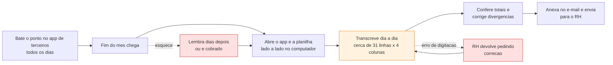
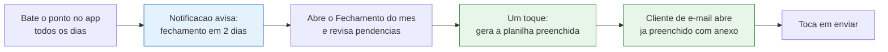

# 01 — Visão e Escopo

## 1.1 O problema

O controle de ponto de muitos funcionários no Brasil não é feito por um sistema corporativo, e sim
por uma **planilha Excel proprietária** que cada empresa monta do seu jeito e envia ao funcionário.
Ao final do mês, o funcionário precisa preencher essa planilha com todos os horários do período e
devolvê-la por e-mail ao RH ou ao gestor.

Na prática, quem faz isso raramente anota os horários direto na planilha — o celular está sempre à
mão, o computador nem sempre. Então surge um fluxo em duas etapas, com uma transcrição manual no
meio. É exatamente o fluxo do autor deste projeto:

**As três dores, em ordem de gravidade:**

| # | Dor | Consequência |
|---|-----|--------------|
| D1 | **Esquecer de enviar** no fechamento do mês | Cobrança do RH, atraso na folha, desgaste |
| D2 | **Transcrição manual** de ~31 dias entre dois formatos | 20 a 40 minutos de trabalho puramente mecânico, todo mês |
| D3 | **Erro de digitação** na transcrição | Retrabalho, divergência de horas, desconfiança no registro |

A raiz das três é a mesma: **o dado já existe em formato estruturado no celular, mas o formato de
entrega é um arquivo arbitrário que só a empresa conhece.** Nenhum app de ponto de mercado resolve
isso, porque cada empresa tem uma planilha diferente e nenhum app se dispõe a aprender um layout
que muda de cliente para cliente.

## 1.2 A proposta

Um aplicativo de ponto que, **na primeira execução, aprende o formato da planilha da empresa**.
O usuário faz o upload do arquivo `.xlsx` que recebeu do RH e um assistente passo a passo pergunta,
em linguagem simples, onde ficam as datas, onde ficam as entradas e as saídas, e onde vão o nome e
a competência. O app guarda esse mapeamento.

A partir daí, o dia a dia é o de qualquer app de ponto: bater o ponto, corrigir um horário, ver o
saldo. Mas no fim do mês, **um toque preenche a planilha original da empresa e abre o e-mail com o
arquivo já anexado, o destinatário certo e o assunto pronto.** E, dias antes, uma notificação
lembra que o fechamento está chegando.

## 1.3 Objetivos

**Objetivo geral.** Eliminar a transcrição manual e o esquecimento no processo de entrega mensal do
registro de ponto, sem obrigar a empresa a mudar a planilha que já usa.

**Objetivos específicos.**

| ID | Objetivo | Como será verificado |
|----|----------|----------------------|
| OE-1 | Registrar marcações de ponto com o mínimo de toques | Bater o ponto em ≤ 2 toques a partir do app aberto |
| OE-2 | Aprender o layout de qualquer planilha tabular de ponto | Configurar um modelo real em ≤ 5 minutos, sem ajuda externa |
| OE-3 | Gerar a planilha do mês preservando a formatação original | O arquivo gerado abre no Excel idêntico ao modelo, só com os dados preenchidos |
| OE-4 | Reduzir o envio a um único fluxo contínuo | Do "Fechamento do mês" ao e-mail pronto em ≤ 3 toques |
| OE-5 | Impedir o esquecimento | Notificação de fechamento configurável, disparada mesmo com o app fechado |
| OE-6 | Manter o dado sob controle do usuário | Nenhum dado sai do aparelho, exceto o anexo que o próprio usuário envia |

## 1.4 Proposta de valor

> Para **quem controla o próprio ponto e precisa entregar uma planilha de horários todo mês**,
> que **perde tempo transcrevendo dados e esquece o prazo de envio**,
> o **Ponto PJ** é um **aplicativo de registro de ponto**
> que **preenche a planilha da própria empresa e a envia por e-mail em poucos toques**.
> Diferente dos **apps de ponto genéricos**, que exportam num formato próprio e obrigam à
> transcrição, o Ponto PJ **aprende o layout do arquivo que a empresa já usa**.

## 1.5 Público-alvo

- **Primário:** trabalhador CLT ou PJ que controla o próprio horário e entrega o registro à empresa
  em planilha. Usa Android, tem familiaridade média com apps, baixa paciência para configuração.
- **Secundário:** analista de RH / gestor que recebe as planilhas e precisa que cheguem no formato
  esperado, no prazo e sem erro.

Detalhamento em [03 — Personas e jornadas](03-ux-personas-jornadas.md).

## 1.6 Escopo

### Incluído nesta versão

| Área | O que entra |
|------|-------------|
| Perfil | Dados do usuário usados para preencher a planilha e o e-mail |
| Jornada de trabalho | Configuração por dia da semana, com turnos previstos e carga horária |
| Registro de ponto | Bater ponto, adicionar, editar e excluir marcações; status e observação do dia |
| Visualização | Dia (linha do tempo), semana e mês (calendário), com totais e saldo |
| Cálculo | Horas trabalhadas, intervalo, saldo do dia, banco de horas, previsão de saída |
| Feriados e ausências | Cadastro de feriados com recorrência; status de ausência por dia |
| Modelo de planilha | Importação do `.xlsx`, assistente de mapeamento, edição posterior |
| Geração | Preenchimento do modelo com os dados da competência, preservando a formatação |
| E-mail | Destinatários, assunto e corpo com variáveis; abertura do cliente de e-mail com anexo |
| Histórico | Registro de cada competência gerada e enviada |
| Notificações | Lembretes de jornada, de dia incompleto e de fechamento do mês |
| Backup | Exportação e restauração de todos os dados em arquivo |
| Aparência | Tema claro e escuro, acompanhando o sistema |

### Explicitamente fora desta versão

| Fora | Por quê |
|------|---------|
| Adicional noturno, sobreaviso, regras de hora extra por tipo de dia | Escopo definido como "núcleo + planilha"; são cálculos de remuneração, não de entrega |
| Valor da hora e cálculo financeiro | Idem |
| Meta semanal e metas de banco de horas | Refinamento posterior de um cálculo que já existe |
| Envio direto por SMTP | Exigiria armazenar senha de aplicativo; ver [ADR-02](15-riscos-e-decisoes.md) |
| Sincronização em nuvem, conta de usuário, multi-dispositivo | Contraria RNF-05 (privacidade) e infla muito o escopo |
| iOS, Web e Windows | O projeto tem as pastas geradas, mas seleção de arquivo e intent de e-mail se comportam de forma diferente em cada uma |
| Geolocalização das marcações | Não é exigido pela planilha alvo e cria questão de privacidade |
| Reconhecimento automático do layout da planilha por IA | Interessante, mas o assistente manual é determinístico e auditável; fica como evolução |
| Múltiplos vínculos empregatícios simultâneos | Um modelo de planilha ativo por vez ([RN-17](02-requisitos.md)) |

O que ficou de fora e por que continua interessante está catalogado em
[15 — Riscos e decisões](15-riscos-e-decisoes.md), seção Backlog futuro.

## 1.7 Premissas

| ID | Premissa | Impacto se for falsa |
|----|----------|----------------------|
| P1 | A planilha da empresa é **tabular**: uma linha por dia, colunas fixas para entrada e saída | O mapeamento por coluna não serve; seria necessário um modelo de célula a célula |
| P2 | A planilha é `.xlsx` (Excel 2007+), não `.xls` nem Google Sheets nativo | Exige conversão prévia pelo usuário; tratado como erro guiado no wizard |
| P3 | A planilha tem no máximo uma aba de dados relevante por competência | Modelos multi-aba exigiriam mapeamento por aba |
| P4 | O usuário tem um cliente de e-mail configurado no Android | O envio cai para o compartilhamento genérico do sistema |
| P5 | O usuário registra o ponto no mesmo aparelho o mês inteiro | Sem backup, a perda do aparelho perde o mês; mitigado por RF-41 |
| P6 | O layout da planilha muda no máximo uma vez por ano | Se mudar todo mês, o custo de reconfigurar anula o ganho |

## 1.8 Restrições

- **Técnicas:** Flutter 3.24.4 / Dart 3.5.4; Android 8.0+; sem serviço de backend; sem custo de
  infraestrutura.
- **De produto:** o app não pode exigir que a empresa mude nada. Ele se adapta ao arquivo existente.
- **Acadêmicas:** a especificação precisa cobrir os artefatos exigidos pelas duas disciplinas
  (UX: pesquisa, personas, jornada, wireframes, heurísticas; Análise: requisitos, casos de uso e
  diagramas UML de entidade, atividade, sequência e estado).
- **De prazo:** implementação em fases independentes e entregáveis, para que o trabalho tenha valor
  demonstrável mesmo se as últimas fases não forem concluídas.

## 1.9 Critérios de sucesso

O projeto é considerado bem-sucedido se, ao final:

1. O autor consegue registrar um mês inteiro de ponto exclusivamente no app.
2. O app gera a planilha real da empresa e o RH a aceita **sem pedir correção**.
3. O tempo total de fechamento cai de ~30 minutos para menos de 3 minutos.
4. Nenhuma competência é esquecida ao longo de dois meses de uso.
5. Um agente de IA consegue implementar uma fase completa lendo apenas este pacote de documentos —
   a hipótese secundária que este trabalho também se propõe a testar.

## 1.10 Glossário

| Termo | Definição |
|-------|-----------|
| **Marcação** | Um único registro de horário, do tipo entrada ou saída. Também chamado de "batida". |
| **Par de marcações** | Uma entrada seguida da saída correspondente. Delimita um turno. |
| **Turno** | Período efetivamente trabalhado entre uma entrada e a saída seguinte. |
| **Intervalo** | Período entre a saída de um turno e a entrada do turno seguinte no mesmo dia. |
| **Jornada** | Configuração de quanto e quando se espera trabalhar em cada dia da semana. |
| **Carga prevista** | Quantidade de minutos que se espera trabalhar em um dia específico. |
| **Minutos trabalhados** | Soma da duração de todos os turnos de um dia. |
| **Saldo do dia** | Minutos trabalhados menos a carga prevista. Positivo é crédito, negativo é débito. |
| **Banco de horas** | Soma acumulada dos saldos diários a partir de uma data de início. |
| **Previsão de saída** | Horário estimado em que a carga prevista do dia será cumprida. |
| **Tolerância** | Margem em minutos dentro da qual o saldo do dia é tratado como zero. |
| **Status do dia** | Classificação do dia: normal, folga, feriado, férias, atestado, falta, abono ou compensação. |
| **Dia inconsistente** | Dia cujas marcações não formam pares completos (número ímpar de marcações). |
| **Competência** | O par mês/ano a que se refere um fechamento. Ex.: competência 05/2026. |
| **Fechamento do mês** | Ato de revisar a competência, gerar a planilha e enviá-la. |
| **Modelo de planilha** | O arquivo `.xlsx` da empresa somado ao mapeamento que ensina o app a preenchê-lo. |
| **Mapeamento de coluna** | Associação entre um campo do app (ex.: primeira entrada) e uma coluna da planilha (ex.: coluna C). |
| **Célula fixa** | Célula de posição absoluta na planilha que recebe um valor único, não repetido por dia. Ex.: `C3` recebe o nome do funcionário. |
| **Estratégia de linha** | Regra que decide em qual linha da planilha cada dia é escrito: sequencial ou por casamento de data. |
| **Texto de status** | Palavra que a empresa espera ver na planilha para um dia não trabalhado. Ex.: `FOLGA`, `FERIADO`. |
| **Envio** | Registro de uma competência que foi gerada e, eventualmente, enviada por e-mail. |
