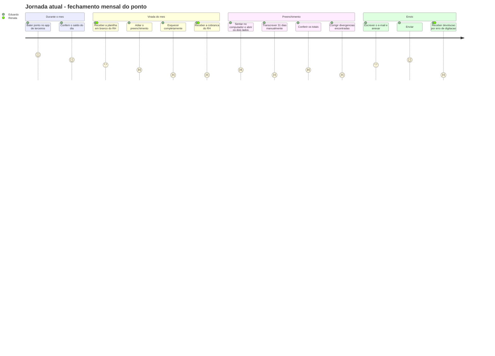
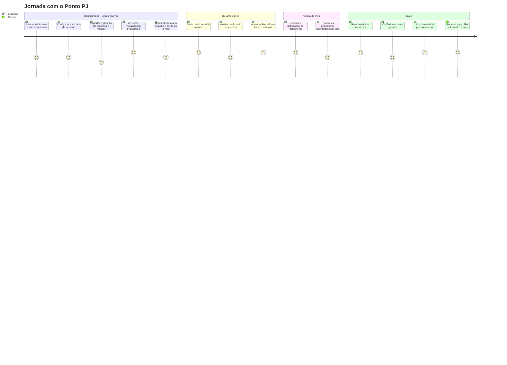

# 03 — UX: Personas e Jornadas

## 3.1 Método

A pesquisa deste projeto é de natureza **autoetnográfica com validação secundária**: o problema é
vivido diretamente pelo autor, que documentou o próprio fluxo mensal durante os meses anteriores ao
início do projeto, e foi complementado pela observação do lado de quem recebe as planilhas.

| Técnica | O que produziu |
|---------|----------------|
| Auto-observação do fluxo mensal | O mapa da jornada atual (3.4) e a cronometragem das etapas |
| Análise de artefato | Estudo da planilha real da empresa, que originou o modelo de mapeamento de [10](10-especificacao-planilha.md) |
| Análise de concorrentes | Benchmark de apps de ponto pessoal (3.3), que originou o inventário de telas de [04](04-ux-navegacao-telas.md) |
| Entrevista informal com o lado receptor | A persona secundária (3.2) e os critérios de aceitação da planilha |

> ⚠️ EM ABERTO — o teste de usabilidade descrito em 3.6 ainda não foi executado. Ele valida
> RNF-12 e é a principal evidência empírica pendente do trabalho.

## 3.2 Personas

### Persona primária — Eduardo, o funcionário que entrega o próprio ponto

<table>
<tr><td width="30%"><b>Perfil</b></td><td>28 anos, desenvolvedor, CLT em regime híbrido. Jornada de 8h, das 08:00 às 12:00 e das 13:00 às 17:00, de segunda a sexta.</td></tr>
<tr><td><b>Contexto</b></td><td>A empresa não tem sistema de ponto. Envia por e-mail, no começo de cada mês, uma planilha Excel a ser preenchida com os horários do mês anterior e devolvida ao RH.</td></tr>
<tr><td><b>Tecnologia</b></td><td>Alta familiaridade. Android, usa apps o dia todo, mas não tem paciência para configurar coisa nenhuma mais de uma vez.</td></tr>
<tr><td><b>Comportamento</b></td><td>Registra o ponto com disciplina no celular, porque leva 5 segundos. Adia sistematicamente o fechamento, porque leva meia hora e exige o computador.</td></tr>
</table>

**Objetivos**
- Não perder tempo com trabalho mecânico que um programa poderia fazer.
- Nunca mais ser cobrado pelo RH por atraso na entrega.
- Ter certeza de que as horas registradas estão corretas, para poder defendê-las se preciso.

**Frustrações**
- "Eu tenho o dado exato no celular e mesmo assim digito tudo de novo."
- "Sempre lembro do e-mail no dia em que o RH cobra."
- "Se eu errar uma linha, a planilha volta e eu faço tudo de novo."

**Citação**
> "O trabalho de registrar o ponto já está feito. O que me consome é *entregar*."

**O que ele precisa do app**
Registro rápido no dia a dia, e o fechamento do mês reduzido a uma revisão de trinta segundos
seguida de um envio.

---

### Persona secundária — Renata, a analista de RH que recebe

<table>
<tr><td width="30%"><b>Perfil</b></td><td>35 anos, analista de departamento pessoal. Recebe as planilhas de dezenas de funcionários entre o dia 1 e o dia 5 de cada mês.</td></tr>
<tr><td><b>Contexto</b></td><td>Consolida as planilhas recebidas em uma pasta de trabalho única, que alimenta o fechamento da folha. Depende do formato exato para que suas fórmulas funcionem.</td></tr>
<tr><td><b>Tecnologia</b></td><td>Excel avançado. Nenhum interesse em instalar ou aprender uma ferramenta nova.</td></tr>
</table>

**Objetivos**
- Receber tudo no prazo, sem precisar cobrar ninguém.
- Receber arquivos no formato exato que ela enviou, com as fórmulas e a formatação intactas.

**Frustrações**
- "Metade das pessoas manda depois do prazo."
- "Alguém sempre mexe na estrutura da planilha e quebra as minhas fórmulas."

**Por que ela importa para o projeto**
Renata é a razão de duas decisões técnicas centrais: o arquivo gerado precisa ser **o arquivo dela**,
com formatação e fórmulas preservadas ([RN-22](02-requisitos.md), [R-01](15-riscos-e-decisoes.md)),
e o app **não pode** propor um formato próprio, por mais elegante que fosse. Ela nunca abre o app;
ela é a beneficiária invisível.

## 3.3 Análise de concorrentes

| Solução | Registro diário | Cálculo de saldo | Entrega no formato da empresa | Veredito |
|---------|:---:|:---:|:---:|---|
| Apps de ponto pessoal do mercado | Excelente | Excelente | **Não** — exportam em PDF ou CSV próprio | Resolvem D2 e D3 pela metade: o dado fica preso num formato que não serve |
| Planilha direto no celular | Ruim | Manual | Sim | Inviável no dia a dia; editar `.xlsx` no celular é hostil |
| Anotação em papel ou bloco de notas | Razoável | Nenhum | Não | Transcrição dupla; pior dos mundos |
| Formulário corporativo (quando existe) | Bom | Bom | N/A | Não é uma opção: a empresa não tem |

**Conclusão que orienta o produto.** A lacuna não está no registro — está na **ponte entre o registro
e o formato de entrega**. Todo app existente termina onde o problema do usuário começa. É por isso
que o assistente de mapeamento de planilha ([10](10-especificacao-planilha.md)) é o coração do
projeto, e não uma funcionalidade acessória de exportação.

Do benchmark também vieram os padrões de interação que este projeto adota por já serem familiares ao
público: navegação por três abas, cabeçalho de período com setas, linha do tempo vertical do dia com
turnos e intervalos, e calendário mensal com resumo por célula.

## 3.4 Jornada atual (as-is)

Escala de satisfação de 1 (péssimo) a 5 (ótimo).

**Onde a jornada quebra**

| Momento | Dor | Causa raiz |
|---------|-----|-----------|
| Virada do mês | Adiamento e esquecimento (D1) | Nada no ambiente lembra; a tarefa depende de iniciativa própria num momento aleatório |
| Preenchimento | 20 a 40 minutos de trabalho mecânico (D2) | Dois formatos incompatíveis, ponte manual |
| Preenchimento | Necessidade do computador | O dado está no celular, a ferramenta de destino não |
| Conferência | Erro de digitação (D3) | Trabalho repetitivo e sem verificação automática |
| Pós-envio | Retrabalho | O erro só é descoberto depois, por outra pessoa |

## 3.5 Jornada futura (to-be)

**O que mudou, item a item**

| Dor | Como o app resolve | Requisitos |
|-----|--------------------|-----------|
| D1 — Esquecer | Notificação de fechamento configurável, disparada mesmo com o app fechado; o histórico mostra a competência pendente | RF-45, RF-42 |
| D2 — Transcrição | O mapeamento aprendido uma vez faz o preenchimento sozinho, para sempre | RF-23…RF-33 |
| D2 — Depender do computador | O fluxo inteiro cabe no celular, inclusive o anexo | RF-40 |
| D3 — Erro de digitação | O dado nunca é redigitado; a lista de pendências mostra o que falta antes de gerar | RF-33, RF-34 |
| D3 — Erro descoberto tarde | A pré-visualização mostra o resultado antes de salvar o mapeamento | RF-30 |
| Confiança de Renata | O arquivo gerado é o arquivo original preenchido, com formatação e fórmulas intactas | RN-22, RF-33 |

**O ponto crítico da nova jornada** é o único momento de nota 3: *importar a planilha e mapear*.
É uma tarefa inerentemente complexa — pedir a alguém que descreva a estrutura de um arquivo — e
acontece logo na primeira execução, quando o usuário ainda não confia no app. Toda a atenção de
design do wizard ([04](04-ux-navegacao-telas.md) TL-16 a TL-20) existe para transformar esse 3 num
4, e a pré-visualização final existe para terminar essa etapa com um 5, transformando ansiedade em
confiança.

## 3.6 Roteiro de teste de usabilidade

Valida RNF-12 e a hipótese de que o wizard é compreensível sem treinamento.

**Participantes.** 3 a 5 pessoas que preenchem planilha de ponto e não conhecem o projeto.

**Material.** Aparelho Android com o app instalado e sem configuração, e um arquivo `.xlsx` de ponto
real (anonimizado) enviado antes ao participante por e-mail, para que a importação parta de uma
situação verdadeira.

**Tarefas.**

| # | Tarefa | Métrica de sucesso |
|---|--------|--------------------|
| T1 | Configure o aplicativo com seus dados e seu horário de trabalho | Concluída sem ajuda em ≤ 2 min |
| T2 | Ensine o aplicativo a preencher a planilha que você recebeu | Concluída sem ajuda em ≤ 5 min (RNF-12) |
| T3 | Registre que você entrou às 08:00 e saiu para almoço às 12:00 | ≤ 4 toques, sem hesitação |
| T4 | Corrija a entrada de ontem, que foi anotada errada | Encontra o caminho em ≤ 30 s |
| T5 | Envie a planilha do mês passado para o RH | Chega ao cliente de e-mail em ≤ 3 toques (OE-4) |

**Coleta.** Tempo por tarefa, número de erros, número de pedidos de ajuda, pensar-alto durante T2 e
uma escala SUS ao final.

**Critério de aprovação.** Todos os participantes concluem T2 sem ajuda; SUS médio ≥ 72.
