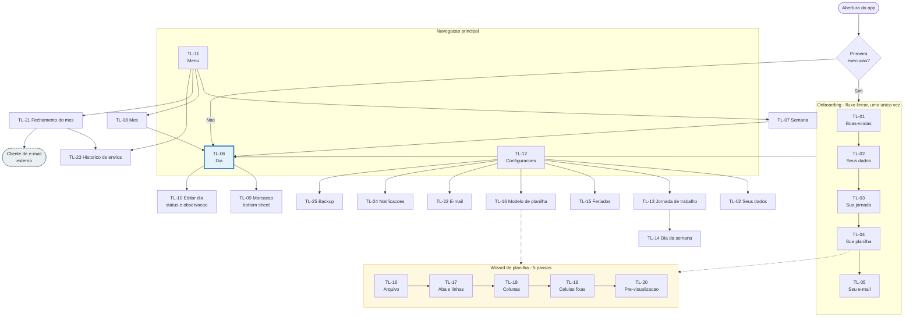

# 04 — UX: Navegação, Telas e Design System

## 4.1 Princípios de design do produto

Cinco princípios que resolvem empates de decisão durante a implementação. Quando duas soluções
forem tecnicamente equivalentes, vence a que atende o princípio de menor número.

1. **O dia a dia é sagrado.** Registrar ponto é a ação feita 4 vezes por dia, todo dia. Ela precisa
   ser possível em dois toques a partir do app aberto e nunca pode ser interrompida por diálogo,
   pergunta ou configuração pendente.
2. **A complexidade fica na configuração, não no uso.** O mapeamento de planilha é intrinsecamente
   complexo. Aceitamos que ele seja longo e detalhado, em troca de o fechamento mensal ser trivial.
3. **Nada é irreversível sem aviso, nada é perdido em silêncio.** Excluir pede confirmação; sair de
   um formulário preenchido pede confirmação; o wizard preserva o progresso ao voltar.
4. **Mostrar o resultado, não descrever o resultado.** Em vez de explicar o que significa "linha de
   cabeçalho", o wizard mostra a planilha real do usuário com a linha destacada. Em vez de prometer
   que a planilha será preenchida corretamente, mostra a pré-visualização preenchida.
5. **O app fala português de gente.** "Você não trabalha neste dia", não "Jornada nula". Sem jargão
   técnico na interface — o vocabulário de [01, glossário](01-visao-e-escopo.md) é para os
   documentos, não para as telas.

## 4.2 Mapa de navegação

Três abas fixas na barra inferior. A aba **Dia** é a inicial e a mais usada. As pilhas de Menu e
Configurações abrigam tudo que não é o dia a dia.



**Regras de navegação**

- A aba Dia é sempre a raiz. O botão físico "voltar" a partir dela fecha o app.
- Trocar de aba preserva a pilha de cada uma.
- O onboarding é linear e permite pular etapas; etapas puladas viram cartões de pendência no topo
  da aba Configurações até serem concluídas.
- O wizard de planilha é acessível por dois caminhos (onboarding e configurações) e se comporta
  igual nos dois, mudando apenas o destino ao concluir.
- Sair do wizard no meio pede confirmação e descarta o progresso — o mapeamento parcial nunca é
  salvo, porque um modelo incompleto violaria [RN-18](02-requisitos.md).

## 4.3 Inventário de telas

| ID | Tela | Tipo | Propósito | RFs |
|----|------|------|-----------|-----|
| TL-01 | Boas-vindas | Página | Apresenta a proposta em uma frase e inicia a configuração | RF-03 |
| TL-02 | Seus dados | Formulário | Nome, matrícula, cargo, empresa, e-mail | RF-01 |
| TL-03 | Sua jornada | Formulário | Atalho para montar a semana padrão rapidamente | RF-04 |
| TL-04 | Sua planilha | Página | Explica por que importar e chama o wizard | RF-03 |
| TL-05 | Seu e-mail | Formulário | Destinatário, assunto e corpo padrão | RF-38 |
| TL-06 | **Dia** | Página principal | Linha do tempo do dia, resumo e ação de bater ponto | RF-08, RF-12, RF-14, RF-18, RF-19 |
| TL-07 | Semana | Página | Sete dias com totais, saldo da semana | RF-16, RF-18, RF-19 |
| TL-08 | Mês | Página | Calendário com resumo por dia | RF-17, RF-18, RF-19, RF-21 |
| TL-09 | Marcação | Bottom sheet | Criar ou editar o horário de uma marcação | RF-09, RF-10, RF-11 |
| TL-10 | Editar dia | Bottom sheet | Status do dia, observação, fechar/reabrir | RF-13, RF-15 |
| TL-11 | Menu | Página | Acesso a semana, mês, fechamento e histórico | — |
| TL-12 | Configurações | Lista | Índice de toda a configuração + pendências | RF-02, RF-31 |
| TL-13 | Jornada de trabalho | Lista | Os sete dias, tolerância, virada de dia, total semanal | RF-04, RF-06, RF-07 |
| TL-14 | Dia da semana | Formulário | Turnos previstos e carga horária de um dia | RF-04, RF-05 |
| TL-15 | Feriados | Lista + form | CRUD de feriados | RF-20, RF-22 |
| TL-16 | Wizard P1 — Arquivo | Wizard | Selecionar e validar o `.xlsx` | RF-23, RF-32 |
| TL-17 | Wizard P2 — Aba e linhas | Wizard | Aba, linha de cabeçalho, primeira linha de dados, estratégia | RF-24, RF-25 |
| TL-18 | Wizard P3 — Colunas | Wizard | Mapear campos por dia às colunas | RF-26 |
| TL-19 | Wizard P4 — Células fixas | Wizard | Células absolutas, textos de status, formatos | RF-27, RF-28, RF-29 |
| TL-20 | Wizard P5 — Pré-visualização | Wizard | Mostrar o preenchimento e salvar | RF-30 |
| TL-21 | **Fechamento do mês** | Página | Pendências, geração e envio | RF-33…RF-37, RF-39, RF-40, RF-41 |
| TL-22 | E-mail | Formulário | Destinatários, assunto, corpo, nome do arquivo | RF-38, RF-39 |
| TL-23 | Histórico de envios | Lista | Competências geradas e enviadas | RF-42, RF-43 |
| TL-24 | Notificações | Lista | Lembretes de jornada, fechamento e dia incompleto | RF-44…RF-47 |
| TL-25 | Backup | Página | Exportar e restaurar | RF-48, RF-49 |

## 4.4 Wireframes das telas críticas

Notação: `[ ]` botão · `( )` seletor · `▸` navega · `⋮` menu · `+` ação de adicionar.

### TL-06 — Dia

A tela mais usada do app. Três zonas: cabeçalho de período com os totais, linha do tempo das
marcações e a ação de bater ponto sempre alcançável pelo polegar.

```
┌──────────────────────────────────────────┐
│  Dia                          ⤴   +      │  ← compartilhar, marcação manual
├──────────────────────────────────────────┤
│  ‹        qui., 07 mai. 2026          ›  │  ← navegação de período
│                                          │
│  Trab. no dia   Saldo do dia   Banco     │
│    08h 30m       + 00h 30m    + 06h 30m  │  ← RF-19
│  ▓▓▓▓▓▓▓▓▓▓▓▓▓▓▓▓▓▓▓▓▓▓▓▓▓░░░░░░         │  ← progresso sobre a carga prevista
│  1h  2h  3h  4h  5h  6h  7h  8h          │
├──────────────────────────────────────────┤
│                                          │
│   ─→   08:00                             │  ← entrada
│   │                                      │
│   │    Turno de 04h 00m                  │
│   │                                      │
│   ←─   12:00                             │  ← saída
│   ┊                                      │
│   ┊    Intervalo de 01h 00m              │
│   ┊                                      │
│   ─→   13:00                             │
│   │                                      │
│   │    Turno de 04h 00m                  │
│   │                                      │
│   ←─   17:00        (esmaecido)          │  ← previsão de saída, RN-16
│        Previsão de saída                 │
│                                          │
├──────────────────────────────────────────┤
│              17:30:22            ( ⏱ + ) │  ← relógio vivo + bater ponto
├──────────────────────────────────────────┤
│    ☰ Menu      📅 Dia      ⚙ Config      │
└──────────────────────────────────────────┘
```

**Interações**
- Arrastar uma marcação para a esquerda revela `Excluir` e `Editar` (padrão já conhecido do público).
- Tocar em uma marcação abre TL-09 em modo edição.
- Tocar no cabeçalho de data abre um seletor de data.
- O botão flutuante mostra o próximo tipo inferido por [RN-06](02-requisitos.md); segurá-lo abre
  TL-09 para informar um horário diferente do atual.
- Quando o dia tem status não trabalhado, a linha do tempo é substituída por um cartão do status
  com a observação e um botão para registrar mesmo assim.

**Estado vazio**
```
        Nenhuma marcação hoje
   Toque em ⏱+ para registrar a entrada
        [ Marcar entrada agora ]
```

### TL-08 — Mês

```
┌──────────────────────────────────────────┐
│  ‹  Mês                              ⋮   │
├──────────────────────────────────────────┤
│  ‹           maio / 2026              ›  │
│  Trab. no mês   Saldo do mês    Banco    │
│    172h 20m      + 04h 20m    + 06h 30m  │
├──────────────────────────────────────────┤
│ dom. seg. ter. qua. qui. sex. sáb.       │
│ ┌────┬────┬────┬────┬────┬────┬────┐     │
│ │26/4│ 27 │ 28 │ 29 │ 30 │01/5│ 02 │     │
│ │    │→08:│→08:│→08:│→08:│→08:│    │     │
│ │    │←12:│←12:│←12:│←12:│←12:│    │     │
│ │    │→13:│→13:│→13:│→13:│→13:│    │     │
│ │    │←17:│←17:│←17:│←17:│←17:│    │     │
│ ├────┼────┼────┼────┼────┼────┼────┤     │
│ │ 03 │ 04 │ 05 │ 06 │ 07 │ 08 │ 09 │     │
│ │    │ ●  │ ⚠  │    │    │    │    │     │
│ │    │Feri│Falt│    │    │    │    │     │
│ └────┴────┴────┴────┴────┴────┴────┘     │
│                                          │
│  ● feriado   ⚠ pendência   ░ fim de semana│
├──────────────────────────────────────────┤
│    ☰ Menu      📅 Dia      ⚙ Config      │
└──────────────────────────────────────────┘
```

Tocar em uma célula navega para TL-06 naquela data. Dias de outros meses aparecem esmaecidos.
Dias com pendência recebem o ícone ⚠ e cor de atenção — a mesma sinalização que reaparece em TL-21.

### TL-16 a TL-20 — Wizard de planilha

O wizard mantém, em todos os passos, a mesma moldura: indicador de progresso no topo, conteúdo no
meio, navegação fixa embaixo. **O conteúdo sempre mostra a planilha real do usuário**, nunca um
desenho abstrato (princípio 4).

**TL-16 — Passo 1: o arquivo**
```
┌──────────────────────────────────────────┐
│  ‹  Modelo de planilha            1 de 5 │
│  ●───○───○───○───○                       │
├──────────────────────────────────────────┤
│  Envie a planilha que a empresa           │
│  te mandou                                │
│                                           │
│  O app vai aprender o formato dela e      │
│  preencher sozinho todo mês. O arquivo    │
│  original nunca é alterado.               │
│                                           │
│      ┌───────────────────────────┐        │
│      │           📄              │        │
│      │  Toque para escolher um   │        │
│      │    arquivo .xlsx          │        │
│      └───────────────────────────┘        │
│                                           │
│  ✓ ponto_maio_2026.xlsx                   │
│    Planilha1 · 45 linhas · 12 colunas     │
│                                           │
├──────────────────────────────────────────┤
│  [ Cancelar ]              [ Continuar ] │
└──────────────────────────────────────────┘
```

**TL-17 — Passo 2: onde os dias começam**
```
┌──────────────────────────────────────────┐
│  ‹  Modelo de planilha            2 de 5 │
│  ●───●───○───○───○                       │
├──────────────────────────────────────────┤
│  Aba          ( Planilha1          ▾ )   │
│                                          │
│  Toque na linha com os títulos das       │
│  colunas:                                │
│  ┌──┬───────┬───────┬───────┬────────┐   │
│  │ 1│CONTROLE DE PONTO             │   │  │
│  │ 2│Nome: ______  Mês: ____       │   │  │
│  │ 3│                              │   │  │
│  │▸4│ DATA │ENTR. 1│SAÍD.1│ENTR. 2 │◂  │  ← selecionada, destacada
│  │ 5│01/05 │       │      │        │   │  │
│  │ 6│02/05 │       │      │        │   │  │
│  └──┴───────┴───────┴───────┴────────┘   │
│                                          │
│  Cabeçalho: linha 4                      │
│  Primeiros dados: linha 5                │
│                                          │
│  Como os dias são organizados?           │
│  (•) Uma linha por dia, na ordem         │
│      Dia 1 na linha 5, dia 2 na 6...     │
│  ( ) Procurar a data na coluna           │
│      Escrevo no lugar onde a data bate   │
│                                          │
├──────────────────────────────────────────┤
│  [ Voltar ]                [ Continuar ] │
└──────────────────────────────────────────┘
```

**TL-18 — Passo 3: as colunas**
```
┌──────────────────────────────────────────┐
│  ‹  Modelo de planilha            3 de 5 │
│  ●───●───●───○───○                       │
├──────────────────────────────────────────┤
│  Diga o que vai em cada coluna           │
│                                          │
│  Data           ( C · DATA        ▾ ) ✓  │  ← obrigatório
│  1ª entrada     ( D · ENTR. 1     ▾ ) ✓  │
│  1ª saída       ( E · SAÍD. 1     ▾ ) ✓  │
│  2ª entrada     ( F · ENTR. 2     ▾ ) ✓  │
│  2ª saída       ( G · SAÍD. 2     ▾ ) ✓  │
│  3ª entrada     ( — não usar      ▾ )    │
│  3ª saída       ( — não usar      ▾ )    │
│  Total do dia   ( H · TOTAL       ▾ )    │
│  Saldo do dia   ( — não usar      ▾ )    │
│  Observação     ( J · OBS.        ▾ )    │
│  Status do dia  ( J · OBS.        ▾ ) ⚠  │  ← aviso de coluna repetida
│                                          │
│  ⚠ Observação e Status vão para a mesma  │
│    coluna. O status tem prioridade.      │
│                                          │
├──────────────────────────────────────────┤
│  [ Voltar ]                [ Continuar ] │
└──────────────────────────────────────────┘
```

Cada seletor lista as colunas pela **letra e pelo texto real do cabeçalho** lido do arquivo, o que
elimina a necessidade de o usuário saber contar colunas.

**TL-19 — Passo 4: os campos que aparecem uma vez só**
```
┌──────────────────────────────────────────┐
│  ‹  Modelo de planilha            4 de 5 │
│  ●───●───●───●───○                       │
├──────────────────────────────────────────┤
│  Onde ficam os dados que aparecem        │
│  uma vez só na planilha?                 │
│                                          │
│  Nome             ( B2 )  ▸ escolher     │
│  Matrícula        ( — )   ▸ escolher     │
│  Empresa          ( — )   ▸ escolher     │
│  Mês/ano          ( E2 )  ▸ escolher     │
│  Total do mês     ( H36 ) ▸ escolher     │
│                                          │
│  ─────────────────────────────────────   │
│  O que escrever nos dias não             │
│  trabalhados?                            │
│  Folga            [ FOLGA           ]    │
│  Feriado          [ FERIADO         ]    │
│  Férias           [ FÉRIAS          ]    │
│  Atestado         [ ATESTADO        ]    │
│  Falta            [ FALTA           ]    │
│                                          │
│  ─────────────────────────────────────   │
│  Formato da data  ( 01/05/2026     ▾ )   │
│  Formato da hora  ( 08:00          ▾ )   │
│                                          │
├──────────────────────────────────────────┤
│  [ Voltar ]                [ Continuar ] │
└──────────────────────────────────────────┘
```

`▸ escolher` abre a mesma grade da planilha do passo 2, agora em modo de seleção de célula única —
o usuário toca na célula em vez de digitar `B2`.

**TL-20 — Passo 5: veja como vai ficar**
```
┌──────────────────────────────────────────┐
│  ‹  Modelo de planilha            5 de 5 │
│  ●───●───●───●───●                       │
├──────────────────────────────────────────┤
│  Assim vai ficar a sua planilha           │
│  Competência de exemplo: maio/2026        │
│                                           │
│  ┌──┬──────┬──────┬──────┬──────┬──────┐  │
│  │ 2│Eduardo F.       │ maio/2026    │  │  ← células fixas preenchidas
│  │ 4│ DATA │ENTR.1│SAÍD.1│ENTR.2│SAÍD.2│  │
│  │ 5│01/05 │08:00 │12:00 │13:00 │17:00 │  │  ← em destaque: o que o app escreve
│  │ 6│02/05 │08:00 │12:00 │13:00 │17:00 │  │
│  │ 7│03/05 │FERIADO             │      │  │
│  │ 8│04/05 │      │      │      │      │  │
│  └──┴──────┴──────┴──────┴──────┴──────┘  │
│         ‹ role para ver mais ›            │
│                                           │
│  ✓ 31 dias couberam nas linhas 5 a 35     │
│  ✓ Todas as colunas obrigatórias mapeadas │
│                                           │
├──────────────────────────────────────────┤
│  [ Voltar ]        [ Salvar modelo ]     │
└──────────────────────────────────────────┘
```

Esta tela é o **momento de conversão de confiança** identificado em
[03, seção 3.5](03-ux-personas-jornadas.md): o usuário vê a própria planilha preenchida antes de
confiar o mês inteiro ao app.

### TL-21 — Fechamento do mês

```
┌──────────────────────────────────────────┐
│  ‹  Fechamento do mês                    │
├──────────────────────────────────────────┤
│  ‹           maio / 2026              ›  │
│                                          │
│  ┌────────────────────────────────────┐  │
│  │ 31 dias · 21 dias úteis            │  │
│  │ Trabalhado 172h 20m                │  │
│  │ Saldo      + 04h 20m               │  │
│  └────────────────────────────────────┘  │
│                                          │
│  Antes de gerar, confira:                │
│  ⚠ 05/05  Marcações incompletas      ▸   │
│  ⚠ 12/05  Dia útil sem registro      ▸   │
│  ✓ Nenhuma outra pendência               │
│                                          │
│  ─────────────────────────────────────   │
│  Modelo   ponto_maio_2026.xlsx           │
│  Para     rh@empresa.com.br              │
│  Assunto  Ponto - Eduardo - maio/2026    │
│                              ▸ revisar   │
│                                          │
│           [ Gerar planilha ]             │
├──────────────────────────────────────────┤
```

Após gerar, a mesma tela evolui para o estado de envio, sem trocar de página:

```
│  ✓ Planilha gerada                       │
│    Ponto_Eduardo_05-2026.xlsx · 24 KB    │
│    [ Abrir ]  [ Compartilhar ]           │
│                                          │
│        [ Enviar por e-mail ]             │
```

E, no retorno do cliente de e-mail, a confirmação exigida por [RN-23](02-requisitos.md):

```
│  ┌────────────────────────────────────┐  │
│  │ Você conseguiu enviar o e-mail?    │  │
│  │ O app não consegue confirmar isso  │  │
│  │ sozinho.                           │  │
│  │        [ Ainda não ]  [ Enviei ]   │  │
│  └────────────────────────────────────┘  │
```

## 4.5 Design system

### Cores

Paleta construída sobre um azul de trabalho, com verde para crédito e vermelho para débito — as
duas cores que o usuário lê dezenas de vezes por mês no saldo.

| Papel | Claro | Escuro | Uso |
|-------|-------|--------|-----|
| Primária | `#1565C0` | `#5B9BF3` | Barra superior, botão principal, seleção |
| Sobre primária | `#FFFFFF` | `#0B1B2B` | Texto sobre a primária |
| Fundo | `#F5F7FA` | `#0F1418` | Fundo das páginas |
| Superfície | `#FFFFFF` | `#1A2027` | Cartões, folhas, listas |
| Superfície variante | `#ECEFF3` | `#232A33` | Cabeçalhos de seção, campos |
| Texto principal | `#101418` | `#E6EAF0` | Conteúdo |
| Texto secundário | `#5A6472` | `#9AA5B4` | Rótulos, legendas |
| Divisória | `#DDE2E9` | `#2C333C` | Separadores |
| Crédito (saldo +) | `#1B7A3E` | `#5FD08A` | Saldo positivo, entrada |
| Débito (saldo −) | `#C0392B` | `#F2857A` | Saldo negativo, exclusão |
| Atenção | `#B26A00` | `#F0B25E` | Pendências, dias inconsistentes |
| Neutro/desabilitado | `#9AA3AE` | `#5C6773` | Previsão de saída, dias de outro mês |

**Regra de contraste.** Todo par texto/fundo desta tabela atinge ao menos 4.5:1
([RNF-03](02-requisitos.md)). Cor **nunca** é o único portador de significado: saldo positivo tem
`+` além do verde, negativo tem `−`, pendência tem o ícone ⚠ além do âmbar. Isso atende daltonismo
e leitura sob sol forte.

### Tipografia

Fonte do sistema (Roboto no Android), sem fonte customizada — decisão de tamanho de APK e de
respeito à preferência de acessibilidade do usuário.

| Estilo | Tamanho | Peso | Uso |
|--------|---------|------|-----|
| Display de horas | 32 sp | 600 | Relógio vivo, total do período |
| Título de tela | 20 sp | 600 | Barra superior |
| Destaque numérico | 18 sp | 600 | `08h 30m` nos cartões de resumo |
| Corpo | 16 sp | 400 | Conteúdo geral, itens de lista |
| Rótulo | 14 sp | 500 | Rótulos de campo, cabeçalhos de coluna |
| Legenda | 12 sp | 400 | Textos de apoio, unidades |

Horários e durações usam **variante tabular** dos algarismos, para que as colunas de números não
"dancem" ao atualizar o relógio.

### Espaçamento e forma

Grade de 4 dp; espaçamentos usuais 8/12/16/24. Raio de canto 12 dp em cartões e 8 dp em campos.
Elevação mínima — separação por cor de superfície, não por sombra.

### Componentes reutilizáveis

| Componente | Responsabilidade | Onde aparece |
|------------|------------------|--------------|
| `SeletorPeriodo` | Setas ‹ ›, rótulo do período, toque abre seletor | TL-06, TL-07, TL-08, TL-21 |
| `CartaoResumo` | Trio trabalhado / saldo / banco de horas com barra de progresso | TL-06, TL-07, TL-08 |
| `LinhaDoTempoMarcacoes` | Marcações, turnos, intervalos, previsão de saída, deslizar para ações | TL-06 |
| `ChipStatusDia` | Status do dia com ícone e cor | TL-06, TL-08, TL-10, TL-21 |
| `GradePlanilha` | Grade rolável do `.xlsx` com seleção de linha, coluna ou célula | TL-17, TL-19, TL-20 |
| `PassoWizard` | Moldura com progresso, conteúdo e navegação inferior | TL-16…TL-20 |
| `ItemPendencia` | Linha de pendência com ícone, data, motivo e navegação | TL-21 |
| `CampoDuracao` | Entrada e exibição de duração no formato `08h 30m` | TL-14, TL-10 |
| `EstadoVazio` | Ilustração simples, frase e ação sugerida | TL-06, TL-15, TL-23 |

`GradePlanilha` é o componente de maior valor do projeto: os três modos de seleção sustentam
sozinhos os passos 2, 4 e 5 do wizard e materializam o princípio 4.

## 4.6 Microcopy

O tom é direto, na segunda pessoa, sem jargão. Erros explicam **o que aconteceu** e **o que fazer**.

| Situação | Texto |
|----------|-------|
| Estado vazio do dia | "Nenhuma marcação hoje. Toque em ⏱+ para registrar a entrada." |
| Dia não trabalhado | "Você não trabalha neste dia." |
| Dia inconsistente | "Faltou uma saída neste dia." |
| Dia útil sem registro | "Dia de trabalho sem nenhuma marcação." |
| Confirmar exclusão | "Excluir a marcação das 12:00? Isso recalcula o dia." |
| Sair do wizard | "Sair agora descarta a configuração da planilha. Você terá que começar de novo." |
| Arquivo não é `.xlsx` | "Este arquivo é `.xls`, um formato antigo do Excel. Abra no Excel e salve como `.xlsx` para continuar." |
| Arquivo ilegível | "Não consegui ler esta planilha. Ela pode estar protegida por senha ou danificada." |
| Falta a coluna de data | "Escolha a coluna da data para continuar. Sem ela o app não sabe onde escrever cada dia." |
| Dias não cabem | "A competência tem 31 dias, mas a planilha só tem 28 linhas livres a partir da linha 5. Confira a primeira linha de dados." |
| Data não encontrada | "Não achei a linha do dia 15/05 na planilha. Esse dia ficou de fora." |
| Sem modelo configurado | "Configure a planilha da empresa antes de fechar o mês." |
| Pendências ao gerar | "Este mês tem 2 pendências. Quer gerar assim mesmo?" |
| Após gerar | "Planilha gerada. Confira antes de enviar." |
| Confirmação de envio | "Você conseguiu enviar o e-mail? O app não consegue confirmar isso sozinho." |
| Sem cliente de e-mail | "Não encontrei um app de e-mail neste aparelho. Você pode compartilhar o arquivo por outro caminho." |
| Notificação de fechamento | "Maio acabou. Que tal fechar o ponto agora? Leva menos de um minuto." |
| Notificação de dia incompleto | "O dia de hoje ficou sem a saída. Toque para corrigir." |
| Restaurar backup | "Restaurar substitui todos os dados atuais do app. Não dá para desfazer." |

## 4.7 Heurísticas de Nielsen aplicadas ao wizard

O wizard é a parte de maior risco de usabilidade do produto ([03, 3.5](03-ux-personas-jornadas.md)).
Cada heurística abaixo se traduz em uma decisão concreta e verificável.

| # | Heurística | Como o wizard atende |
|---|-----------|----------------------|
| 1 | Visibilidade do estado | Indicador "3 de 5" e trilha de bolinhas em todos os passos; ✓ verde por campo já resolvido em TL-18 |
| 2 | Correspondência com o mundo real | "Onde ficam os dados que aparecem uma vez só", não "células fixas"; colunas listadas pelo texto real do cabeçalho, não por índice |
| 3 | Controle e liberdade | `Voltar` em todos os passos, preservando o preenchido; cancelar exige confirmação explícita |
| 4 | Consistência | Mesma moldura, mesma posição de botões e mesma `GradePlanilha` nos cinco passos |
| 5 | Prevenção de erro | `Continuar` desabilitado enquanto faltar campo obrigatório; formato inválido é bloqueado na origem, não validado no fim |
| 6 | Reconhecer em vez de lembrar | O usuário **toca na linha e na célula** da própria planilha; nunca precisa digitar `B2` nem lembrar em que coluna algo está |
| 7 | Flexibilidade | Caminho rápido para quem já sabe: os seletores aceitam a letra da coluna digitada direto |
| 8 | Estética e minimalismo | Um assunto por passo; formatos e textos de status ficam no passo 4, longe do mapeamento principal |
| 9 | Recuperação de erros | Toda mensagem diz a causa e a saída (ver 4.6); erro de arquivo não perde o progresso dos outros passos |
| 10 | Ajuda e documentação | Cada passo abre com uma frase que explica **por que** aquilo está sendo pedido; nenhum manual é necessário |

## 4.8 Checklist de acessibilidade

Verificado antes do encerramento de cada fase de [13](13-plano-de-implementacao.md).

- [ ] Todo elemento acionável tem no mínimo 48 × 48 dp de área de toque.
- [ ] Todo ícone sem texto tem rótulo `Semantics` descritivo em português.
- [ ] Contraste mínimo de 4.5:1 para texto e 3:1 para ícones e bordas, nos dois temas.
- [ ] Nenhuma informação depende exclusivamente de cor (sempre há ícone, sinal ou texto).
- [ ] O layout permanece utilizável com fonte do sistema ampliada até 200%; nenhum texto é cortado.
- [ ] A ordem de foco do leitor de tela segue a ordem visual em todas as telas.
- [ ] A linha do tempo de TL-06 é anunciada como lista, com cada marcação lida como
      "entrada às 8 horas" e não como "seta 08:00".
- [ ] A `GradePlanilha` anuncia a célula em foco como "coluna C, linha 5, valor 01/05".
- [ ] Ações destrutivas são anunciadas como destrutivas antes da confirmação.
- [ ] Campos de formulário têm rótulo associado e mensagem de erro vinculada ao campo.
- [ ] Nenhuma ação depende de gesto complexo sem alternativa: deslizar para excluir também está no
      menu de contexto ao tocar.
- [ ] O app respeita a preferência de redução de movimento do sistema.
