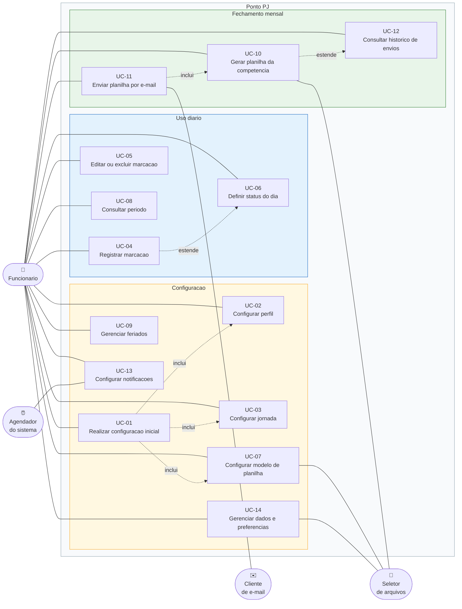

# 05 — Casos de Uso

## 5.1 Atores

| Ator | Tipo | Descrição |
|------|------|-----------|
| **Funcionário** | Primário, humano | Único usuário do aplicativo. Registra o próprio ponto, configura o sistema e dispara o fechamento mensal. Corresponde à persona Eduardo de [03](03-ux-personas-jornadas.md). |
| **Agendador do sistema** | Secundário, automático | Serviço do Android que dispara as notificações agendadas mesmo com o app fechado. Ator iniciador de UC-13. |
| **Cliente de e-mail** | Secundário, externo | Aplicativo de e-mail instalado no dispositivo. Recebe a intenção com anexo e assume o envio. O app não tem controle nem retorno sobre o que acontece depois. |
| **Seletor de arquivos** | Secundário, externo | Componente do sistema operacional que fornece o arquivo `.xlsx` e recebe o arquivo gerado. |
| **Destinatário** | Fora do sistema | RH ou gestor que recebe o e-mail. Corresponde à persona Renata. Não interage com o app — aparece aqui para deixar explícita a fronteira do sistema. |

## 5.2 Diagrama de casos de uso

**Relacionamentos**

- `UC-01 «include» UC-02, UC-03, UC-07` — a configuração inicial executa os três em sequência,
  permitindo pular cada um.
- `UC-11 «include» UC-10` — não se envia o que não foi gerado. Se a competência já tiver um arquivo
  gerado e válido, a inclusão é satisfeita por ele.
- `UC-06 «extend» UC-04` — ao registrar em um dia com status não trabalhado, o sistema oferece
  ajustar o status.
- `UC-12 «extend» UC-10` — concluída a geração, o registro no histórico é criado automaticamente.

## 5.3 Casos de uso resumidos

| ID | Nome | Ator | Disparo | Resultado |
|----|------|------|---------|-----------|
| UC-01 | Realizar configuração inicial | Funcionário | Primeira abertura do app | Perfil, jornada, modelo e e-mail configurados ou explicitamente adiados |
| UC-02 | Configurar perfil | Funcionário | Onboarding ou Configurações | Dados pessoais salvos |
| UC-03 | Configurar jornada de trabalho | Funcionário | Onboarding ou Configurações | Jornada dos sete dias, tolerância e virada de dia salvas |
| UC-04 | Registrar marcação | Funcionário | Botão de bater ponto ou adição manual | Marcação persistida e dia recalculado |
| UC-05 | Editar ou excluir marcação | Funcionário | Toque ou deslize sobre uma marcação | Marcação alterada ou removida e dia recalculado |
| UC-06 | Definir status e observação do dia | Funcionário | Ação no dia | Status e observação salvos e dia recalculado |
| UC-07 | Configurar modelo de planilha | Funcionário | Onboarding ou Configurações | Modelo ativo com arquivo base e mapeamento completo |
| UC-08 | Consultar período | Funcionário | Navegação entre dia, semana e mês | Dados do período exibidos com totais e saldo |
| UC-09 | Gerenciar feriados | Funcionário | Configurações | Feriados criados, editados ou removidos |
| UC-10 | Gerar planilha da competência | Funcionário | Fechamento do mês | Arquivo `.xlsx` gerado e registrado no histórico |
| UC-11 | Enviar planilha por e-mail | Funcionário | Fechamento do mês | Cliente de e-mail aberto e envio registrado após confirmação |
| UC-12 | Consultar histórico de envios | Funcionário | Menu | Lista de competências com status e acesso aos arquivos |
| UC-13 | Configurar notificações | Funcionário / Agendador | Configurações / horário agendado | Lembretes agendados e disparados |
| UC-14 | Gerenciar dados e preferências | Funcionário | Configurações | Tema alterado, backup exportado ou restaurado |

## 5.4 Casos de uso detalhados

Formato: ator, pré-condições, fluxo principal, fluxos alternativos, exceções, pós-condições.

---

### UC-01 — Realizar configuração inicial

| | |
|---|---|
| **Ator** | Funcionário |
| **Pré-condição** | Aplicativo instalado e nunca configurado |
| **Requisitos** | RF-03, RF-22 · **Telas** TL-01 a TL-05 |

**Fluxo principal**
1. O sistema detecta que não existe perfil cadastrado e abre a tela de boas-vindas.
2. O funcionário inicia a configuração.
3. O sistema conduz o cadastro do perfil (UC-02).
4. O sistema conduz a configuração da jornada (UC-03).
5. O sistema carrega a lista de feriados nacionais pré-definidos.
6. O sistema apresenta a etapa de planilha e conduz UC-07.
7. O sistema conduz a configuração do e-mail.
8. O sistema marca a configuração inicial como concluída e abre a aba Dia.

**Alternativos**
- 3a/4a/6a/7a — *Pular etapa*: o funcionário adia. O sistema registra a pendência e segue. Ao final,
  a aba Configurações exibe um cartão de pendência para cada etapa adiada.
- 6b — *Ainda não tenho a planilha*: o sistema explica que o registro diário funciona normalmente e
  que a planilha pode ser configurada até o fechamento do mês.

**Pós-condição** — App utilizável; toda etapa não concluída está visível como pendência.

---

### UC-04 — Registrar marcação

| | |
|---|---|
| **Ator** | Funcionário |
| **Pré-condição** | Uma data selecionada, não futura |
| **Requisitos** | RF-08, RF-09 · **Regras** RN-01 a RN-06 · **Telas** TL-06, TL-09 |

**Fluxo principal (bater ponto)**
1. O funcionário aciona o botão de bater ponto na tela do Dia.
2. O sistema obtém o horário atual do dispositivo.
3. O sistema determina o tipo da marcação pela quantidade de marcações já existentes no dia:
   quantidade par resulta em ENTRADA, ímpar em SAÍDA (RN-06).
4. O sistema valida a marcação contra RN-03 (não futura) e RN-04 (horário não duplicado).
5. O sistema persiste a marcação com origem AUTOMATICA.
6. O sistema reordena as marcações do dia e recalcula tipos, minutos trabalhados, saldo e previsão
   de saída (RN-01, RN-07, RN-11, RN-16).
7. O sistema atualiza a linha do tempo e o cartão de resumo, e confirma com um aviso breve
   contendo a ação de desfazer.

**Alternativos**
- 1a — *Marcação manual*: o funcionário aciona `+` ou mantém pressionado o botão de bater ponto.
  O sistema abre TL-09 com o horário atual pré-preenchido; o funcionário informa outro horário e
  confirma. A origem registrada é MANUAL. Segue no passo 4.
- 1b — *Dia com status não trabalhado*: o sistema avisa que o dia está marcado como folga, feriado,
  férias ou atestado e pergunta se deve registrar mesmo assim. Confirmando, segue no passo 2;
  o sistema oferece também alterar o status (UC-06, extensão).
- 7a — *Desfazer*: acionado dentro de 5 segundos, o sistema remove a marcação e recalcula o dia.

**Exceções**
- E1 — *Horário no futuro* (RN-03): o sistema recusa e informa "Não dá para registrar um horário que
  ainda não aconteceu."
- E2 — *Horário duplicado* (RN-04): o sistema recusa e informa "Já existe uma marcação às 08:00
  neste dia."
- E3 — *Falha ao gravar*: o sistema mantém a interface no estado anterior e informa que a marcação
  não foi salva. Nenhum dado é perdido (RNF-06).

**Pós-condição** — Marcação persistida; o dia recalculado e consistente com RN-01.

---

### UC-07 — Configurar modelo de planilha

| | |
|---|---|
| **Atores** | Funcionário, Seletor de arquivos |
| **Pré-condição** | O funcionário possui o arquivo `.xlsx` da empresa no dispositivo |
| **Requisitos** | RF-23 a RF-32 · **Regras** RN-17, RN-18, RN-22 · **Telas** TL-16 a TL-20 |
| **Especificação completa** | [10 — Especificação da planilha](10-especificacao-planilha.md) |

**Fluxo principal**
1. O funcionário abre o assistente de modelo de planilha.
2. O sistema solicita o arquivo e aciona o seletor de arquivos do sistema operacional.
3. O funcionário escolhe um arquivo `.xlsx`.
4. O sistema copia o arquivo para a área privada do app, lê sua estrutura e exibe o nome do arquivo,
   as abas encontradas e as dimensões da primeira aba.
5. O sistema apresenta a grade com o conteúdo real da planilha.
6. O funcionário seleciona a aba, toca na linha de cabeçalho e confirma a primeira linha de dados.
7. O funcionário escolhe a estratégia de linha: SEQUENCIAL ou POR_DATA.
8. O sistema exibe a lista de campos por dia; cada seletor de coluna mostra a letra e o texto do
   cabeçalho lido do arquivo.
9. O funcionário mapeia ao menos a coluna de data e as colunas de entrada e saída que usar.
10. O funcionário mapeia as células fixas tocando nas células da grade, define os textos de status
    e escolhe os formatos de data e hora.
11. O sistema gera a pré-visualização do preenchimento com os dados reais da competência mais
    recente disponível, ou com dados de exemplo se não houver.
12. O sistema valida o mapeamento e apresenta o resultado da validação.
13. O funcionário salva.
14. O sistema desativa qualquer modelo anterior (RN-17), persiste o novo modelo e o mapeamento, e
    retorna à origem com confirmação.

**Alternativos**
- 3a — *Arquivo `.xls` antigo*: o sistema recusa e orienta a converter para `.xlsx` no Excel.
- 3b — *Substituição de arquivo em modelo existente* (RF-32): o sistema compara a estrutura do novo
  arquivo com o mapeamento salvo. Se as colunas e as dimensões forem compatíveis, oferece manter o
  mapeamento e pular direto ao passo 11; se não, avisa o que mudou e segue no passo 5.
- 6a — *Planilha sem cabeçalho*: o funcionário informa que não há linha de cabeçalho; os seletores
  de coluna passam a exibir apenas as letras e uma amostra do conteúdo da primeira linha de dados.
- 9a — *Coluna repetida em dois campos*: o sistema alerta e explica a regra de prioridade adotada,
  sem impedir a continuação.
- 12a — *Validação com alerta*: pendências não bloqueantes são exibidas; o funcionário pode salvar
  mesmo assim.
- 13a — *Cancelar*: o sistema pede confirmação e descarta todo o progresso, sem alterar um modelo
  anteriormente salvo.

**Exceções**
- E1 — *Arquivo protegido por senha ou corrompido*: o sistema informa a causa provável e volta ao
  passo 2. Nenhum modelo existente é alterado (RNF-06).
- E2 — *Coluna de data não mapeada* (RN-18): o sistema impede o avanço e explica por que ela é
  obrigatória.
- E3 — *Dias não cabem nas linhas disponíveis* (RN-21, estratégia SEQUENCIAL): a validação do passo
  12 falha com a contagem exata de dias e de linhas disponíveis.
- E4 — *Falha ao copiar o arquivo*: o sistema informa e não persiste nada.

**Pós-condição** — Existe exatamente um modelo ativo, com arquivo base íntegro e mapeamento válido.
O arquivo original escolhido pelo funcionário permanece inalterado no dispositivo (RN-22).

---

### UC-10 — Gerar planilha da competência

| | |
|---|---|
| **Atores** | Funcionário, Seletor de arquivos |
| **Pré-condição** | Existe modelo ativo e válido (RN-18) |
| **Requisitos** | RF-33 a RF-37 · **Regras** RN-18 a RN-22, RN-24 · **Tela** TL-21 |
| **Especificação completa** | [10, seção Algoritmo de preenchimento](10-especificacao-planilha.md) |

**Fluxo principal**
1. O funcionário abre o Fechamento do mês.
2. O sistema seleciona por padrão a competência do mês anterior, se o dia atual for até o dia 10, ou
   a do mês corrente caso contrário.
3. O sistema carrega todos os dias da competência e apresenta o resumo: dias corridos, dias úteis,
   total trabalhado e saldo.
4. O sistema levanta as pendências: dias inconsistentes (RN-02), dias úteis sem nenhuma marcação e
   dias com marcações mas sem status definido.
5. O sistema exibe as pendências e o resumo do modelo e do e-mail configurados.
6. O funcionário aciona "Gerar planilha".
7. O sistema, havendo pendências, solicita confirmação explícita (RN-19).
8. O sistema carrega o arquivo base do modelo ativo.
9. O sistema resolve, para cada dia da competência, a linha de destino conforme a estratégia
   configurada, e escreve os valores das colunas mapeadas.
10. O sistema escreve as células fixas com os dados do perfil e os totais da competência.
11. O sistema grava o arquivo resultante com o nome derivado do template configurado.
12. O sistema cria ou atualiza o registro de envio da competência com status GERADO (RN-24).
13. O sistema exibe o arquivo gerado com as ações de abrir, compartilhar e enviar por e-mail.

**Alternativos**
- 2a — *Outra competência*: o funcionário navega com as setas para qualquer mês com dados.
- 4a — *Sem pendências*: o passo 7 é omitido.
- 7a — *Funcionário desiste*: retorna ao passo 5 sem gerar nada.
- 9a — *Data não encontrada na estratégia POR_DATA* (RN-20): o sistema registra o dia como não
  escrito, continua os demais e reporta a lista ao final.
- 13a — *Compartilhar* (RF-37): o sistema aciona o compartilhamento do sistema operacional.

**Exceções**
- E1 — *Nenhum modelo ativo* (RN-18): o sistema bloqueia a geração e oferece configurar a planilha.
- E2 — *Arquivo base ausente*: o modelo aponta para um arquivo que não existe mais. O sistema
  informa e oferece reimportar mantendo o mapeamento (UC-07, alternativo 3b).
- E3 — *Dias não cabem* (RN-21): a geração é interrompida antes de qualquer escrita, com mensagem
  contendo os números exatos.
- E4 — *Falha na escrita do arquivo*: nenhum arquivo parcial é mantido; o registro de envio não é
  criado; o modelo permanece íntegro (RNF-06, RN-22).
- E5 — *Sem espaço em disco*: o sistema informa e aborta.

**Pós-condição** — Arquivo `.xlsx` da competência salvo na área do app; registro de envio com status
GERADO; arquivo modelo inalterado.

---

### UC-11 — Enviar planilha por e-mail

| | |
|---|---|
| **Atores** | Funcionário, Cliente de e-mail |
| **Pré-condição** | Competência gerada (UC-10) e configuração de e-mail preenchida |
| **Requisitos** | RF-38 a RF-41 · **Regras** RN-23, RN-24 · **Telas** TL-21, TL-22 |
| **Especificação completa** | [11 — E-mail e envio](11-especificacao-email-e-envio.md) |

**Fluxo principal**
1. O funcionário aciona "Enviar por e-mail" na tela de fechamento.
2. O sistema resolve as variáveis do assunto, do corpo e do nome do arquivo para a competência.
3. O sistema apresenta a pré-visualização com destinatários, cópia, assunto, corpo e anexo.
4. O funcionário confirma.
5. O sistema constrói a intenção de e-mail com o arquivo anexado e a entrega ao sistema operacional.
6. O sistema operacional abre o cliente de e-mail escolhido pelo funcionário, já preenchido.
7. O funcionário revisa e envia pelo cliente de e-mail.
8. Ao retornar ao app, o sistema pergunta se o envio foi concluído (RN-23).
9. O funcionário confirma que enviou.
10. O sistema registra o envio com status ENVIADO e a data e hora da confirmação.
11. O sistema exibe a competência como concluída e cancela o lembrete de fechamento do período.

**Alternativos**
- 3a — *Editar antes de enviar*: o funcionário abre a configuração de e-mail (TL-22), ajusta e
  retorna ao passo 2.
- 6a — *Nenhum cliente de e-mail instalado*: o sistema informa e oferece o compartilhamento genérico
  do sistema operacional como alternativa; o fluxo segue no passo 8.
- 6b — *Múltiplos clientes de e-mail*: o sistema operacional apresenta o seletor; a escolha é do
  funcionário e o app não interfere.
- 9a — *Funcionário responde "ainda não"*: o registro permanece com status GERADO e a competência
  continua listada como pendente. O lembrete não é cancelado.
- 9b — *Funcionário fecha o app sem responder*: o registro permanece GERADO. A pergunta reaparece
  na próxima abertura da tela de fechamento daquela competência.

**Exceções**
- E1 — *Arquivo gerado não encontrado*: o sistema oferece gerar novamente (UC-10).
- E2 — *Destinatário não configurado*: o sistema bloqueia e leva à configuração de e-mail.
- E3 — *Falha ao anexar*: o sistema informa e mantém o arquivo disponível para compartilhamento
  manual.

**Pós-condição** — Envio registrado com status ENVIADO ou mantido em GERADO. O app **nunca** afirma
que o e-mail foi enviado sem confirmação humana, porque não tem como sabê-lo (RN-23).

---

### UC-13 — Configurar e disparar notificações

| | |
|---|---|
| **Atores** | Funcionário, Agendador do sistema |
| **Requisitos** | RF-44 a RF-47 · **Regra** RN-30 · **Tela** TL-24 |

**Fluxo de configuração**
1. O funcionário abre as notificações e ativa os lembretes desejados, com antecedência opcional.
2. O sistema solicita a permissão de notificação, se ainda não concedida.
3. O sistema calcula as próximas ocorrências a partir da jornada configurada e agenda cada uma.

**Fluxo de disparo (ator: Agendador)**
1. O agendador dispara no horário previsto.
2. O sistema verifica o status do dia; se for folga, feriado, férias ou atestado, suprime a
   notificação (RN-30).
3. O sistema verifica se a ação já foi cumprida — por exemplo, o lembrete de saída é suprimido se a
   saída já foi registrada.
4. O sistema exibe a notificação; ao ser tocada, o app abre diretamente na tela relevante.

**Exceções**
- E1 — *Permissão negada*: o sistema mantém as configurações salvas, exibe o motivo pelo qual os
  lembretes não funcionarão e oferece atalho para as configurações do sistema operacional.
- E2 — *Restrição de bateria do fabricante*: o sistema informa, na tela de notificações, que
  otimizações agressivas de bateria podem atrasar os lembretes, com orientação de como isentá-lo.

---

### Demais casos de uso

**UC-02 — Configurar perfil.** O funcionário informa nome, matrícula, cargo, empresa e e-mail; o
sistema valida o formato do e-mail e salva. Nenhum campo é obrigatório além do nome, mas o sistema
avisa quando uma célula fixa mapeada depende de um campo vazio.

**UC-03 — Configurar jornada.** Para cada dia da semana, o funcionário define se trabalha e quais
são os turnos previstos; o sistema calcula a carga horária resultante e permite sobrescrevê-la.
Define ainda a tolerância e se turnos podem cruzar a meia-noite. Alterações não recalculam dias já
fechados (RN-29).

**UC-05 — Editar ou excluir marcação.** O funcionário toca em uma marcação para editar o horário, ou
desliza para excluir. Em ambos os casos o sistema revalida RN-03 e RN-04, reordena as marcações,
recalcula tipos (RN-01, RN-05) e atualiza os totais. A exclusão pede confirmação e oferece desfazer.

**UC-06 — Definir status e observação do dia.** O funcionário escolhe o status entre os oito
disponíveis e escreve uma observação livre. O sistema recalcula o saldo conforme RN-12 e RN-13.
Fechar o dia o torna somente leitura; reabrir exige confirmação e recalcula (RN-28).

**UC-08 — Consultar período.** O funcionário navega entre dia, semana e mês; o sistema carrega o
período, calcula totais, saldo e banco de horas acumulado (RN-15) e destaca dias com pendência.

**UC-09 — Gerenciar feriados.** CRUD de feriados com data, descrição e recorrência anual. Ao salvar,
o sistema aplica o status FERIADO aos dias correspondentes que ainda não tenham status manual
(RN-27); ao excluir, reverte apenas os dias cujo status foi aplicado automaticamente.

**UC-12 — Consultar histórico de envios.** Lista das competências com status, data de geração, data
de envio e tamanho do arquivo. Permite abrir, compartilhar e regerar — o que cria um novo registro
preservando o anterior (RN-24).

**UC-14 — Gerenciar dados e preferências.** Alternar o tema; exportar um arquivo de backup contendo
banco de dados e arquivo modelo; restaurar a partir de um backup, com confirmação de que os dados
atuais serão substituídos e validação da versão do esquema antes de aplicar.
