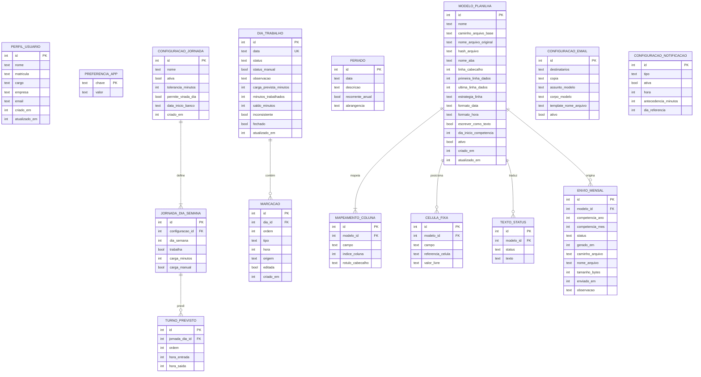
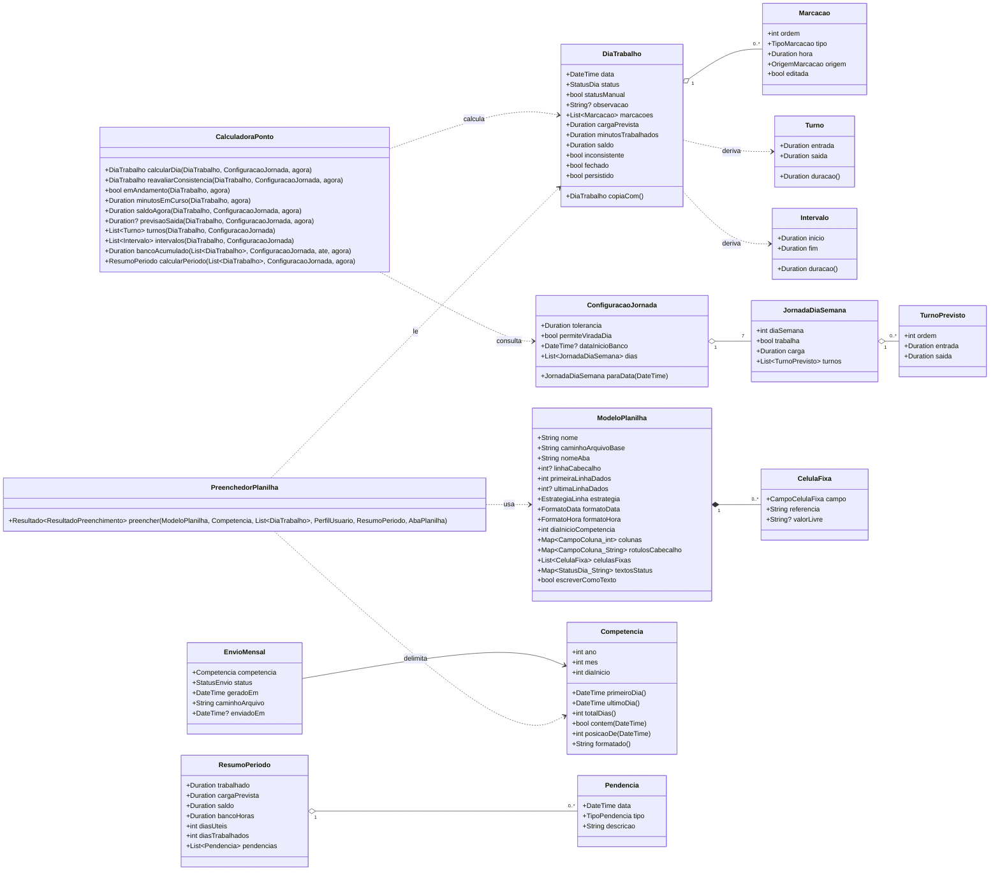

# 06 — Modelo de Dados

Este documento é a **fonte única de verdade** sobre entidades, campos e tipos. Nenhum outro
documento pode introduzir um campo que não esteja aqui, e nenhuma implementação pode criar uma
coluna sem antes registrá-la neste arquivo.

## 6.1 Convenções de armazenamento

| Conceito | Representação | Justificativa |
|----------|---------------|---------------|
| **Data** (sem hora) | `TEXT` no formato ISO `AAAA-MM-DD` | Imune a fuso horário e a horário de verão. Uma data de ponto é um fato civil, não um instante. Ordenável lexicograficamente. |
| **Hora do dia** | `INTEGER`, minutos desde a meia-noite (0 a 1439) | Aritmética trivial, sem fuso, sem ambiguidade. `08:30` é `510`. |
| **Duração** | `INTEGER`, minutos, podendo ser negativa | Saldos negativos são a metade do domínio do problema. |
| **Instante** (auditoria) | `INTEGER`, segundos desde a época, UTC | Padrão do Drift para `DateTime`. Usado só em `criado_em` e `atualizado_em`. |
| **Enumeração** | `TEXT` com o nome da constante | Legível ao inspecionar o banco e ao ler um backup; migração de valores fica óbvia. Em Dart os valores seguem a convenção da linguagem (`porData`, `entrada1`); o `ConversorEnum` grava `POR_DATA`, `ENTRADA_1`. |
| **Booleano** | `INTEGER` 0 ou 1 | Padrão do SQLite. |
| **Referência de célula** | `TEXT` no formato A1, ex.: `C3` | Formato que o usuário reconhece e que aparece na interface. |

Nomes de tabelas e colunas em `snake_case` sem acento; classes de domínio em `PascalCase` sem
acento. Toda tabela tem `id INTEGER PRIMARY KEY AUTOINCREMENT`, exceto `preferencia_app`.

## 6.2 Diagrama entidade-relacionamento



**Relacionamentos que existem no domínio mas não viram chave estrangeira**

| Entre | Natureza | Por quê não é FK |
|-------|----------|------------------|
| `FERIADO` → `DIA_TRABALHO` | Por data | O feriado é uma regra aplicada sobre a data; o dia pode nem existir ainda no banco. A ligação é resolvida em tempo de consulta. |
| `PERFIL_USUARIO` → `CELULA_FIXA` | Por campo | A célula fixa referencia um *tipo* de dado do perfil (`NOME`, `MATRICULA`), não um registro. |
| `CONFIGURACAO_EMAIL` → `ENVIO_MENSAL` | Histórica | O envio guarda o que foi efetivamente usado; a configuração pode mudar depois sem reescrever o histórico. |
| `CONFIGURACAO_JORNADA` → `DIA_TRABALHO` | Por data | A carga prevista é **copiada** para o dia no momento do cálculo, não referenciada. É isso que torna RN-29 possível: mudar a jornada não reescreve o passado. |

Essa última decisão é deliberada e importante: `dia_trabalho` é um **registro histórico
autossuficiente**. Ele guarda a carga prevista que valia naquele dia, e não um ponteiro para uma
configuração que pode mudar. Sem isso, alterar a jornada em agosto corromperia todos os saldos de
janeiro.

## 6.3 Enumerações

| Enum | Valores | Onde é usado |
|------|---------|--------------|
| `StatusDia` | `NORMAL`, `FOLGA`, `FERIADO`, `FERIAS`, `ATESTADO`, `FALTA`, `ABONO`, `COMPENSACAO` | `dia_trabalho.status`, `texto_status.status` |
| `TipoMarcacao` | `ENTRADA`, `SAIDA` | `marcacao.tipo` |
| `OrigemMarcacao` | `AUTOMATICA`, `MANUAL`, `IMPORTADA` | `marcacao.origem` |
| `EstrategiaLinha` | `SEQUENCIAL`, `POR_DATA` | `modelo_planilha.estrategia_linha` |
| `CampoColuna` | `DATA`, `ENTRADA_1`, `SAIDA_1`, `ENTRADA_2`, `SAIDA_2`, `ENTRADA_3`, `SAIDA_3`, `TOTAL_DIA`, `SALDO_DIA`, `OBSERVACAO`, `STATUS`, `DIA_SEMANA` | `mapeamento_coluna.campo` |
| `CampoCelulaFixa` | `NOME`, `MATRICULA`, `CARGO`, `EMPRESA`, `MES`, `ANO`, `COMPETENCIA`, `TOTAL_MES`, `SALDO_MES`, `BANCO_HORAS`, `DATA_GERACAO`, `TEXTO_LIVRE` | `celula_fixa.campo` |
| `StatusEnvio` | `PENDENTE`, `GERADO`, `ENVIADO`, `CANCELADO` | `envio_mensal.status` |
| `TipoNotificacao` | `INICIO_JORNADA`, `INICIO_INTERVALO`, `FIM_INTERVALO`, `FIM_JORNADA`, `DIA_INCOMPLETO`, `FECHAMENTO_MES` | `configuracao_notificacao.tipo` |
| `AbrangenciaFeriado` | `NACIONAL`, `ESTADUAL`, `MUNICIPAL`, `EMPRESA` | `feriado.abrangencia` |
| `TipoPendencia` ¹ | `MARCACOES_INCOMPLETAS`, `DIA_UTIL_SEM_REGISTRO`, `FALTA_COM_MARCACOES` | `Pendencia.tipo` |
| `FormatoData` | `DD_MM_AAAA`, `DD_MM`, `DD`, `AAAA_MM_DD`, `DATA_EXCEL` | `modelo_planilha.formato_data` |
| `FormatoHora` | `HH_MM`, `HH_MM_SS`, `DECIMAL`, `HORA_EXCEL` | `modelo_planilha.formato_hora` |

¹ `TipoPendencia` existe apenas no domínio: pendências são calculadas em tempo de leitura pelo
`GeradorPendencias` ([12, seção 12.3](12-regras-de-calculo.md)) e nunca são persistidas.

`dia_semana` em `jornada_dia_semana` segue a convenção do Dart: 1 = segunda-feira … 7 = domingo
(igual a `DateTime.weekday`), evitando conversões espalhadas pelo código.

## 6.4 Dicionário de dados

Legenda: **O** obrigatório · **N** aceita nulo · **D** valor padrão.

### `perfil_usuario` — dados que alimentam a planilha e o e-mail

| Campo | Tipo | Reg. | Descrição |
|-------|------|------|-----------|
| `id` | int | O | Sempre 1; a tabela tem registro único |
| `nome` | text | O | Nome completo, usado na célula fixa `NOME` e na variável `{nome}` |
| `matricula` | text | N | Matrícula na empresa |
| `cargo` | text | N | Cargo |
| `empresa` | text | N | Razão social ou nome fantasia |
| `email` | text | N | E-mail do funcionário, usado na variável `{email}` |
| `criado_em`, `atualizado_em` | int | O | Auditoria |

### `preferencia_app` — chave-valor para preferências simples

| Campo | Tipo | Reg. | Descrição |
|-------|------|------|-----------|
| `chave` | text | O | PK. Chaves previstas: `tema`, `onboarding_concluido`, `versao_esquema_backup`, `ultima_competencia_aberta` |
| `valor` | text | O | Valor serializado como texto |

### `configuracao_jornada` — parâmetros globais de cálculo

| Campo | Tipo | Reg. | Descrição |
|-------|------|------|-----------|
| `nome` | text | O | Rótulo livre. D: `"Jornada padrão"` |
| `ativa` | bool | O | Apenas uma ativa. D: `1` |
| `tolerancia_minutos` | int | O | Margem de RN-14. D: `0` |
| `permite_virada_dia` | bool | O | Habilita RN-08. D: `0` |
| `data_inicio_banco` | text | N | Data a partir da qual o banco de horas acumula (RN-15). Nulo significa desde o primeiro dia registrado |

### `jornada_dia_semana` — o esperado em cada dia da semana

| Campo | Tipo | Reg. | Descrição |
|-------|------|------|-----------|
| `configuracao_id` | int | O | FK, cascata na exclusão |
| `dia_semana` | int | O | 1 a 7, segunda a domingo. Único por configuração |
| `trabalha` | bool | O | Se falso, `carga_minutos` é 0 |
| `carga_minutos` | int | O | Carga prevista do dia |
| `carga_manual` | bool | O | Verdadeiro quando o usuário sobrescreveu o valor derivado dos turnos (RF-05). D: `0` |

### `turno_previsto` — horários esperados, usados nos lembretes e na previsão de saída

| Campo | Tipo | Reg. | Descrição |
|-------|------|------|-----------|
| `jornada_dia_id` | int | O | FK, cascata |
| `ordem` | int | O | 1, 2, 3… na sequência do dia |
| `hora_entrada` | int | O | Minutos desde a meia-noite |
| `hora_saida` | int | O | Minutos desde a meia-noite |

### `dia_trabalho` — um registro por data com marcação ou status

| Campo | Tipo | Reg. | Descrição |
|-------|------|------|-----------|
| `data` | text | O | `AAAA-MM-DD`, **único**. Índice principal de consulta |
| `status` | text | O | `StatusDia`. D: `NORMAL` |
| `status_manual` | bool | O | Verdadeiro quando definido pelo usuário; impede sobrescrita automática por feriado (RN-27). D: `0` |
| `observacao` | text | N | Texto livre, também exportado para a coluna `OBSERVACAO` |
| `carga_prevista_minutos` | int | O | Copiado da jornada no momento do cálculo. D: `0` |
| `minutos_trabalhados` | int | O | Resultado de RN-07. D: `0` |
| `saldo_minutos` | int | O | Resultado de RN-11 a RN-14, já com tolerância aplicada. D: `0` |
| `inconsistente` | bool | O | Resultado de RN-02. D: `0` |
| `fechado` | bool | O | Somente leitura quando verdadeiro (RF-15). D: `0` |
| `atualizado_em` | int | O | Auditoria |

Os três campos calculados (`minutos_trabalhados`, `saldo_minutos`, `inconsistente`) são
**derivados e persistidos**. A duplicação é intencional: consultar mês e ano exigiria recalcular
centenas de dias a cada rolagem, o que inviabilizaria RNF-02. A integridade é garantida por um
único ponto de escrita — o serviço de cálculo de [12](12-regras-de-calculo.md) — que recalcula e
regrava o dia após qualquer alteração em suas marcações ou em seu status.

### `marcacao` — uma batida de ponto

| Campo | Tipo | Reg. | Descrição |
|-------|------|------|-----------|
| `dia_id` | int | O | FK, cascata na exclusão |
| `ordem` | int | O | Posição dentro do dia, a partir de 1. Derivada da ordenação por hora (RN-01) |
| `tipo` | text | O | `TipoMarcacao`. Derivado da paridade da ordem (RN-01) |
| `hora` | int | O | Minutos desde a meia-noite. Único dentro do dia (RN-04) |
| `origem` | text | O | `OrigemMarcacao`. D: `MANUAL` |
| `editada` | bool | O | Verdadeiro se o horário foi alterado após a criação. D: `0` |

### `feriado`

| Campo | Tipo | Reg. | Descrição |
|-------|------|------|-----------|
| `data` | text | O | `AAAA-MM-DD`. Quando `recorrente_anual`, o ano é ignorado nas comparações |
| `descricao` | text | O | Ex.: `"Tiradentes"` |
| `recorrente_anual` | bool | O | RN-26. D: `1` |
| `abrangencia` | text | O | `AbrangenciaFeriado`. D: `NACIONAL` |

### `modelo_planilha` — o coração da configuração

| Campo | Tipo | Reg. | Descrição |
|-------|------|------|-----------|
| `nome` | text | O | Rótulo exibido ao usuário |
| `caminho_arquivo_base` | text | O | Caminho do `.xlsx` copiado para a área privada do app |
| `nome_arquivo_original` | text | O | Nome com que o usuário conhece o arquivo |
| `hash_arquivo` | text | O | SHA-256 do arquivo base; detecta troca ou corrupção |
| `nome_aba` | text | O | Aba de dados |
| `linha_cabecalho` | int | N | Base 1. Nulo quando a planilha não tem cabeçalho |
| `primeira_linha_dados` | int | O | Base 1. Onde o primeiro dia é escrito na estratégia `SEQUENCIAL` |
| `ultima_linha_dados` | int | N | Base 1. Limite da área de dados; usado na validação de RN-21 |
| `estrategia_linha` | text | O | `EstrategiaLinha` |
| `formato_data` | text | O | `FormatoData`. D: `DD_MM_AAAA` |
| `formato_hora` | text | O | `FormatoHora`. D: `HH_MM` |
| `escrever_como_texto` | bool | O | Verdadeiro escreve tudo como string; falso usa tipos nativos do Excel. Derivado dos formatos: é falso quando a data é `DATA_EXCEL` ou a hora é `HORA_EXCEL`. D: `1` |
| `dia_inicio_competencia` | int | O | Dia do mês anterior em que o período da competência começa, de 1 a 28 (RN-25). `1` é o mês civil; `26` faz a competência 10/2026 ir de 26/09 a 25/10. D: `1` |
| `ativo` | bool | O | RN-17: no máximo um verdadeiro |

### `mapeamento_coluna`

| Campo | Tipo | Reg. | Descrição |
|-------|------|------|-----------|
| `modelo_id` | int | O | FK, cascata |
| `campo` | text | O | `CampoColuna`. Único por modelo |
| `indice_coluna` | int | O | Base 0. A coluna `A` é 0 |
| `rotulo_cabecalho` | text | N | Texto lido do cabeçalho, guardado para exibir na interface e detectar incompatibilidade em RF-32 |

### `celula_fixa`

| Campo | Tipo | Reg. | Descrição |
|-------|------|------|-----------|
| `modelo_id` | int | O | FK, cascata |
| `campo` | text | O | `CampoCelulaFixa` |
| `referencia_celula` | text | O | Formato A1, ex.: `C3` |
| `valor_livre` | text | N | Conteúdo fixo, usado apenas quando `campo` é `TEXTO_LIVRE` |

### `texto_status`

| Campo | Tipo | Reg. | Descrição |
|-------|------|------|-----------|
| `modelo_id` | int | O | FK, cascata |
| `status` | text | O | `StatusDia`. Único por modelo |
| `texto` | text | O | O que escrever na planilha, ex.: `"FOLGA"` |

### `configuracao_email`

| Campo | Tipo | Reg. | Descrição |
|-------|------|------|-----------|
| `destinatarios` | text | O | E-mails separados por ponto e vírgula |
| `copia` | text | N | Idem, em cópia |
| `assunto_modelo` | text | O | Aceita variáveis. D: `"Ponto - {nome} - {competencia}"` |
| `corpo_modelo` | text | O | Aceita variáveis, multilinha |
| `template_nome_arquivo` | text | O | D: `"Ponto_{nome}_{mes}-{ano}.xlsx"` |
| `ativo` | bool | O | D: `1` |

### `envio_mensal` — histórico

| Campo | Tipo | Reg. | Descrição |
|-------|------|------|-----------|
| `modelo_id` | int | N | FK do modelo usado. Nulo se o modelo foi excluído depois |
| `competencia_ano` | int | O | Ex.: `2026` |
| `competencia_mes` | int | O | 1 a 12 |
| `status` | text | O | `StatusEnvio` |
| `gerado_em` | int | O | Instante da geração |
| `caminho_arquivo` | text | O | Caminho do arquivo gerado |
| `nome_arquivo` | text | O | Nome resolvido pelo template |
| `tamanho_bytes` | int | O | Exibido no histórico |
| `enviado_em` | int | N | Preenchido apenas na confirmação de RN-23 |
| `observacao` | text | N | Registro de pendências confirmadas ou de erros parciais de RN-20 |

Índice composto não único em (`competencia_ano`, `competencia_mes`) — RN-24 permite vários
registros para a mesma competência.

### `configuracao_notificacao`

| Campo | Tipo | Reg. | Descrição |
|-------|------|------|-----------|
| `tipo` | text | O | `TipoNotificacao`. Único |
| `ativa` | bool | O | D: `0` |
| `hora` | int | N | Minutos desde a meia-noite. Nulo para tipos derivados da jornada |
| `antecedencia_minutos` | int | O | Quanto antes avisar. D: `0` |
| `dia_referencia` | int | N | Só para `FECHAMENTO_MES`: positivo é dia do mês, negativo conta a partir do fim (`-1` é o último dia) |

## 6.5 Modelo de classes do domínio

A camada de domínio é composta de objetos imutáveis, sem dependência de Flutter ou de Drift
([RNF-10](02-requisitos.md)). As tabelas acima são o modelo de persistência; as classes abaixo são
o modelo de negócio, e a conversão entre os dois acontece na camada de dados.



`Turno` e `Intervalo` **não são persistidos**: são derivados das marcações em tempo de leitura. Só
existe uma fonte de verdade para a sequência do dia, e é a lista de marcações.

**Por que `DiaTrabalho` não tem métodos de cálculo.** A primeira versão deste diagrama punha
`emAndamento`, `saldoAgora`, `turnos` e afins em `DiaTrabalho`. Na implementação eles foram para a
`CalculadoraPonto`, porque são cálculo de horas e a regra 2 do projeto é que todo cálculo vive em um
único serviço. `DiaTrabalho` virou um registro de dados imutável — o que também o torna trivial de
comparar nos testes.

## 6.6 Definição em Drift

Trecho representativo. As demais tabelas seguem exatamente o mesmo padrão descrito no dicionário.

```dart
// data/local/conversores.dart
/// Datas civis são persistidas como texto ISO 'AAAA-MM-DD' (ver 6.1).
class ConversorData extends TypeConverter<DateTime, String> {
  const ConversorData();
  @override
  DateTime fromSql(String fromDb) => DateTime.parse(fromDb);
  @override
  String toSql(DateTime value) =>
      '${value.year.toString().padLeft(4, '0')}-'
      '${value.month.toString().padLeft(2, '0')}-'
      '${value.day.toString().padLeft(2, '0')}';
}

/// Horas do dia são persistidas como minutos desde a meia-noite (ver 6.1).
class ConversorHora extends TypeConverter<Duration, int> {
  const ConversorHora();
  @override
  Duration fromSql(int fromDb) => Duration(minutes: fromDb);
  @override
  int toSql(Duration value) => value.inMinutes;
}
```

```dart
// data/local/tabelas.dart
@DataClassName('DiaTrabalhoLinha')
class DiasTrabalho extends Table {
  @override
  String get tableName => 'dia_trabalho';

  IntColumn get id => integer().autoIncrement()();
  TextColumn get data => text().map(const ConversorData()).unique()();
  TextColumn get status =>
      textEnum<StatusDia>().withDefault(const Constant('NORMAL'))();
  BoolColumn get statusManual =>
      boolean().named('status_manual').withDefault(const Constant(false))();
  TextColumn get observacao => text().nullable()();
  IntColumn get cargaPrevistaMinutos =>
      integer().named('carga_prevista_minutos').withDefault(const Constant(0))();
  IntColumn get minutosTrabalhados =>
      integer().named('minutos_trabalhados').withDefault(const Constant(0))();
  IntColumn get saldoMinutos =>
      integer().named('saldo_minutos').withDefault(const Constant(0))();
  BoolColumn get inconsistente => boolean().withDefault(const Constant(false))();
  BoolColumn get fechado => boolean().withDefault(const Constant(false))();
  DateTimeColumn get atualizadoEm =>
      dateTime().named('atualizado_em').withDefault(currentDateAndTime)();
}

@DataClassName('MarcacaoLinha')
class Marcacoes extends Table {
  @override
  String get tableName => 'marcacao';

  IntColumn get id => integer().autoIncrement()();
  IntColumn get diaId => integer()
      .named('dia_id')
      .references(DiasTrabalho, #id, onDelete: KeyAction.cascade)();
  IntColumn get ordem => integer()();
  TextColumn get tipo => textEnum<TipoMarcacao>()();
  IntColumn get hora => integer().map(const ConversorHora())();
  TextColumn get origem =>
      textEnum<OrigemMarcacao>().withDefault(const Constant('MANUAL'))();
  BoolColumn get editada => boolean().withDefault(const Constant(false))();
  DateTimeColumn get criadoEm =>
      dateTime().named('criado_em').withDefault(currentDateAndTime)();

  @override
  List<Set<Column>> get uniqueKeys => [
        {diaId, hora}, // RN-04
      ];
}
```

A implementação completa está em `lib/data/local/tabelas.dart`. Duas diferenças em relação ao
trecho acima, ambas de forma e não de esquema: as enumerações usam o `ConversorEnum` genérico (que
grava `NORMAL`, `POR_DATA`) em vez de `textEnum`, e as horas usam `ConversorMinutos`.

**Índices obrigatórios**

| Tabela | Índice | Motivo |
|--------|--------|--------|
| `dia_trabalho` | `data` (único) | Consulta por dia, semana e mês. Sustenta RNF-02 |
| `marcacao` | `dia_id, ordem` | Leitura ordenada do dia |
| `marcacao` | `dia_id, hora` (único) | RN-04 |
| `feriado` | `data` | Aplicação de RN-27 ao montar o período |
| `envio_mensal` | `competencia_ano, competencia_mes` | Listagem do histórico |
| `mapeamento_coluna` | `modelo_id, campo` (único) | Um campo, uma coluna |

## 6.7 Migrações e dados iniciais

**Versão do esquema: 1.** Toda alteração futura incrementa a versão e acrescenta um passo em
`onUpgrade`, sem jamais recriar tabelas com dados de ponto ([RNF-09](02-requisitos.md)).

Dados semeados na criação do banco:

1. **`configuracao_jornada`** — um registro `"Jornada padrão"` ativo, tolerância 0, sem virada de
   dia, com os sete `jornada_dia_semana`: segunda a sexta trabalhando 8h (turnos 08:00–12:00 e
   13:00–17:00), sábado e domingo não trabalhando.
2. **`configuracao_email`** — um registro com assunto `"Ponto - {nome} - {competencia}"`, corpo
   padrão e template de nome de arquivo `"Ponto_{nome}_{mes}-{ano}.xlsx"`.
3. **`configuracao_notificacao`** — um registro por `TipoNotificacao`, todos inativos, com
   `FECHAMENTO_MES` em `dia_referencia = -1` e `hora = 1140` (19:00).
4. **`feriado`** — feriados nacionais brasileiros de data fixa, todos recorrentes: 01/01, 21/04,
   01/05, 07/09, 12/10, 02/11, 15/11, 25/12. Os feriados móveis (Carnaval, Sexta-feira Santa,
   Corpus Christi) **não** são semeados por dependerem do cálculo da Páscoa; ficam a cargo do
   usuário nesta versão e estão registrados como evolução em [15](15-riscos-e-decisoes.md).
   > Na primeira entrega (núcleo funcional) os feriados ficaram fora por decisão de escopo: a
   > tabela `feriado` existe no esquema versão 1, para não exigir migração depois, mas não é
   > semeada nem usada. Enquanto isso, o feriado é marcado pelo status do dia (TL-10).
5. **`preferencia_app`** — `tema = sistema`, `onboarding_concluido = false`.

`perfil_usuario` **não** é semeado: sua ausência é justamente o que dispara o onboarding (UC-01).
