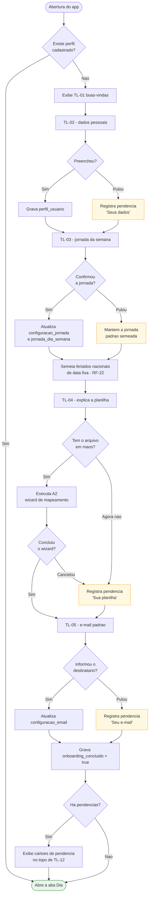
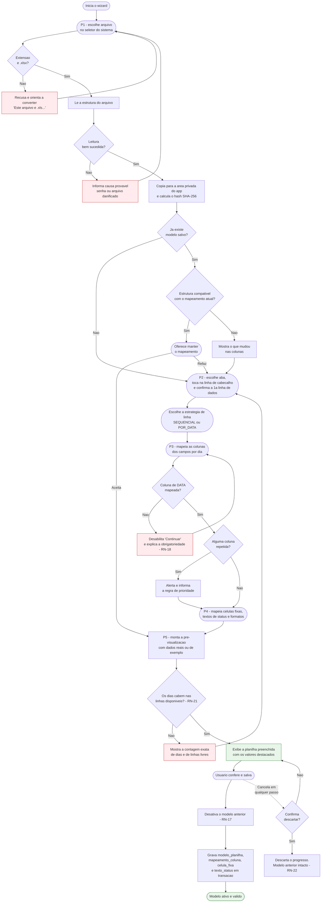
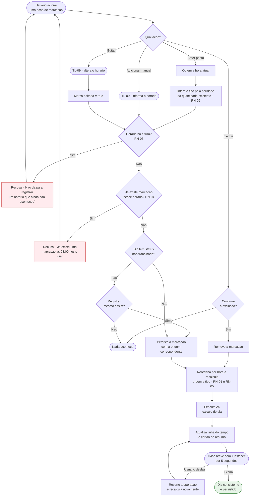
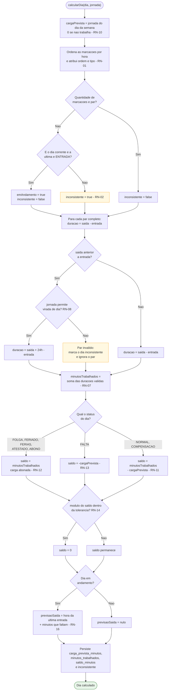
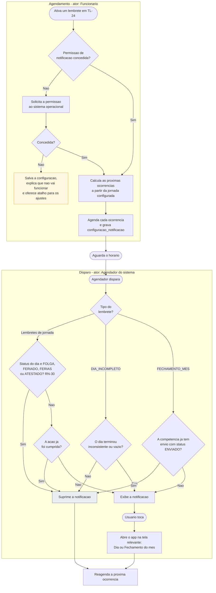

# 07 — Diagramas de Atividade

Seis fluxos que cobrem todo o comportamento do sistema. Cada um corresponde a um ou mais casos de
uso de [05](05-casos-de-uso.md) e cita as regras de [02](02-requisitos.md) que aplica.

Convenção dos diagramas: losango é decisão, retângulo é ação do sistema, retângulo arredondado é
ação do usuário, e nós em vermelho são caminhos de erro ou de recusa.

---

## A1 — Configuração inicial (onboarding)

**Caso de uso:** UC-01 · **Telas:** TL-01 a TL-05 · **Requisitos:** RF-03, RF-22

**Notas de projeto.** Nenhuma etapa é obrigatória. Um usuário que só quer bater ponto hoje consegue
chegar à tela do Dia em dois toques, e a configuração da planilha continua disponível até o
fechamento do mês. Isso atende ao princípio 1 de [04](04-ux-navegacao-telas.md) e evita o abandono
na primeira execução, que é o momento de menor confiança.

---

## A2 — Importação e mapeamento da planilha

**Caso de uso:** UC-07 · **Telas:** TL-16 a TL-20 · **Requisitos:** RF-23 a RF-32 ·
**Regras:** RN-17, RN-18, RN-21, RN-22

**Nota de projeto.** Nada é gravado antes do passo 5. Um wizard abandonado no meio não deixa
resíduo, e um modelo já existente nunca é degradado por uma tentativa incompleta de substituí-lo —
exigência direta de [RNF-06](02-requisitos.md).

---

## A3 — Registrar, editar e excluir marcação

**Casos de uso:** UC-04, UC-05 · **Telas:** TL-06, TL-09 ·
**Regras:** RN-01 a RN-06

**Nota de projeto.** Ordem e tipo **nunca** são informados pelo usuário: são sempre derivados da
ordenação por horário. Isso elimina por construção a classe inteira de bugs de "saída antes da
entrada" e mantém RN-01 como invariante do sistema, não como validação a ser lembrada.

---

## A4 — Fechamento do mês: gerar e enviar

**Casos de uso:** UC-10, UC-11 · **Tela:** TL-21 ·
**Regras:** RN-18 a RN-24 · Este é o fluxo que justifica o produto.

```mermaid
flowchart TD
    INI(["Abre o Fechamento do mes"]) --> DEF["Seleciona a competencia padrao<br/>ate o dia 10 usa o mes anterior"]
    DEF --> CARGA["Carrega os dias da competencia<br/>e calcula o resumo"]
    CARGA --> PEND["Levanta pendencias:<br/>dias inconsistentes, dias uteis<br/>sem registro, status indefinido"]
    PEND --> MOSTRA["Exibe resumo, pendencias<br/>e a configuracao em uso"]

    MOSTRA --> ACAO(["Usuario aciona<br/>'Gerar planilha'"])
    ACAO --> MOD{"Existe modelo<br/>ativo? RN-18"}
    MOD -->|Nao| E1["Bloqueia e oferece<br/>configurar a planilha"]
    E1 --> WIZ(["Vai para A2"])
    MOD -->|Sim| ARQ{"Arquivo base<br/>existe e o hash confere?"}
    ARQ -->|Nao| E2["Informa e oferece reimportar<br/>mantendo o mapeamento"]
    E2 --> WIZ
    ARQ -->|Sim| TEMP{"Ha pendencias?"}

    TEMP -->|Sim| CONF{"Usuario confirma<br/>gerar assim mesmo? RN-19"}
    CONF -->|Nao| MOSTRA
    CONF -->|Sim| CABE
    TEMP -->|Nao| CABE

    CABE{"Os dias cabem<br/>nas linhas? RN-21"} -->|Nao| E3["Aborta antes de escrever<br/>com os numeros exatos"]
    E3 --> MOSTRA
    CABE -->|Sim| ABRE["Abre o arquivo base<br/>preservando todo o conteudo - RN-22"]

    ABRE --> LOOP["Para cada dia da competencia:<br/>resolve a linha de destino e<br/>escreve as colunas mapeadas"]
    LOOP --> NAOACHOU{"Estrategia POR_DATA<br/>e data nao encontrada?"}
    NAOACHOU -->|Sim| REGISTRA["Registra o dia como nao escrito<br/>e continua os demais - RN-20"]
    NAOACHOU -->|Nao| SEGUE["Segue"]
    REGISTRA --> FIXAS
    SEGUE --> FIXAS

    FIXAS["Escreve as celulas fixas<br/>com perfil e totais do mes"] --> SALVA["Grava o novo arquivo<br/>com o nome do template"]
    SALVA --> OK{"Gravacao<br/>bem sucedida?"}
    OK -->|Nao| E4["Remove qualquer arquivo parcial<br/>e informa a falha - RNF-06"]
    E4 --> MOSTRA
    OK -->|Sim| HIST["Cria registro em envio_mensal<br/>com status GERADO - RN-24"]

    HIST --> GERADO["Exibe o arquivo gerado<br/>com abrir, compartilhar e enviar"]
    GERADO --> PARCIAL{"Houve dias<br/>nao escritos?"}
    PARCIAL -->|Sim| LISTA["Lista os dias que ficaram de fora"]
    PARCIAL -->|Nao| ENVIAR
    LISTA --> ENVIAR

    ENVIAR(["Usuario aciona<br/>'Enviar por e-mail'"]) --> RESOLVE["Resolve as variaveis do assunto,<br/>do corpo e do nome do arquivo"]
    RESOLVE --> DEST{"Destinatario<br/>configurado?"}
    DEST -->|Nao| E5["Bloqueia e leva a TL-22"]
    E5 --> GERADO
    DEST -->|Sim| PREVIEW["Mostra a pre-visualizacao<br/>do e-mail com o anexo"]

    PREVIEW --> INTENT["Monta a intencao de e-mail<br/>e entrega ao sistema operacional"]
    INTENT --> CLI{"Existe cliente<br/>de e-mail?"}
    CLI -->|Nao| ALT["Oferece o compartilhamento<br/>generico do sistema"]
    CLI -->|Sim| EXTERNO(["Cliente de e-mail abre preenchido.<br/>O usuario revisa e envia."])
    ALT --> PERG
    EXTERNO --> PERG

    PERG{"Ao voltar ao app:<br/>'Voce conseguiu enviar?' RN-23"}
    PERG -->|"Enviei"| ENVIADO["Status ENVIADO<br/>com data e hora"]
    PERG -->|"Ainda nao"| MANTEM["Mantem status GERADO.<br/>Competencia segue pendente"]
    PERG -->|"Fecha o app"| MANTEM

    ENVIADO --> CANCELA["Cancela o lembrete<br/>de fechamento do periodo"]
    CANCELA --> FIM(["Competencia concluida"])
    MANTEM --> FIM2(["Pergunta reaparece<br/>na proxima visita"])

    style E1 fill:#ffebee,stroke:#c62828
    style E2 fill:#ffebee,stroke:#c62828
    style E3 fill:#ffebee,stroke:#c62828
    style E4 fill:#ffebee,stroke:#c62828
    style E5 fill:#ffebee,stroke:#c62828
    style EXTERNO fill:#eceff1,stroke:#546e7a,stroke-dasharray: 4 4
    style FIM fill:#e8f5e9,stroke:#2e7d32
```

**Nota de projeto.** O app perde o controle do processo no nó `EXTERNO`, desenhado tracejado porque
está fora da fronteira do sistema. É essa perda de controle que obriga a confirmação manual de
RN-23 — e é por isso que a interface pergunta em vez de afirmar. Um app que dissesse "enviado com
sucesso" sem saber estaria mentindo para o usuário justamente sobre a coisa que ele mais precisa
que seja verdade.

---

## A5 — Cálculo do dia

**Regras:** RN-02, RN-07 a RN-14, RN-16 · **Detalhamento:** [12 — Regras de cálculo](12-regras-de-calculo.md)

Executado após qualquer alteração em marcações, status do dia ou configuração de jornada. É o único
ponto do sistema autorizado a escrever os campos derivados de `dia_trabalho`.

---

## A6 — Notificações: agendamento e disparo

**Caso de uso:** UC-13 · **Tela:** TL-24 · **Requisitos:** RF-44 a RF-47 · **Regra:** RN-30

**Nota de projeto.** A verificação de supressão acontece **no disparo**, não no agendamento. Um
lembrete agendado na segunda-feira precisa se calar se, na quinta, o usuário marcar aquele dia como
atestado. Reagendar tudo a cada mudança de status seria caro e frágil; verificar no momento do
disparo é barato e sempre correto.

O lembrete de fechamento é o que existe para resolver a dor D1 de
[01](01-visao-e-escopo.md) — a razão original do projeto. Ele se cala sozinho quando a competência
já foi enviada, para não virar ruído que o usuário aprende a ignorar.
