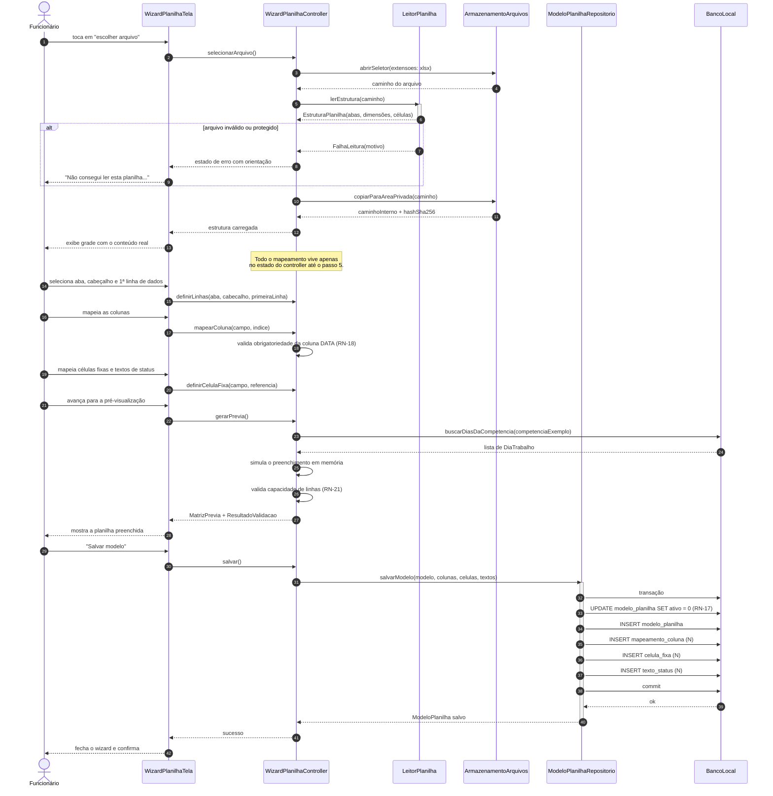
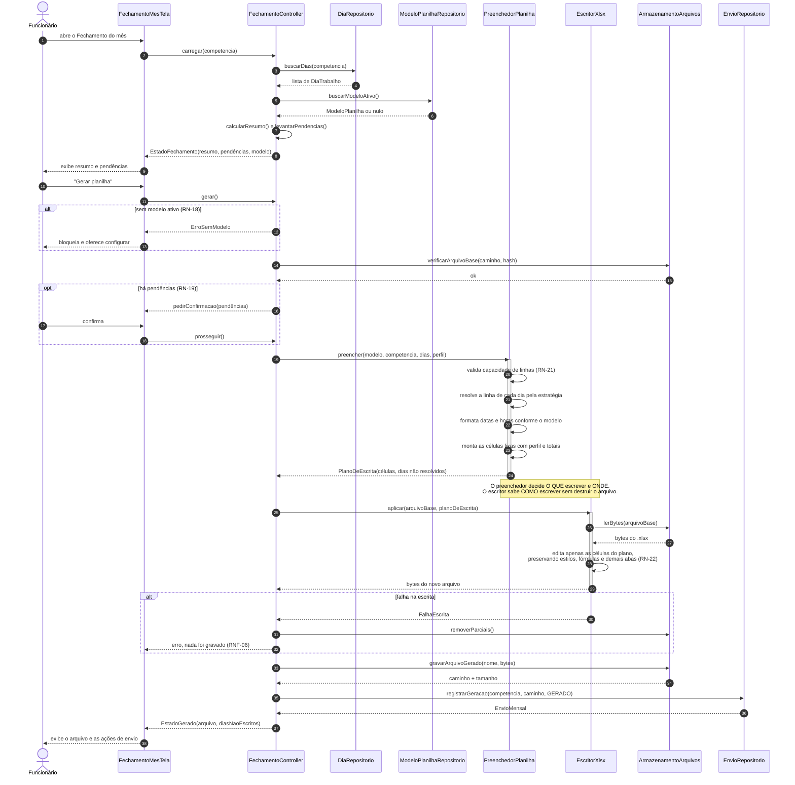
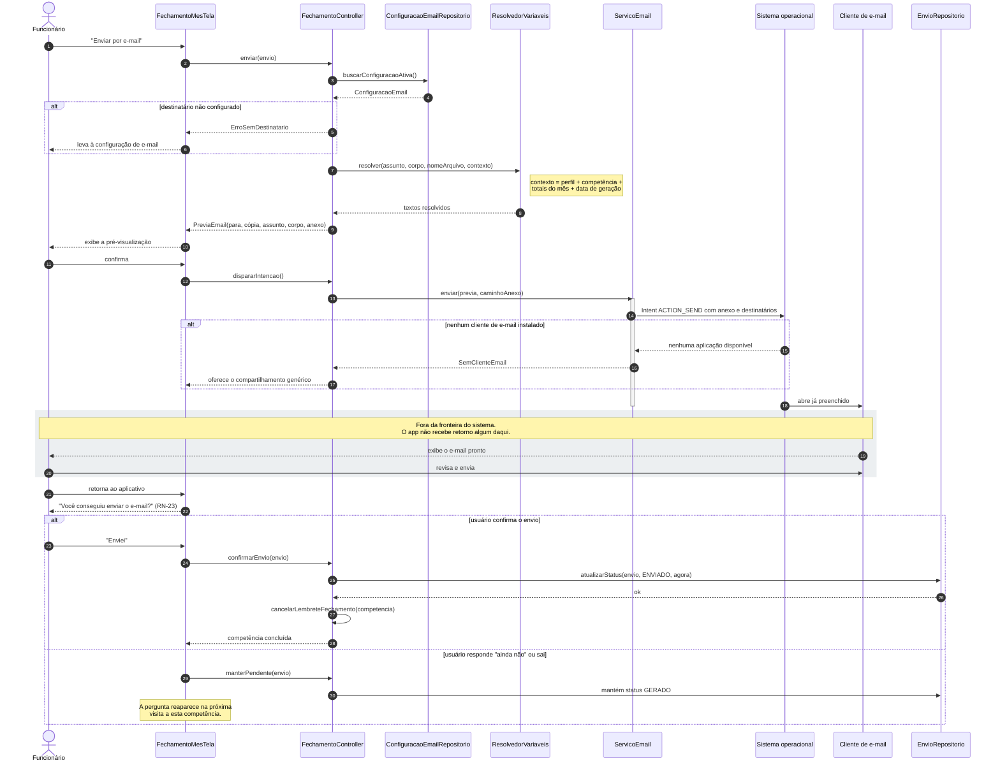
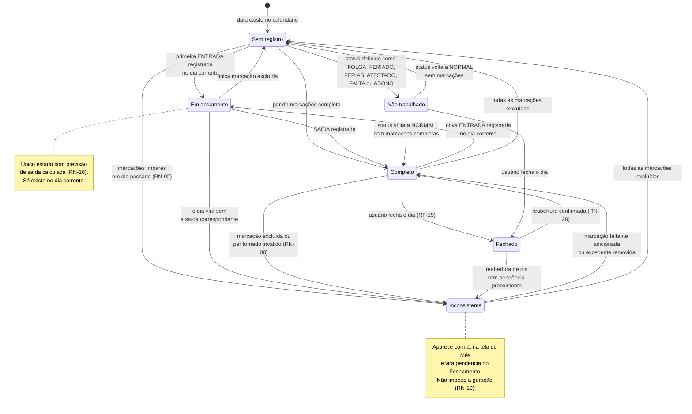
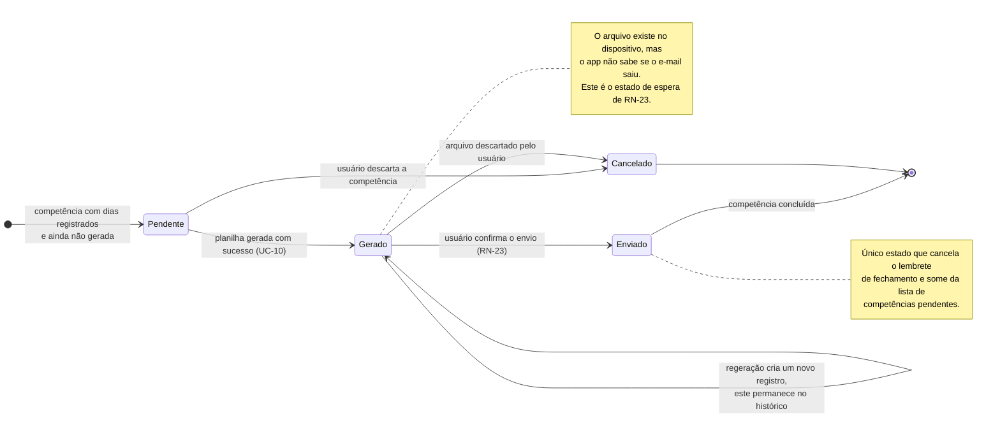

# 08 — Diagramas de Sequência e de Estado

Os fluxos de [07](07-fluxos-atividade.md) descrevem **o que acontece**. Este documento descreve
**quem faz o quê**, entre os componentes definidos em [09](09-arquitetura-tecnica.md), e quais são
os estados válidos das duas entidades que têm ciclo de vida próprio.

---

## S1 — Importação e mapeamento da planilha

Realiza UC-07. Mostra como o wizard mantém tudo em memória até o salvamento final, garantindo que
um abandono não deixe resíduo.

---

## S2 — Geração da planilha da competência

Realiza UC-10. É a sequência de maior risco técnico do projeto — ver
[R-01](15-riscos-e-decisoes.md).

O ponto central desta sequência é a separação entre `PreenchedorPlanilha` e `EscritorXlsx`.
O primeiro é lógica de domínio pura, testável sem arquivo nenhum: dado um modelo e uma lista de
dias, produz um `PlanoDeEscrita` — a lista de coordenadas e valores. O segundo é infraestrutura,
e é o único componente do sistema que conhece o formato `.xlsx`. Se a estratégia técnica de escrita
precisar mudar ([S-01](15-riscos-e-decisoes.md)), só o `EscritorXlsx` é substituído, e todos os
testes do preenchedor continuam válidos.

---

## S3 — Envio por e-mail e confirmação

Realiza UC-11. Note onde o controle do sistema termina.

---

## E1 — Ciclo de vida do dia de trabalho

Estados de `dia_trabalho`. As transições de cálculo são todas executadas pelo fluxo
[A5](07-fluxos-atividade.md).

**Invariantes**

- `Em andamento` só é atingível quando a data do dia é hoje. Na virada da meia-noite, um dia nesse
  estado passa a `Inconsistente` sem intervenção do usuário — o recálculo ocorre na próxima leitura
  do dia, e é o que dispara o lembrete `DIA_INCOMPLETO` de [A6](07-fluxos-atividade.md).
- `Fechado` é o único estado somente leitura. Toda tentativa de escrita é recusada pela camada de
  aplicação antes de chegar ao repositório.
- `Não trabalhado` não impede marcações: um dia de folga com marcações registra hora extra integral,
  conforme RN-12.

---

## E2 — Ciclo de vida do envio mensal

Estados de `envio_mensal`. Uma competência pode ter vários registros ao longo do tempo (RN-24), cada
um percorrendo esta máquina de forma independente.

**Por que não existe transição automática de `Gerado` para `Enviado`.** O Android não devolve ao
aplicativo o resultado de uma intenção de e-mail: o `resultCode` é `RESULT_CANCELED` mesmo quando a
mensagem foi enviada, porque o cliente de e-mail encerra a atividade sem informar o desfecho.
Qualquer tentativa de inferir o envio produziria falso positivo — o pior erro possível para este
produto, já que faria o app silenciar o lembrete de uma competência que nunca chegou ao RH.
A confirmação humana de RN-23 é, portanto, uma decisão de projeto consciente, não uma limitação
não resolvida.
