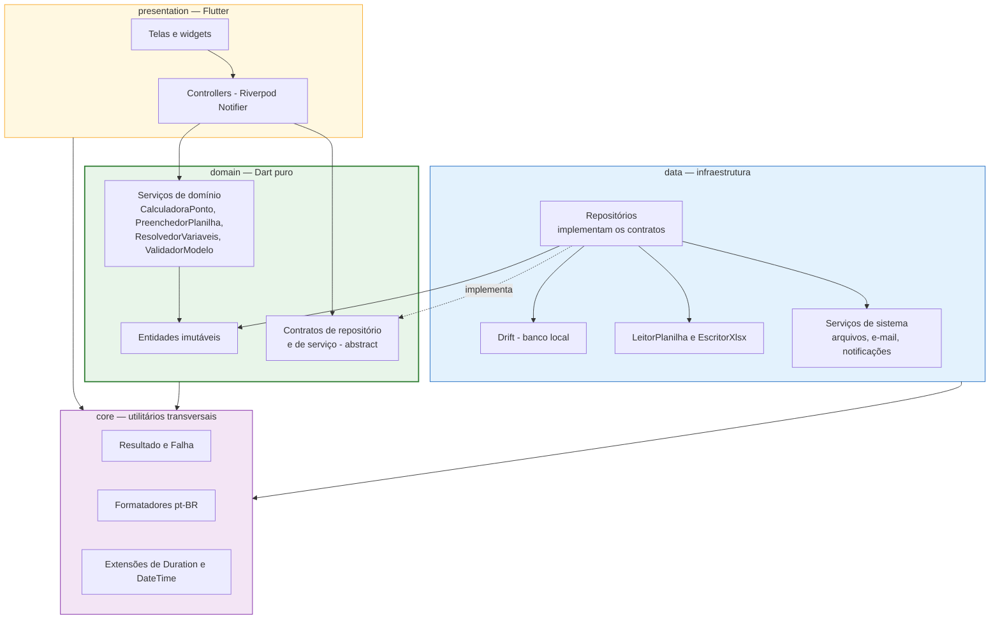

# 09 — Arquitetura Técnica

## 9.1 Camadas

Quatro camadas com dependência em sentido único. A regra que governa tudo: **o domínio não sabe que
existe Flutter, Drift ou Excel.** Ele é Dart puro, e é o que torna [RNF-10](02-requisitos.md)
possível — as regras de [12](12-regras-de-calculo.md) e o preenchimento de
[10](10-especificacao-planilha.md) rodam em `flutter test` sem emulador, sem banco e sem arquivo.



**Regras de dependência, verificáveis por inspeção de imports**

| Camada | Pode importar | Nunca importa |
|--------|---------------|---------------|
| `domain/` | `core/`, Dart SDK | `package:flutter/*`, `package:drift/*`, `data/`, `presentation/` |
| `data/` | `domain/`, `core/`, pacotes de infraestrutura | `presentation/` |
| `presentation/` | `domain/`, `core/`, Flutter, Riverpod | `data/` diretamente — só via provider |
| `core/` | Dart SDK, `intl` | qualquer outra camada do projeto |

A proibição de `presentation` importar `data` é o que mantém as telas testáveis: um widget test
substitui o provider do repositório por uma implementação falsa sem tocar em Drift.

## 9.2 Estrutura de pastas

A árvore abaixo é a da implementação. Ela difere do primeiro rascunho em três pontos, todos por
causa das regras de dependência: `ReferenciaCelula`, `PlanoDeEscrita` e `ConteudoPlanilha` estão no
domínio (o `PreenchedorPlanilha` usa os três); os contratos de serviço de infraestrutura
(`EscritorXlsx`, `ServicoEmail`...) estão em `domain/contratos/`, porque `presentation/` os enxerga
pelos providers e não pode importar `data/`; e a formatação de competência recebe `(ano, mes)`,
porque `core/` não pode importar `Competencia`.

```
lib/
├── main.dart                         # abre o banco, carrega preferências, runApp
├── app/
│   ├── app.dart                      # MaterialApp.router, tema, localização pt-BR
│   ├── rotas.dart                    # GoRouter: três abas e as telas por cima
│   ├── tema.dart                     # claro e escuro (04, seção 4.5) e CoresPonto
│   └── providers.dart                # providers raiz: banco, repositórios, serviços
├── core/
│   ├── resultado.dart                # Resultado<T> — sucesso ou falha
│   ├── falhas.dart                   # hierarquia de Falha
│   ├── formatadores.dart             # duração, data, hora, competência em pt-BR
│   ├── relogio.dart                  # Relogio injetável: o único DateTime.now()
│   ├── datas_excel.dart              # número de série e fração de dia do Excel
│   └── extensoes/data_extensoes.dart # datas civis em UTC, iso, horaDoDia...
├── domain/
│   ├── enums/                        # enums.dart (doc 06) e rotulos.dart (pt-BR)
│   ├── entidades/                    # dia, marcação, jornada, competência, modelo,
│   │                                 # envio, e-mail, resumo, plano de escrita,
│   │                                 # referência de célula, conteúdo lido da planilha
│   ├── servicos/
│   │   ├── calculadora_ponto.dart    # A5 e doc 12 — o único lugar com cálculo de horas
│   │   ├── gerador_pendencias.dart   # pendências do fechamento
│   │   ├── validador_marcacao.dart   # RN-03, RN-04
│   │   ├── consulta_periodo.dart     # dias + totais + banco de um período
│   │   ├── preenchedor_planilha.dart # doc 10 — produz o PlanoDeEscrita
│   │   ├── inferencia_planilha.dart  # sugestões do wizard
│   │   ├── validador_modelo.dart     # validações do wizard
│   │   └── resolvedor_variaveis.dart # {nome}, {competencia}, {mes}...
│   ├── repositorios/repositorios.dart# SOMENTE contratos de repositório
│   └── contratos/contratos.dart      # contratos de leitor, escritor, arquivos, e-mail
├── data/
│   ├── local/                        # Drift: banco_local.dart (seeds), tabelas, conversores
│   ├── repositorios/                 # implementações Drift dos contratos
│   ├── planilha/
│   │   ├── pacote_xlsx.dart          # navegação no pacote OOXML (rels, abas)
│   │   ├── leitor_planilha_xml.dart  # lê abas e células (ADR-11)
│   │   └── escritor_xlsx_zip.dart    # escrita cirúrgica do XML (ADR-05)
│   └── servicos/                     # arquivos, e-mail, compartilhar/abrir, seletor
└── presentation/
    ├── comum/                        # componentes.dart (SeletorPeriodo, CartaoResumo,
    │                                 # ChipStatusDia, EstadoVazio...), grade_planilha.dart,
    │                                 # interacao.dart (diálogos, mensagens, seletores)
    ├── dia/                          # TL-06, TL-09, TL-10
    ├── menu/  periodo/               # TL-11, TL-07, TL-08
    ├── configuracoes/                # TL-12, TL-02, TL-13, TL-14, TL-22
    ├── onboarding/                   # TL-01 a TL-05
    ├── planilha_wizard/              # TL-16 a TL-20
    ├── fechamento/  historico/       # TL-21, TL-23

test/
├── core/  domain/                    # testes puros: cálculo, preenchimento, validação
├── data/                             # escritor e leitor .xlsx, repositórios em memória
├── presentation/                     # widget tests das telas críticas
├── fixtures/                         # mes_exemplo.dart e modelo_exemplo.dart
└── helpers/
tool/spike_xlsx.dart                  # spike S-01 sobre uma planilha real
```

Cada tela tem seu controller (Riverpod `AsyncNotifier`) no mesmo diretório. O estado assíncrono
usa o próprio `AsyncValue` — carregando, erro e pronto —, renderizado pelo `ConteudoAssincrono`
comum, que mantém o conteúdo anterior na tela durante a recarga.

## 9.3 Dependências

> As versões abaixo são as linhas conhecidamente compatíveis com Flutter 3.24.4 / Dart 3.5.4.
> Na primeira execução da fase F-0, resolva-as com `flutter pub add <pacote>` e registre no
> `pubspec.yaml` as versões que o resolvedor efetivamente escolher — não copie estes números às
> cegas.

| Pacote | Linha | Papel | Fase |
|--------|-------|-------|------|
| `flutter_riverpod` | ^2.5 | Estado e injeção de dependências | F-0 |
| `go_router` | ^14.2 | Navegação declarativa | F-0 |
| `drift` | ^2.20 | ORM tipado sobre SQLite | F-0 |
| `drift_flutter` | ^0.2 | Abertura do banco no Flutter | F-0 |
| `sqlite3_flutter_libs` | ^0.5 | Binários do SQLite no Android | F-0 |
| `path_provider` | ^2.1 | Diretórios da aplicação | F-0 |
| `intl` | 0.19.0 | Formatação e localização pt-BR | F-0 |
| `collection` | ^1.18 | Utilitários de lista | F-0 |
| `file_picker` | ^8.1 | Seleção do `.xlsx` | F-4 |
| ~~`excel`~~ | — | Substituído por leitura própria do XML ([ADR-11](15-riscos-e-decisoes.md)) | — |
| `archive` | ^3.6 | Zip do `.xlsx`, na leitura e na escrita | F-4 |
| `xml` | ^6.5 | XML interno das planilhas, na leitura e na escrita | F-4 |
| `crypto` | ^3.0 | SHA-256 do arquivo modelo | F-4 |
| `share_plus` | ^10.0 | Compartilhamento e fallback de envio | F-5 |
| `flutter_email_sender` | ^6.0 | Abertura do cliente de e-mail com anexo | F-6 |
| `flutter_local_notifications` | ^17.2 | Lembretes agendados | F-7 |
| `timezone` | ^0.9 | Agendamento correto no fuso local | F-7 |
| `permission_handler` | ^11.3 | Permissão de notificação no Android 13+ | F-7 |

**Desenvolvimento:** `drift_dev`, `build_runner`, `flutter_lints ^4.0` e `sqlite3` — este só para
apontar o SQLite do sistema nos testes de repositório no Windows. O `mocktail` não foi necessário:
os testes usam o banco real em memória e implementações falsas escritas à mão.

**Versões resolvidas na F-0** (fixadas no `pubspec.yaml`): drift e drift_dev 2.23.1,
drift_flutter 0.2.4, flutter_riverpod 2.6.1, go_router 14.8.1, file_picker 8.3.7, archive 3.6.1,
xml 6.5.0, crypto 3.0.8, share_plus 10.1.4, flutter_email_sender 6.0.3, path_provider 2.1.5,
intl 0.19.0. Atenção: o `drift_flutter` declara `drift: ^2.21`, mas a partir da 0.2.5 usa APIs
de drift mais novas que a 2.23 e quebra a compilação do APK — por isso ele está preso em `<0.2.5`.
Os pacotes de notificação ainda não foram adicionados: são da F-7.

**Decisão sobre leitura e escrita do `.xlsx`.** O pacote `excel` é usado **apenas para ler** a
estrutura e o conteúdo do arquivo no wizard. A escrita **não** usa `excel`, porque ele reserializa
a pasta de trabalho inteira e pode descartar estilos, formatação condicional e fórmulas do arquivo
da empresa — o que quebraria [RN-22](02-requisitos.md) e a persona Renata de
[03](03-ux-personas-jornadas.md). A escrita é feita por `EscritorXlsxZip`, que trata o `.xlsx` como
o que ele é — um zip de XML — e altera cirurgicamente apenas as células do plano. Detalhes em
[10, seção Estratégia de escrita](10-especificacao-planilha.md) e
[ADR-05](15-riscos-e-decisoes.md).

**Sem permissão de INTERNET.** O `AndroidManifest.xml` não declara `android.permission.INTERNET`.
É a garantia estrutural de [RNF-05](02-requisitos.md): mesmo uma dependência mal-intencionada não
conseguiria exfiltrar dados. Se alguma dependência futura exigir a permissão, é sinal de que ela
não pertence a este projeto.

## 9.4 Contratos

Os contratos vivem em `domain/` e são a fronteira entre o que o negócio precisa e como a
infraestrutura entrega.

```dart
// domain/repositorios/dia_repositorio.dart
abstract interface class DiaRepositorio {
  Future<DiaTrabalho> buscarPorData(DateTime data);
  Future<List<DiaTrabalho>> buscarIntervalo(DateTime inicio, DateTime fim);
  Future<List<DiaTrabalho>> buscarCompetencia(Competencia competencia);
  Stream<DiaTrabalho> observarData(DateTime data);

  Future<void> salvarDia(DiaTrabalho dia);
  Future<void> adicionarMarcacao(DateTime data, Duration hora, OrigemMarcacao origem);
  Future<void> editarMarcacao(int marcacaoId, Duration novaHora);
  Future<void> excluirMarcacao(int marcacaoId);
  Future<void> definirStatus(DateTime data, StatusDia status, String? observacao);
}
```

Na implementação, as operações de escrita devolvem `Future<Resultado<DiaTrabalho>>` — o dia já
recalculado ou a `Falha` de RN-03/RN-04 —, e o contrato ganhou `primeiraDataRegistrada`,
`existeRegistroEntre` e `recalcularAPartirDe` (RN-15, R-03 e RN-29). Os contratos completos
estão em `lib/domain/repositorios/repositorios.dart` e `lib/domain/contratos/contratos.dart`.

`buscarPorData` **nunca** retorna nulo: uma data sem registro devolve um `DiaTrabalho` vazio já com
a carga prevista da jornada aplicada. Isso elimina verificações de nulo em toda a camada de
apresentação e faz o estado "Sem registro" de [E1](08-sequencia-e-estados.md) ser um objeto legítimo
em vez de uma ausência.

```dart
// domain/repositorios/modelo_planilha_repositorio.dart
abstract interface class ModeloPlanilhaRepositorio {
  Future<ModeloPlanilha?> buscarAtivo();
  Future<void> salvar(ModeloPlanilha modelo);   // aplica RN-17 em transação
  Future<void> substituirArquivoBase(int modeloId, String novoCaminho, String novoHash);
  Future<void> desativarTodos();
}

// domain/servicos/calculadora_ponto.dart — Dart puro, sem I/O
abstract interface class CalculadoraPonto {
  DiaTrabalho calcularDia(DiaTrabalho dia, ConfiguracaoJornada jornada, {DateTime? agora});
  ResumoPeriodo calcularPeriodo(List<DiaTrabalho> dias, ConfiguracaoJornada jornada);
  Duration? previsaoSaida(DiaTrabalho dia, ConfiguracaoJornada jornada, {DateTime? agora});
}

// domain/servicos/preenchedor_planilha.dart — Dart puro, sem I/O
abstract interface class PreenchedorPlanilha {
  ResultadoPreenchimento preencher({
    required ModeloPlanilha modelo,
    required Competencia competencia,
    required List<DiaTrabalho> dias,
    required PerfilUsuario perfil,
    required ResumoPeriodo resumo,
  });
}

/// O que escrever e onde. Não sabe nada sobre o formato do arquivo.
class PlanoDeEscrita {
  final String nomeAba;
  final Map<ReferenciaCelula, ValorCelula> celulas;
}

class ResultadoPreenchimento {
  final PlanoDeEscrita plano;
  final List<DateTime> diasNaoResolvidos;   // RN-20
  final List<String> avisos;
}
```

```dart
// data/planilha/escritor_xlsx.dart — o único componente que conhece .xlsx
abstract interface class EscritorXlsx {
  /// Aplica o plano sobre os bytes do modelo e devolve um NOVO arquivo,
  /// preservando tudo que não foi explicitamente alterado (RN-22).
  Future<Resultado<Uint8List>> aplicar(Uint8List modeloBase, PlanoDeEscrita plano);
}

// data/servicos/servico_email.dart
abstract interface class ServicoEmail {
  Future<Resultado<void>> abrirComposicao({
    required List<String> destinatarios,
    required List<String> copia,
    required String assunto,
    required String corpo,
    required String caminhoAnexo,
  });
}
```

`ServicoEmail` retorna sucesso quando **conseguiu abrir** o cliente de e-mail — nunca quando o
e-mail foi enviado, o que ele não tem como saber ([E2](08-sequencia-e-estados.md)). O nome
`abrirComposicao`, e não `enviar`, existe para tornar isso impossível de confundir na hora de usar.

## 9.5 Tratamento de erros

Nada de exceções para fluxo esperado. Operações que podem falhar por causa do mundo externo —
arquivo, banco, sistema operacional — retornam `Resultado<T>`.

```dart
// core/resultado.dart
sealed class Resultado<T> {
  const Resultado();
  R quando<R>({
    required R Function(T valor) sucesso,
    required R Function(Falha falha) erro,
  });
}

final class Sucesso<T> extends Resultado<T> {
  final T valor;
  const Sucesso(this.valor);
}

final class Erro<T> extends Resultado<T> {
  final Falha falha;
  const Erro(this.falha);
}

// core/falhas.dart
sealed class Falha {
  final String mensagem;      // já em pt-BR, pronta para a tela (04, seção 4.6)
  final Object? causa;
  const Falha(this.mensagem, {this.causa});
}

final class FalhaArquivo extends Falha { ... }        // não encontrado, sem permissão
final class FalhaFormatoPlanilha extends Falha { ... }// .xls, protegido, corrompido
final class FalhaMapeamento extends Falha { ... }     // RN-18, RN-21
final class FalhaEscritaPlanilha extends Falha { ... }
final class FalhaBanco extends Falha { ... }
final class FalhaSistemaOperacional extends Falha { ... } // sem cliente de e-mail, sem permissão
final class FalhaValidacao extends Falha { ... }      // RN-03, RN-04
```

**Princípio.** Toda `Falha` nasce com a mensagem em português que o usuário vai ler, escrita no
ponto onde o contexto é conhecido. A camada de apresentação nunca traduz códigos de erro nem monta
mensagens — ela exibe `falha.mensagem`. Isso mantém o vocabulário de
[04, seção 4.6](04-ux-navegacao-telas.md) em um lugar só e impede o clássico "Erro: null".

Exceções continuam existindo para **erros de programação** — argumento inválido, invariante
violada. Essas devem quebrar em desenvolvimento, não virar `Resultado`.

## 9.6 Estado e injeção de dependências

Riverpod sem geração de código, para manter o ciclo de build curto e o código legível por quem
revisa o trabalho.

```dart
// app/providers.dart
final bancoLocalProvider = Provider<BancoLocal>((ref) => throw UnimplementedError(
      'Sobrescrito em main.dart após a abertura do banco',
    ));

final diaRepositorioProvider = Provider<DiaRepositorio>(
  (ref) => DiaRepositorioDrift(ref.watch(bancoLocalProvider)),
);

final calculadoraProvider = Provider<CalculadoraPonto>(
  (ref) => const CalculadoraPontoPadrao(),
);

// presentation/dia/dia_controller.dart
class DiaController extends AutoDisposeFamilyNotifier<DiaEstado, DateTime> {
  @override
  DiaEstado build(DateTime data) {
    ref.listen(diaRepositorioProvider.select((r) => r), (_, __) {});
    _carregar(data);
    return DiaEstado.carregando(data);
  }

  Future<void> baterPonto() async { /* A3 */ }
  Future<void> editarMarcacao(int id, Duration hora) async { /* A3 */ }
  Future<void> excluirMarcacao(int id) async { /* A3 */ }
}

final diaControllerProvider =
    AutoDisposeNotifierProviderFamily<DiaController, DiaEstado, DateTime>(
  DiaController.new,
);
```

Cada tela tem um `Estado` imutável com variantes explícitas — `carregando`, `pronto`, `erro` — para
que nenhuma tela precise adivinhar o que fazer com campos nulos.

**Substituição em teste.** Widget tests sobrescrevem `diaRepositorioProvider` com uma implementação
falsa; testes de repositório usam `NativeDatabase.memory()` do Drift. Nenhum teste precisa de
emulador, exceto os de integração descritos em [14](14-testes-e-qualidade.md).

## 9.7 Navegação

```dart
// app/rotas.dart
final rotas = GoRouter(
  initialLocation: '/dia',
  routes: [
    GoRoute(path: '/onboarding', builder: ...),   // TL-01..TL-05
    StatefulShellRoute.indexedStack(              // três abas com pilha própria
      branches: [
        StatefulShellBranch(routes: [GoRoute(path: '/menu', ...)]),
        StatefulShellBranch(routes: [GoRoute(path: '/dia', ...)]),
        StatefulShellBranch(routes: [GoRoute(path: '/configuracoes', ...)]),
      ],
    ),
    GoRoute(path: '/planilha/wizard', ...),       // TL-16..TL-20
    GoRoute(path: '/fechamento', ...),            // TL-21
  ],
  redirect: (context, state) {
    // Onboarding não concluído e rota fora dele -> /onboarding
  },
);
```

`StatefulShellRoute.indexedStack` é o que preserva a pilha de cada aba ao alternar entre elas,
conforme exigido pelas regras de navegação de [04, seção 4.2](04-ux-navegacao-telas.md).

Na implementação, Semana, Mês e Histórico ficam na pilha da aba Menu (`/menu/semana`,
`/menu/mes`, `/menu/historico`), e a data ou a competência vão na própria URL
(`/dia?data=2026-05-07`, `/fechamento?ano=2026&mes=10`), o que ajuda a restaurar a tela depois que
o sistema encerra o app (RNF-13). Os formulários de configuração — `/perfil`, `/jornada`,
`/jornada/:dia`, `/email` — são rotas de primeiro nível, como o wizard e o fechamento, porque
também são abertos de fora da aba Configurações (pelo fechamento e pelos cartões de pendência).

## 9.8 Localização, formatação e tempo

- `MaterialApp` com `locale: Locale('pt', 'BR')` fixo e `flutter_localizations`. O app não oferece
  outros idiomas nesta versão; todos os textos são literais em português no código, sem ARB — uma
  simplificação consciente, registrada como evolução em [15](15-riscos-e-decisoes.md).
- Toda formatação passa por `core/formatadores.dart`. Nenhum widget monta string de data ou duração
  por conta própria.

```dart
// core/formatadores.dart
String formatarDuracao(Duration d);          // 510 min  -> "08h 30m"
String formatarDuracaoComSinal(Duration d);  // -30 min   -> "- 00h 30m"
String formatarHora(Duration horaDoDia);     // 510 min   -> "08:00"
String formatarDataCurta(DateTime d);        //           -> "07/05/2026"
String formatarDataExtensa(DateTime d);      //           -> "qui., 07 mai. 2026"
String formatarCompetencia(Competencia c);   //           -> "maio/2026"
```

**Tempo.** Datas civis nunca carregam hora ([06, seção 6.1](06-modelo-de-dados.md)); horas do dia
são `Duration` desde a meia-noite. `DateTime.now()` só é chamado em dois lugares — o serviço de
relógio e o agendador — e é sempre injetável, para que os testes de
[12](12-regras-de-calculo.md) possam fixar "agora" e verificar previsão de saída e estado
"em andamento" de forma determinística.

## 9.9 Armazenamento de arquivos

| Conteúdo | Local | Motivo |
|----------|-------|--------|
| Banco SQLite | `getApplicationDocumentsDirectory()/ponto_pj.db` | Privado ao app, incluído no backup |
| Arquivo modelo `.xlsx` | `.../modelos/<id>_<nome original>` | Privado; cópia, nunca o arquivo do usuário (RN-22) |
| Planilhas geradas | `.../geradas/<instante>/<nome resolvido>` | Privado; uma pasta por geração, para que regerar não apague o arquivo de um envio anterior (RN-24). Compartilhado por `FileProvider` quando aberto ou anexado |

Modelos e planilhas geradas ficam em `getApplicationSupportDirectory()`, que no Android é
`context.getFilesDir()` — a pasta que o `<files-path>` do `file_paths.xml` enxerga.
| Backups | Escolhido pelo usuário via seletor do sistema | Precisa sobreviver à desinstalação |

O anexo de e-mail exige um `FileProvider` declarado no `AndroidManifest.xml` com
`res/xml/file_paths.xml` — sem isso, o cliente de e-mail recebe uma URI que não consegue abrir.
É a causa mais comum de falha silenciosa nesse fluxo e está registrada como item de checagem da
fase F-6 em [13](13-plano-de-implementacao.md).
