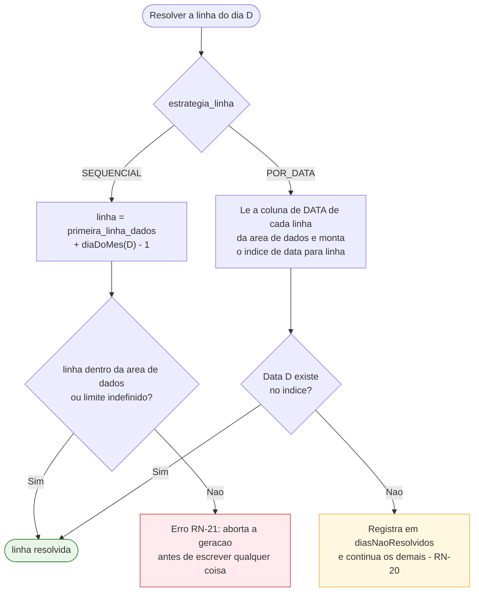

# 10 — Especificação da Planilha

Este é o documento central do projeto. Tudo o que os apps de ponto existentes **não** fazem está
descrito aqui: ensinar o aplicativo a preencher um arquivo Excel arbitrário, criado por outra
pessoa, sem estragá-lo.

Cobre UC-07 e UC-10, os fluxos [A2 e A4](07-fluxos-atividade.md), as sequências
[S1 e S2](08-sequencia-e-estados.md) e as entidades `modelo_planilha`, `mapeamento_coluna`,
`celula_fixa` e `texto_status` de [06](06-modelo-de-dados.md).

---

## 10.1 A anatomia de uma planilha de ponto

Planilhas de ponto de empresas variam muito na aparência, mas quase todas compartilham a mesma
estrutura lógica. Reconhecer essa estrutura é o que torna o mapeamento genérico possível.

```
     A         B          C        D        E        F        G       H
 1  ┌──────────────────────────────────────────────────────────────────┐
 2  │  CONTROLE DE PONTO — MAIO/2026                                   │  ← título
 3  │  Nome: ______________________     Matrícula: ______             │  ← campos únicos
 4  ├────────┬─────────┬────────┬────────┬────────┬────────┬──────────┤
 5  │  DATA  │ DIA SEM │ ENTR.1 │ SAÍD.1 │ ENTR.2 │ SAÍD.2 │  TOTAL   │  ← cabeçalho
 6  │ 01/05  │  sex    │        │        │        │        │          │  ← primeira linha de dados
 7  │ 02/05  │  sáb    │        │        │        │        │          │
 8  │  ...   │         │        │        │        │        │          │
 36 │ 31/05  │  dom    │        │        │        │        │          │  ← última linha de dados
 37 ├────────┴─────────┴────────┴────────┴────────┴────────┼──────────┤
 38 │  TOTAL DO MÊS                                        │ =SOMA(H6:H36) │ ← fórmula
 39 │  Assinatura: ____________________________________               │
    └──────────────────────────────────────────────────────────────────┘
```

Quatro tipos de conteúdo, e o modelo de mapeamento tem uma resposta para cada:

| Tipo | Exemplo | Como o app trata |
|------|---------|------------------|
| **Área de dados tabular** | Linhas 6 a 36 | `mapeamento_coluna` + `estrategia_linha` |
| **Campos únicos** | `B3` nome, `F3` matrícula | `celula_fixa` |
| **Texto para dias especiais** | "FOLGA" escrito sobre as colunas de horário | `texto_status` |
| **Fórmulas e formatação da empresa** | `=SOMA(H6:H36)`, bordas, cores | **Não se toca.** Preservação integral (RN-22) |

O quarto item é o mais importante e o mais fácil de errar: qualquer abordagem que "gere uma planilha
parecida" falha, porque quem recebe é a Renata de [03](03-ux-personas-jornadas.md), cujas fórmulas
de consolidação dependem do arquivo continuar sendo o mesmo arquivo.

---

## 10.2 O modelo de mapeamento

Um modelo de planilha é composto de cinco grupos de informação.

### 1. Localização da área de dados

| Campo | Significado | Exemplo |
|-------|-------------|---------|
| `nome_aba` | Qual aba contém a tabela de dias | `"Maio"` |
| `linha_cabecalho` | Linha com os títulos das colunas. Opcional | `5` |
| `primeira_linha_dados` | Onde o primeiro dia é escrito | `6` |
| `ultima_linha_dados` | Limite da área de dados. Opcional, mas necessário para validar RN-21 | `36` |

### 2. Estratégia de linha

Como o app decide em qual linha escrever cada dia. Esta é a decisão de projeto que resolve a maior
parte da variação entre planilhas.

**`SEQUENCIAL`** — o dia *n* do mês vai na linha `primeira_linha_dados + n - 1`.

> Serve para planilhas emitidas por competência, em que as linhas já correspondem aos dias na
> ordem. É a mais comum e a mais rápida. Falha se a planilha tiver linhas intercaladas — como uma
> linha de subtotal semanal no meio da tabela.

**`POR_DATA`** — o app lê a coluna de data de cada linha da área de dados, monta um índice
`data → linha`, e escreve cada dia na linha correspondente.

> Serve para planilhas com as datas já preenchidas, planilhas anuais, ou tabelas com linhas
> intercaladas. É robusta a qualquer arranjo, desde que as datas estejam lá. Um dia cuja data não
> for encontrada é reportado e ignorado (RN-20), sem interromper os demais.



O índice do modo `POR_DATA` é construído **uma única vez** por geração e reaproveitado para os 31
dias, o que mantém a operação dentro do orçamento de 3 segundos de [RNF-02](02-requisitos.md).

### 3. Colunas dos campos por dia

Cada `CampoColuna` é associado a um índice de coluna base 0. Apenas `DATA` é obrigatória
([RN-18](02-requisitos.md)).

| Campo | O que escreve |
|-------|---------------|
| `DATA` | A data do dia, no `formato_data` do modelo |
| `DIA_SEMANA` | Abreviação em pt-BR: `seg`, `ter`, `qua`, `qui`, `sex`, `sáb`, `dom` |
| `ENTRADA_1` … `SAIDA_3` | Os horários das marcações, em ordem, no `formato_hora` |
| `TOTAL_DIA` | `minutos_trabalhados` do dia |
| `SALDO_DIA` | `saldo_minutos`, com sinal |
| `OBSERVACAO` | A observação do dia |
| `STATUS` | O `texto_status` correspondente, quando o dia não é `NORMAL` |

**Regra de prioridade em coluna compartilhada.** Se `STATUS` e `OBSERVACAO` apontarem para a mesma
coluna — arranjo comum, em que a planilha tem uma única coluna "Obs." — e o dia tiver ambos, escreve
o texto de status. Havendo observação também, ela é concatenada: `"FERIADO — Natal"`. A interface
avisa sobre isso no passo 3 do wizard ([04](04-ux-navegacao-telas.md), TL-18).

**Mais marcações que colunas.** Se o dia tiver 8 marcações e o modelo mapear só até `SAIDA_2`, as
excedentes não cabem. O app escreve as que couberem e acrescenta um aviso ao resultado da geração,
listando os dias truncados. Nunca falha silenciosamente.

### 4. Células fixas

Valores que aparecem uma única vez, endereçados por referência A1.

| Campo | Valor escrito |
|-------|---------------|
| `NOME`, `MATRICULA`, `CARGO`, `EMPRESA` | Do `perfil_usuario` |
| `MES` | Nome do mês por extenso: `"maio"` |
| `ANO` | `"2026"` |
| `COMPETENCIA` | `"maio/2026"` |
| `TOTAL_MES` | Soma de `minutos_trabalhados` da competência |
| `SALDO_MES` | Soma de `saldo_minutos` da competência |
| `BANCO_HORAS` | Banco acumulado até o último dia da competência (RN-15) |
| `DATA_GERACAO` | Data em que o arquivo foi gerado |
| `TEXTO_LIVRE` | O conteúdo de `valor_livre` |

Uma célula fixa cujo dado de origem esteja vazio — matrícula não preenchida no perfil, por exemplo —
é **pulada**, deixando o conteúdo original da planilha intacto. Escrever string vazia apagaria um
rótulo que talvez já estivesse ali.

### 5. Formatos

| `FormatoData` | Resultado para 07/05/2026 |
|---------------|---------------------------|
| `DD_MM_AAAA` | `07/05/2026` |
| `DD_MM` | `07/05` |
| `DD` | `7` |
| `AAAA_MM_DD` | `2026-05-07` |
| `DATA_EXCEL` | número de série `46149`, com o formato da célula preservado |

| `FormatoHora` | Resultado para 8h30 |
|---------------|---------------------|
| `HH_MM` | `08:30` |
| `HH_MM_SS` | `08:30:00` |
| `DECIMAL` | `8,5` |
| `HORA_EXCEL` | fração de dia `0,354166…`, com o formato da célula preservado |

Os formatos `DATA_EXCEL` e `HORA_EXCEL` escrevem **valores nativos**, o que permite que as fórmulas
da empresa somem as colunas corretamente. Os demais escrevem texto. O padrão é texto
(`escrever_como_texto = true`), porque é o comportamento que nunca surpreende; a opção nativa fica
disponível para quem tem uma planilha com fórmulas sobre as horas, e a pré-visualização do passo 5
mostra a diferença imediatamente.

---

## 10.3 O assistente de mapeamento

Cinco passos, detalhados como wireframes em [04, seção 4.4](04-ux-navegacao-telas.md) e como fluxo
em [A2](07-fluxos-atividade.md). Aqui está a especificação funcional de cada um.

### Passo 1 — O arquivo (TL-16)

| | |
|---|---|
| **Mostra** | Área de seleção; após escolher, nome do arquivo, abas encontradas e dimensões |
| **Coleta** | O `.xlsx` |
| **Valida** | Extensão `.xlsx`; arquivo abre; contém ao menos uma aba com conteúdo |
| **Ao avançar** | Copia para a área privada, calcula SHA-256, carrega a estrutura para os próximos passos |
| **Erros** | `.xls` antigo → orienta converter · protegido por senha → informa · corrompido → informa |

O arquivo escolhido pelo usuário **nunca** é modificado nem movido. O app trabalha sobre a cópia.

### Passo 2 — Aba e linhas (TL-17)

| | |
|---|---|
| **Mostra** | Seletor de aba e a `GradePlanilha` com o conteúdo real, com números de linha |
| **Coleta** | Aba, linha de cabeçalho (por toque na linha), primeira e última linha de dados, estratégia |
| **Valida** | `primeira_linha_dados > linha_cabecalho`; a linha de cabeçalho tem ao menos um texto |
| **Infere** | Sugere como cabeçalho a primeira linha com 3 ou mais células de texto não vazias, e como primeira linha de dados a seguinte |
| **Erros** | Nenhum bloqueante; sugestões erradas são corrigidas por toque |

A inferência é uma sugestão, não uma decisão. Ela existe para que o caso comum seja resolvido em um
toque de confirmação, e o caso incomum continue possível.

### Passo 3 — Colunas (TL-18)

| | |
|---|---|
| **Mostra** | Lista de `CampoColuna`, cada um com um seletor que exibe `letra · texto do cabeçalho` |
| **Coleta** | Índice de coluna por campo, ou "não usar" |
| **Valida** | `DATA` obrigatória (RN-18); alerta não bloqueante em coluna repetida |
| **Infere** | Associa campos a colunas por semelhança do texto do cabeçalho, sem acento e sem caixa: `data`, `entrada`/`entr`, `saida`/`saíd`, `total`, `obs` |
| **Erros** | Sem coluna de data → `Continuar` desabilitado com explicação |

### Passo 4 — Células fixas, textos e formatos (TL-19)

| | |
|---|---|
| **Mostra** | Lista de `CampoCelulaFixa` com a referência atual; campos de texto por status; seletores de formato |
| **Coleta** | Referências A1 (por toque na grade), textos de status, formatos de data e hora |
| **Valida** | Referência dentro das dimensões da aba; alerta se a célula alvo contiver fórmula |
| **Erros** | Nenhum bloqueante |

O alerta de fórmula é importante: escrever sobre `=SOMA(H6:H36)` destrói o cálculo da empresa.
O app avisa e deixa a decisão com o usuário, que pode ter um motivo legítimo.

### Passo 5 — Pré-visualização (TL-20)

| | |
|---|---|
| **Mostra** | A planilha renderizada com os valores que o app escreveria, em destaque sobre o conteúdo original |
| **Usa** | A competência com mais dias registrados; não havendo nenhuma, dados de exemplo de um mês fictício completo |
| **Valida** | RN-21 (capacidade de linhas), presença dos campos obrigatórios, resolução de todas as datas no modo `POR_DATA` |
| **Ao salvar** | Desativa o modelo anterior e grava tudo em uma transação (RN-17) |

A pré-visualização usa exatamente o mesmo `PreenchedorPlanilha` da geração real
([09](09-arquitetura-tecnica.md)), operando em memória. Não existe um "modo de simulação" separado
que possa divergir do comportamento real — o que o usuário vê aqui é literalmente o que será
escrito.

---

## 10.4 Algoritmo de preenchimento

Executado por `PreenchedorPlanilha`, em Dart puro, sem tocar em arquivo. Produz um `PlanoDeEscrita`.

```
função preencher(modelo, competencia, dias, perfil, resumo) -> ResultadoPreenchimento

  plano ← PlanoDeEscrita(aba: modelo.nomeAba)
  naoResolvidos ← []
  avisos ← []

  // 1. Validação prévia — falha antes de escrever qualquer coisa (RN-21)
  se modelo.estrategia = SEQUENCIAL e modelo.ultimaLinhaDados ≠ nulo:
      linhasDisponiveis ← modelo.ultimaLinhaDados - modelo.primeiraLinhaDados + 1
      se competencia.totalDias() > linhasDisponiveis:
          retorna Erro(FalhaMapeamento(
              "A competência tem {totalDias} dias, mas a planilha só tem
               {linhasDisponiveis} linhas livres a partir da linha {primeiraLinhaDados}."))

  // 2. Índice de datas, apenas no modo POR_DATA
  indiceDatas ← vazio
  se modelo.estrategia = POR_DATA:
      colunaData ← modelo.colunas[DATA]
      para cada linha de primeiraLinhaDados até ultimaLinhaDados:
          valor ← leitura da célula (linha, colunaData) do arquivo base
          data ← interpretarData(valor)          // texto OU serial do Excel
          se data ≠ nulo: indiceDatas[data] ← linha

  // 3. Um dia de cada vez
  para cada dia em dias:
      linha ← resolverLinha(dia.data, modelo, indiceDatas)
      se linha = nulo:
          naoResolvidos.adicionar(dia.data)      // RN-20
          continua

      escreverColuna(plano, linha, DATA,        formatarData(dia.data, modelo.formatoData))
      escreverColuna(plano, linha, DIA_SEMANA,  abreviacaoDiaSemana(dia.data))

      se dia.status ≠ NORMAL e existe texto para o status:
          texto ← modelo.textosStatus[dia.status]
          colunaAlvo ← modelo.colunas[STATUS] ?? modelo.colunas[ENTRADA_1]
          escreverEm(plano, linha, colunaAlvo, texto)
          limparColunasDeHorario(plano, linha, modelo, exceto: colunaAlvo)
      senão:
          // marcações em pares, na ordem: ENTRADA_1, SAIDA_1, ENTRADA_2, ...
          para i de 0 até min(dia.marcacoes.length, 6) - 1:
              campo ← CAMPOS_HORARIO[i]
              escreverColuna(plano, linha, campo,
                             formatarHora(dia.marcacoes[i].hora, modelo.formatoHora))
          se dia.marcacoes.length > 6 e modelo mapeia menos colunas que o necessário:
              avisos.adicionar("O dia {data} tem mais marcações do que a planilha comporta.")

      escreverColuna(plano, linha, TOTAL_DIA, formatarDuracao(dia.minutosTrabalhados, modelo))
      escreverColuna(plano, linha, SALDO_DIA, formatarDuracaoComSinal(dia.saldo, modelo))

      textoObs ← dia.observacao
      se modelo.colunas[OBSERVACAO] = modelo.colunas[STATUS] e há texto de status:
          textoObs ← textoStatus + (observação vazia ? "" : " — " + observação)
      escreverColuna(plano, linha, OBSERVACAO, textoObs)

  // 4. Células fixas — puladas quando o dado de origem é vazio
  para cada (campo, referencia) em modelo.celulasFixas:
      valor ← resolverCelulaFixa(campo, perfil, competencia, resumo)
      se valor não é vazio:
          plano.celulas[referencia] ← valor

  retorna ResultadoPreenchimento(plano, naoResolvidos, avisos)
```

`escreverColuna` não faz nada quando o campo não está mapeado — é o que torna todos os campos além
de `DATA` opcionais sem espalhar verificações pelo algoritmo.

`limparColunasDeHorario` escreve célula vazia nas colunas de horário mapeadas, garantindo que um dia
de folga não herde valores que porventura já estivessem no modelo.

**O valor de uma célula é tipado**, e é isso que permite ao escritor decidir como serializar:

```dart
sealed class ValorCelula { }
final class TextoCelula   extends ValorCelula { final String texto; }
final class NumeroCelula  extends ValorCelula { final num valor; }
final class DataCelula    extends ValorCelula { final DateTime data; }   // vira serial
final class HoraCelula    extends ValorCelula { final Duration hora; }   // vira fração de dia
final class VaziaCelula   extends ValorCelula { }
```

---

## 10.5 Estratégia de escrita do `.xlsx`

Este é o **maior risco técnico do projeto** ([R-01](15-riscos-e-decisoes.md)) e o ponto onde a
maioria das soluções ingênuas falha.

### Por que não usar um pacote de alto nível para escrever

O pacote `excel` do Dart lê a pasta de trabalho para um modelo em memória e a **reserializa por
inteiro** ao salvar. Tudo que o modelo dele não representa se perde no caminho: formatação
condicional, validação de dados, células mescladas em certos arranjos, imagens, cabeçalhos e
rodapés de impressão, e — o mais grave — fórmulas. Uma planilha corporativa de ponto tem quase todos
esses elementos.

O resultado seria um arquivo que **abre**, tem os dados certos, e mesmo assim é rejeitado por quem
recebe, porque as bordas sumiram e o `=SOMA()` do total do mês virou um número fixo. Isso violaria
[RN-22](02-requisitos.md) e falharia com a persona Renata — ou seja, falharia no objetivo do
produto, mesmo tendo "funcionado" tecnicamente.

### A abordagem adotada: edição cirúrgica do XML

Um arquivo `.xlsx` é um arquivo ZIP contendo XML:

```
ponto_maio.xlsx
├── [Content_Types].xml
├── _rels/.rels
└── xl/
    ├── workbook.xml            ← lista de abas, configurações de cálculo
    ├── _rels/workbook.xml.rels ← liga cada aba ao seu arquivo
    ├── styles.xml              ← TODA a formatação. Nunca tocado.
    ├── sharedStrings.xml       ← tabela de textos. Nunca tocada (ver abaixo).
    └── worksheets/
        ├── sheet1.xml          ← as células. O ÚNICO arquivo alterado.
        └── sheet2.xml
```

`EscritorXlsxZip` descompacta em memória, altera **apenas** `xl/worksheets/sheetN.xml` da aba alvo,
e recompacta com todas as demais entradas byte a byte idênticas. Tudo que não foi explicitamente
escrito continua exatamente como estava — porque literalmente é o mesmo dado.

**Como uma célula é alterada, preservando a formatação**

Uma célula no XML tem esta forma:

```xml
<c r="D6" s="42" t="s"><v>17</v></c>
```

- `r` — a referência A1.
- `s` — o índice do estilo em `styles.xml`. **É o que carrega borda, fonte, cor e formato de
  número.** É preservado sem alteração; é a chave da fidelidade visual.
- `t` — o tipo do valor.

Para escrever texto, o escritor usa `t="inlineStr"`, que embute a string na própria célula:

```xml
<c r="D6" s="42" t="inlineStr"><is><t>08:00</t></is></c>
```

Isso evita mexer em `sharedStrings.xml` — que exigiria reindexar a tabela inteira e é uma fonte
clássica de corrupção. `inlineStr` é parte do padrão OOXML e o Excel o lê sem qualquer ressalva.

Para escrever valor nativo (`DATA_EXCEL`, `HORA_EXCEL`, números), omite-se `t`:

```xml
<c r="D6" s="42"><v>0.3541666666666667</v></c>
```

O `s="42"` preservado faz o Excel exibir `08:00` se a célula já estava formatada como hora — o
usuário obtém o valor nativo **com a aparência que a empresa definiu**.

**Inserção de célula ou linha inexistente.** Se `<c r="D6">` não existir, é inserida no `<row>`
correto, em ordem crescente de coluna. Se a `<row r="6">` não existir, é inserida em `<sheetData>`
em ordem crescente de linha. A ordem é obrigatória pelo padrão; o Excel rejeita o arquivo se ela for
violada. Células novas nascem sem `s`, herdando o estilo padrão — daí a preferência por planilhas
que já tenham a grade formatada, que é o caso normal.

**Fórmulas.** Ao escrever sobre uma célula que contém `<f>`, o escritor remove o elemento `<f>` —
não faz sentido manter uma fórmula e um valor fixo conflitantes — e registra um aviso. Além disso,
para que as fórmulas **não sobrescritas** recalculem ao abrir:

- a entrada `xl/calcChain.xml` é removida do zip, se existir;
- `<calcPr>` em `workbook.xml` recebe `fullCalcOnLoad="1"`.

Sem isso, o total do mês continuaria exibindo o valor em cache de quando a planilha foi salva vazia,
e o usuário abriria um arquivo com todos os dias preenchidos e total zero.

**Escape de XML.** Todo texto escrito passa por escape de `&`, `<`, `>`. Uma observação com "P&D"
corromperia o arquivo sem isso.

### Contrato e verificação

```dart
abstract interface class EscritorXlsx {
  Future<Resultado<Uint8List>> aplicar(Uint8List modeloBase, PlanoDeEscrita plano);
}
```

O escritor é a única classe do sistema que conhece o formato `.xlsx`
([09, seção 9.4](09-arquitetura-tecnica.md)). Trocá-lo não afeta nenhum teste do preenchedor.

Os testes obrigatórios dele estão em [14](14-testes-e-qualidade.md) e incluem o mais importante de
todos: **gerar a partir de um modelo com fórmulas e formatação e verificar, descompactando o
resultado, que `styles.xml` e `sharedStrings.xml` são byte a byte idênticos ao original.**

### Plano de contingência

Se a validação do spike [S-01](15-riscos-e-decisoes.md) mostrar que a edição cirúrgica não cobre
algum caso real da planilha do usuário, a ordem de recuo é:

1. Usar `excel` para escrever e aceitar a perda de formatação **apenas** se o teste com a planilha
   real da empresa mostrar que nada relevante se perde.
2. Restringir o escopo a planilhas sem fórmulas, avisando o usuário no wizard.
3. Gerar um `.csv` auxiliar junto com o `.xlsx`, para conferência manual.

A opção 1 é aceitável somente com evidência; sem ela, mantém-se a edição cirúrgica.

---

## 10.6 Casos de erro

| Situação | Momento | Comportamento | Mensagem ao usuário |
|----------|---------|---------------|---------------------|
| Arquivo `.xls` antigo | Passo 1 | Recusa | "Este arquivo é `.xls`, um formato antigo do Excel. Abra no Excel e salve como `.xlsx` para continuar." |
| Arquivo protegido por senha | Passo 1 | Recusa | "Não consegui ler esta planilha. Ela pode estar protegida por senha ou danificada." |
| Arquivo corrompido ou não é zip | Passo 1 | Recusa | Idem |
| Planilha sem nenhuma aba com conteúdo | Passo 1 | Recusa | "Esta planilha está vazia." |
| Coluna de data não mapeada | Passo 3 | Bloqueia o avanço | "Escolha a coluna da data para continuar. Sem ela o app não sabe onde escrever cada dia." |
| Duas colunas iguais | Passo 3 | Alerta, não bloqueia | "Observação e Status vão para a mesma coluna. O status tem prioridade." |
| Célula fixa fora das dimensões | Passo 4 | Bloqueia o campo | "A célula `Z99` não existe nesta aba." |
| Célula fixa sobre fórmula | Passo 4 | Alerta, não bloqueia | "A célula `H38` tem uma fórmula. Escrever nela vai apagá-la." |
| Dias não cabem nas linhas | Passo 5 / geração | Aborta antes de escrever | "A competência tem 31 dias, mas a planilha só tem 28 linhas livres a partir da linha 6." |
| Data não encontrada (`POR_DATA`) | Geração | Continua, reporta | "Não achei a linha do dia 15/05 na planilha. Esse dia ficou de fora." |
| Mais marcações que colunas | Geração | Trunca, reporta | "O dia 12/05 tem 6 marcações, mas a planilha comporta 4. As últimas ficaram de fora." |
| Arquivo base sumiu | Geração | Bloqueia | "A planilha modelo não está mais no aparelho. Importe o arquivo de novo." |
| Hash do arquivo base mudou | Geração | Alerta, não bloqueia | "O arquivo modelo mudou desde que você configurou. Confira se o mapeamento ainda está certo." |
| Falha ao gravar o arquivo gerado | Geração | Remove parciais, aborta | "Não consegui salvar a planilha. Verifique o espaço disponível no aparelho." |

Nenhum destes casos deixa o sistema em estado inválido: o modelo salvo permanece íntegro e o
arquivo base jamais é alterado ([RNF-06](02-requisitos.md), [RN-22](02-requisitos.md)).
