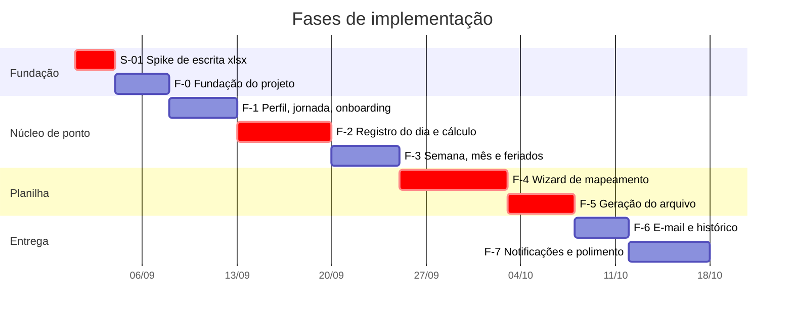

# 13 — Plano de Implementação

Este documento é o roteiro de execução. Ele existe para ser seguido em ordem, por um humano ou por
um agente de IA, com cada tarefa apontando os documentos que a especificam. Instruções operacionais
complementares estão em [`../CLAUDE.md`](../CLAUDE.md).

## 13.1 Regras do plano

1. **As fases são executadas em ordem.** Cada uma depende do que a anterior deixou pronto.
2. **Uma fase só termina quando seu "Pronto quando" está inteiramente satisfeito** — incluindo os
   testes. Não se avança com dívida aberta.
3. **Cada fase é entregável.** Ao final de qualquer uma, o app compila, roda e faz algo útil. Se o
   projeto parar na F-3, existe um app de ponto funcional; se parar na F-5, existe o produto
   inteiro exceto o e-mail.
4. **Nenhum campo, tabela ou enum é criado sem estar em [06](06-modelo-de-dados.md).** Se algo
   faltar, a correção é atualizar o documento 06 primeiro.
5. **Nenhuma regra de cálculo é escrita fora de `CalculadoraPonto`**, e ela segue exatamente
   [12](12-regras-de-calculo.md).
6. **Funcionalidades listadas como fora de escopo em [01](01-visao-e-escopo.md) não são
   implementadas**, nem "já que estamos aqui".

## 13.2 Visão geral



As durações são estimativas de esforço relativo, não compromissos de calendário. Os três marcos
críticos são S-01, F-2 e F-4: o primeiro decide se a abordagem técnica se sustenta, o segundo é o
núcleo do domínio, e o terceiro é a funcionalidade que diferencia o produto.

---

## S-01 — Spike: escrita do `.xlsx` preservando formatação

**Esta é a primeira coisa a fazer, antes de qualquer outra linha de código de produção.**
É uma investigação com prazo fixo, cujo resultado pode alterar todo o restante do plano.

**Pergunta a responder.** É possível, em Dart, abrir um `.xlsx` real de ponto, escrever valores em
células específicas e salvá-lo de forma que o Excel o abra com toda a formatação, as fórmulas e as
demais abas intactas?

**Como executar**
1. Obter um `.xlsx` real de ponto — de preferência o da empresa do autor — com bordas, células
   mescladas, ao menos uma fórmula de soma e formatação de hora nas células.
2. Escrever um script Dart isolado (fora de `lib/`, em `tool/spike_xlsx.dart`) que:
   descompacte com `archive`, altere `xl/worksheets/sheet1.xml` com `xml` conforme
   [10, seção 10.5](10-especificacao-planilha.md), remova `calcChain.xml`, marque
   `fullCalcOnLoad="1"` e recompacte.
3. Escrever texto via `t="inlineStr"` e valor nativo sem `t`, preservando o atributo `s`.
4. Abrir o resultado no Excel **e** no LibreOffice.

**Critérios de aprovação** — todos obrigatórios:
- [ ] O arquivo abre sem aviso de reparo em ambos os programas.
- [ ] Bordas, cores, fontes e mesclagens estão idênticas ao original.
- [ ] As fórmulas não sobrescritas continuam existindo e recalculam com os novos valores.
- [ ] `xl/styles.xml` e `xl/sharedStrings.xml` são byte a byte idênticos aos do original.
- [ ] Escrever em uma célula que não existia no XML funciona e não corrompe o arquivo.

**Se falhar.** Seguir a ordem de recuo de [10, seção 10.5](10-especificacao-planilha.md) e
registrar a decisão como uma nova ADR em [15](15-riscos-e-decisoes.md). Reduzir o escopo é
aceitável; entregar um arquivo que o RH rejeita não é.

---

## F-0 — Fundação do projeto

**Objetivo.** Deixar o esqueleto pronto para receber funcionalidade: dependências, camadas, banco,
tema, navegação.

| Tarefa | Descrição | Especificação |
|--------|-----------|---------------|
| T-001 | Adicionar as dependências da fase F-0 com `flutter pub add` e fixar as versões resolvidas | [09, 9.3](09-arquitetura-tecnica.md) |
| T-002 | Criar a árvore de pastas de `lib/` e `test/` | [09, 9.2](09-arquitetura-tecnica.md) |
| T-003 | Implementar `core/`: `Resultado`, hierarquia de `Falha`, formatadores, extensões | [09, 9.5](09-arquitetura-tecnica.md), [12, 12.10](12-regras-de-calculo.md) |
| T-004 | Criar os enums de domínio | [06, 6.3](06-modelo-de-dados.md) |
| T-005 | Criar as entidades de domínio imutáveis com `copiaCom` | [06, 6.5](06-modelo-de-dados.md) |
| T-006 | Definir as tabelas Drift, conversores e índices | [06, 6.4 e 6.6](06-modelo-de-dados.md) |
| T-007 | Implementar `BancoLocal` com esquema versão 1, migração e seeds | [06, 6.7](06-modelo-de-dados.md) |
| T-008 | Configurar o tema claro e escuro com a paleta e a tipografia definidas | [04, 4.5](04-ux-navegacao-telas.md) |
| T-009 | Configurar `GoRouter` com as três abas e o redirecionamento de onboarding | [09, 9.7](09-arquitetura-tecnica.md) |
| T-010 | Configurar `main.dart`, `ProviderScope` e a sobrescrita de `bancoLocalProvider` | [09, 9.6](09-arquitetura-tecnica.md) |
| T-011 | Configurar `minSdk 26`, `applicationId` e o rótulo do app no Android | [02, RNF-08](02-requisitos.md) |
| T-012 | Escrever os testes de `formatarDuracao`, `formatarDuracaoComSinal` e `formatarHora` | [12, 12.10](12-regras-de-calculo.md) |

**Pronto quando**
- `flutter analyze` não reporta nada; `flutter test` passa.
- O app abre nas três abas vazias, com tema claro e escuro corretos.
- O banco é criado com os dados semeados, verificável por um teste de repositório.

---

## F-1 — Perfil, jornada e onboarding

**Objetivo.** O usuário consegue dizer quem é e qual é o seu horário. Realiza UC-01, UC-02, UC-03.

| Tarefa | Descrição | Especificação |
|--------|-----------|---------------|
| T-101 | `PerfilRepositorio` e `JornadaRepositorio` — contrato e implementação Drift | [09, 9.4](09-arquitetura-tecnica.md) |
| T-102 | TL-02 Seus dados: formulário e validação | [04](04-ux-navegacao-telas.md), RF-01 |
| T-103 | TL-13 Jornada de trabalho: lista dos sete dias, tolerância, virada de dia, total semanal | RF-04, RF-06, RF-07 |
| T-104 | TL-14 Dia da semana: turnos previstos, cálculo da carga, sobrescrita manual | RF-04, RF-05 |
| T-105 | TL-01 a TL-05: fluxo de onboarding com pular etapa | [A1](07-fluxos-atividade.md) |
| T-106 | Cartões de pendência no topo de TL-12 para etapas puladas | [A1](07-fluxos-atividade.md) |
| T-107 | TL-12 Configurações: índice de navegação | [04, 4.3](04-ux-navegacao-telas.md) |
| T-108 | Testes de repositório de perfil e jornada com banco em memória | [14](14-testes-e-qualidade.md) |

**Critérios de aceite**

```gherkin
Cenário: Primeira execução leva ao onboarding
  Dado que o aplicativo nunca foi configurado
  Quando eu abro o aplicativo
  Então vejo a tela de boas-vindas

Cenário: Pular etapas não impede o uso
  Dado que estou no onboarding
  Quando pulo todas as etapas
  Então chego à aba Dia
  E vejo um cartão de pendência para cada etapa pulada na aba Configurações

Cenário: A carga horária é derivada dos turnos
  Dado que estou configurando a quinta-feira
  Quando informo os turnos 08:00 às 12:00 e 13:00 às 17:00
  Então a carga horária exibida é 08h 00m
```

**Pronto quando** — o onboarding completa, os dados persistem entre execuções, e a jornada semeada
pode ser alterada e recarregada corretamente.

---

## F-2 — Registro do dia e cálculo

**Objetivo.** O app vira um app de ponto utilizável. Realiza UC-04, UC-05, UC-06 e o fluxo
[A3](07-fluxos-atividade.md). É a fase mais importante do núcleo.

| Tarefa | Descrição | Especificação |
|--------|-----------|---------------|
| T-201 | `CalculadoraPontoPadrao`: `calcularDia`, `previsaoSaida`, turnos e intervalos | [12, 12.3](12-regras-de-calculo.md), [A5](07-fluxos-atividade.md) |
| T-202 | **Testes da calculadora: uma tabela de casos de [12](12-regras-de-calculo.md) por grupo de testes** | 12.4 a 12.9 |
| T-203 | `DiaRepositorio` — contrato e implementação, com recálculo após cada escrita | [09, 9.4](09-arquitetura-tecnica.md) |
| T-204 | `LinhaDoTempoMarcacoes`: turnos, intervalos, previsão de saída, deslizar para ações | [04, 4.4](04-ux-navegacao-telas.md) |
| T-205 | `CartaoResumo` e `SeletorPeriodo` | [04, 4.5](04-ux-navegacao-telas.md) |
| T-206 | TL-06 Dia: montagem completa, relógio vivo, estado vazio | RF-12, RF-18, RF-19 |
| T-207 | Bater ponto com inferência de tipo e desfazer em 5 segundos | RN-06, [A3](07-fluxos-atividade.md) |
| T-208 | TL-09 Marcação: criar e editar, com validação de RN-03 e RN-04 | RF-09, RF-10 |
| T-209 | Excluir marcação com confirmação e recálculo | RF-11, RN-05 |
| T-210 | TL-10 Editar dia: status e observação | RF-13, RN-12, RN-13 |
| T-211 | Sinalização visual de dia inconsistente | RF-14, RN-02 |
| T-212 | Widget test de TL-06 com repositório falso | [14](14-testes-e-qualidade.md) |

**Critérios de aceite**

```gherkin
Cenário: Bater ponto alterna entre entrada e saída
  Dado que o dia de hoje não tem nenhuma marcação
  Quando toco em bater ponto
  Então é registrada uma ENTRADA com a hora atual
  Quando toco em bater ponto de novo
  Então é registrada uma SAÍDA

Cenário: Marcação fora de ordem é reordenada
  Dado que o dia tem uma marcação às 13:00
  Quando adiciono uma marcação às 08:00
  Então a marcação das 08:00 é a primeira e é do tipo ENTRADA
  E a marcação das 13:00 é a segunda e é do tipo SAÍDA

Cenário: Horário futuro é recusado
  Dado que agora são 10:00
  Quando tento registrar uma marcação às 14:00 de hoje
  Então vejo "Não dá para registrar um horário que ainda não aconteceu"
  E nenhuma marcação é criada

Cenário: Dia útil sem a saída fica inconsistente
  Dado um dia útil passado com as marcações 08:00, 12:00 e 13:00
  Quando abro esse dia
  Então ele é exibido como inconsistente
  E o total trabalhado é 04h 00m
```

**Pronto quando** — **todas** as tabelas de casos de [12](12-regras-de-calculo.md) passam como
testes automatizados, e o registro diário funciona ponta a ponta em aparelho real.

---

## F-3 — Semana, mês e feriados

**Objetivo.** Consultar o histórico e ver o saldo acumulado. Realiza UC-08 e UC-09.

| Tarefa | Descrição | Especificação |
|--------|-----------|---------------|
| T-301 | `calcularPeriodo` e `bancoAcumuladoAte` com testes | [12, 12.3 e 12.9](12-regras-de-calculo.md) |
| T-302 | Consultas de intervalo e de competência no repositório, com índice por data | [06, 6.6](06-modelo-de-dados.md) |
| T-303 | TL-07 Semana | RF-16 |
| T-304 | TL-08 Mês em calendário, com indicadores por dia | RF-17, RF-21 |
| T-305 | Navegação entre períodos e salto para hoje, em todas as visões | RF-18 |
| T-306 | `FeriadoRepositorio` e TL-15 Feriados | RF-20, RF-22 |
| T-307 | Aplicação automática do status FERIADO sem sobrescrever status manual | RN-27 |
| T-308 | Fechar e reabrir o dia | RF-15, RN-28 |
| T-309 | Teste de desempenho: carregar um mês com 31 dias preenchidos | RNF-02 |

**Critérios de aceite**

```gherkin
Cenário: Feriado não sobrescreve status manual
  Dado que o dia 07/09 está marcado manualmente como FERIAS
  Quando eu cadastro o feriado nacional de 07/09
  Então o dia 07/09 continua com o status FERIAS

Cenário: O mês carrega dentro do orçamento de desempenho
  Dado um mês com 31 dias e 124 marcações
  Quando abro a visão de mês
  Então o carregamento leva menos de 300 ms
```

**Pronto quando** — as três visões navegam entre si mantendo a data selecionada, e os totais batem
com a tabela de banco de horas de [12, 12.9](12-regras-de-calculo.md).

---

## F-4 — Wizard de mapeamento da planilha

**Objetivo.** O app aprende o formato da planilha da empresa. Realiza UC-07 e o fluxo
[A2](07-fluxos-atividade.md). É a fase que diferencia o produto.

| Tarefa | Descrição | Especificação |
|--------|-----------|---------------|
| T-401 | `LeitorPlanilha`: abas, dimensões, matriz de valores, detecção de fórmula | [10, 10.3](10-especificacao-planilha.md) |
| T-402 | `ReferenciaCelula`: conversão A1 ↔ (linha, coluna), com testes de `Z`, `AA`, `AB` | [10](10-especificacao-planilha.md) |
| T-403 | `ArmazenamentoArquivos`: cópia para a área privada e SHA-256 | [09, 9.9](09-arquitetura-tecnica.md) |
| T-404 | `GradePlanilha` com os três modos de seleção: linha, coluna e célula | [04, 4.5](04-ux-navegacao-telas.md) |
| T-405 | TL-16 Passo 1: seleção e validação do arquivo | RF-23, RF-32 |
| T-406 | TL-17 Passo 2: aba, linhas e estratégia, com inferência do cabeçalho | RF-24, RF-25 |
| T-407 | TL-18 Passo 3: mapeamento de colunas, com inferência por texto do cabeçalho | RF-26, RN-18 |
| T-408 | TL-19 Passo 4: células fixas, textos de status e formatos | RF-27, RF-28, RF-29 |
| T-409 | `PreenchedorPlanilha` completo | [10, 10.4](10-especificacao-planilha.md) |
| T-410 | **Testes do preenchedor: as duas estratégias, RN-20, RN-21, prioridade de coluna, truncamento** | [10, 10.4](10-especificacao-planilha.md) |
| T-411 | TL-20 Passo 5: pré-visualização usando o preenchedor real | RF-30 |
| T-412 | `ValidadorModelo` e a tabela de erros do wizard | [10, 10.6](10-especificacao-planilha.md) |
| T-413 | `ModeloPlanilhaRepositorio` com salvamento transacional e RN-17 | [S1](08-sequencia-e-estados.md) |
| T-414 | Edição do modelo salvo a partir de TL-12 e substituição de arquivo | RF-31, RF-32 |

**Critérios de aceite**

```gherkin
Cenário: A coluna de data é obrigatória
  Dado que estou no passo 3 do assistente
  Quando não mapeio a coluna de data
  Então o botão Continuar fica desabilitado
  E vejo a explicação de por que ela é necessária

Cenário: A pré-visualização mostra o preenchimento real
  Dado um modelo mapeado com estratégia sequencial a partir da linha 6
  E uma competência com marcações no dia 1
  Quando chego ao passo 5
  Então vejo 08:00 na linha 6, na coluna mapeada como primeira entrada

Cenário: Cancelar não destrói o modelo existente
  Dado que já existe um modelo de planilha salvo
  Quando inicio um novo assistente e cancelo no passo 4
  Então o modelo anterior continua ativo e inalterado

Cenário: Dias que não cabem são detectados antes de salvar
  Dado uma planilha cuja área de dados tem 28 linhas
  E a estratégia sequencial
  Quando a pré-visualização usa uma competência de 31 dias
  Então vejo a mensagem com a contagem exata de dias e de linhas
```

**Pronto quando** — é possível configurar um `.xlsx` real de ponto do começo ao fim em menos de
cinco minutos ([RNF-12](02-requisitos.md)), e a pré-visualização mostra o preenchimento correto.

---

## F-5 — Geração do arquivo

**Objetivo.** Produzir o `.xlsx` preenchido. Realiza UC-10 e o trecho de geração de
[A4](07-fluxos-atividade.md).

| Tarefa | Descrição | Especificação |
|--------|-----------|---------------|
| T-501 | `EscritorXlsxZip` a partir do resultado de S-01 | [10, 10.5](10-especificacao-planilha.md) |
| T-502 | **Teste de preservação: `styles.xml` e `sharedStrings.xml` byte a byte idênticos** | [14](14-testes-e-qualidade.md) |
| T-503 | Teste de fórmula: soma não sobrescrita recalcula com os novos valores | [10, 10.5](10-especificacao-planilha.md) |
| T-504 | `GeradorPendencias` e a lista de pendências da competência | [12, 12.3](12-regras-de-calculo.md), RF-34 |
| T-505 | TL-21 Fechamento do mês: resumo, pendências e estado inicial | RF-33, RF-34 |
| T-506 | Confirmação de geração com pendências | RF-35, RN-19 |
| T-507 | Gravação do arquivo com nome resolvido pelo template | RF-36, [11, 11.1](11-especificacao-email-e-envio.md) |
| T-508 | `EnvioRepositorio` e o registro com status GERADO | RN-24 |
| T-509 | Abrir e compartilhar o arquivo gerado | RF-37 |
| T-510 | Tratamento de todos os erros de geração da tabela de [10, 10.6](10-especificacao-planilha.md) | RNF-06 |

**Critérios de aceite**

```gherkin
Cenário: A formatação da empresa é preservada
  Dado um modelo com bordas, células mescladas e uma fórmula de soma
  Quando gero a planilha de uma competência
  Então o arquivo gerado abre no Excel sem aviso de reparo
  E a formatação está idêntica ao modelo
  E a fórmula de soma continua existindo e reflete os novos valores

Cenário: O arquivo modelo nunca é alterado
  Dado um modelo com um hash conhecido
  Quando gero a planilha três vezes seguidas
  Então o hash do arquivo modelo continua o mesmo

Cenário: Falha na escrita não deixa resíduo
  Dado que a gravação do arquivo falha
  Quando a geração é interrompida
  Então nenhum arquivo parcial permanece no dispositivo
  E nenhum registro de envio é criado
```

**Pronto quando** — o autor gera a planilha real da própria empresa e a abre no Excel sem qualquer
diferença visual em relação ao modelo.

---

## F-6 — E-mail e histórico

**Objetivo.** Fechar o ciclo. Realiza UC-11 e UC-12.

| Tarefa | Descrição | Especificação |
|--------|-----------|---------------|
| T-601 | `ResolvedorVariaveis` com todas as variáveis e as regras de resolução | [11, 11.1](11-especificacao-email-e-envio.md) |
| T-602 | Testes do resolvedor: variável desconhecida, origem vazia, saneamento do nome de arquivo | [11, 11.1](11-especificacao-email-e-envio.md) |
| T-603 | TL-22 Configuração de e-mail, com pré-visualização | RF-38, RF-39 |
| T-604 | **`FileProvider`, `file_paths.xml` e `queries` no `AndroidManifest.xml`** | [11, 11.3](11-especificacao-email-e-envio.md) |
| T-605 | `ServicoEmailAndroid` com `flutter_email_sender` | RF-40 |
| T-606 | Alternativa por `share_plus` quando não há cliente de e-mail | [11, 11.3](11-especificacao-email-e-envio.md) |
| T-607 | Diálogo de confirmação de envio e transição para ENVIADO | RF-41, RN-23 |
| T-608 | TL-23 Histórico de envios, com abrir, compartilhar, regerar e excluir | RF-42, RF-43 |
| T-609 | Reexibição da pergunta de confirmação em competência pendente | [S3](08-sequencia-e-estados.md) |

**Critérios de aceite**

```gherkin
Cenário: O cliente de e-mail abre preenchido
  Dado uma competência gerada e um destinatário configurado
  Quando toco em enviar por e-mail
  Então o cliente de e-mail abre com destinatário, assunto, corpo e o anexo

Cenário: O app não afirma o que não sabe
  Dado que voltei do cliente de e-mail
  Quando o aplicativo volta ao primeiro plano
  Então sou perguntado se consegui enviar
  E o status só muda para ENVIADO se eu confirmar

Cenário: Sem cliente de e-mail existe alternativa
  Dado um aparelho sem nenhum aplicativo de e-mail
  Quando toco em enviar por e-mail
  Então vejo a explicação e a opção de compartilhar o arquivo
```

**Pronto quando** — o autor envia a planilha real ao RH pelo app, e o RH a aceita sem pedir
correção. Este é o critério de sucesso número 2 de [01, seção 1.9](01-visao-e-escopo.md).

---

## F-7 — Notificações, backup e polimento

**Objetivo.** Eliminar o esquecimento e fechar as pontas. Realiza UC-13 e UC-14.

| Tarefa | Descrição | Especificação |
|--------|-----------|---------------|
| T-701 | `ServicoNotificacoes` com `flutter_local_notifications` e `timezone` | [A6](07-fluxos-atividade.md) |
| T-702 | Permissão de notificação no Android 13+ e tratamento de negação | UC-13, exceção E1 |
| T-703 | TL-24 Notificações: lembretes de jornada com antecedência | RF-44, RF-47 |
| T-704 | Lembrete de fechamento com dia de referência e escalonamento | RF-45, [11, 11.6](11-especificacao-email-e-envio.md) |
| T-705 | Supressão no disparo conforme RN-30 e status já cumprido | [A6](07-fluxos-atividade.md) |
| T-706 | Notificação de dia incompleto | RF-46 |
| T-707 | `ServicoBackup`: exportar banco e arquivo modelo em um único arquivo | RF-48 |
| T-708 | Restaurar backup com confirmação e validação da versão do esquema | RF-49 |
| T-709 | TL-25 Backup e alternância de tema em TL-12 | RF-02, RF-48, RF-49 |
| T-710 | **Percorrer o checklist de acessibilidade de [04, 4.8](04-ux-navegacao-telas.md) em todas as telas** | RNF-03 |
| T-711 | Revisão do microcopy: toda mensagem de erro do app confere com [04, 4.6](04-ux-navegacao-telas.md) | RNF-07 |
| T-712 | Ícone, nome e tela de abertura do aplicativo | — |

**Critérios de aceite**

```gherkin
Cenário: O lembrete de fechamento chega e leva direto ao lugar certo
  Dado que hoje é o último dia do mês e o lembrete está ativo
  Quando chega o horário configurado
  Então recebo a notificação de fechamento
  Quando toco na notificação
  Então o aplicativo abre no fechamento da competência que está terminando

Cenário: O lembrete se cala quando não é mais necessário
  Dado que a competência já foi enviada e confirmada
  Quando chega o horário do lembrete de fechamento
  Então nenhuma notificação é exibida

Cenário: Folga não gera lembrete de jornada
  Dado que hoje está marcado como FOLGA
  Quando chega a hora de começar configurada
  Então nenhuma notificação é exibida
```

**Pronto quando** — o checklist de acessibilidade está integralmente marcado, o backup exportado
restaura corretamente em uma instalação limpa, e nenhuma mensagem da interface diverge de
[04, seção 4.6](04-ux-navegacao-telas.md).

---

## 13.3 Definição de pronto (todas as fases)

Uma tarefa só está concluída quando:

- [ ] `flutter analyze` não reporta nada.
- [ ] `flutter test` passa por inteiro.
- [ ] Toda regra de negócio implementada tem teste que a exercita, incluindo o caso de borda.
- [ ] Nenhum campo ou tabela foi criado sem constar em [06](06-modelo-de-dados.md).
- [ ] Nenhum texto de interface está em inglês.
- [ ] Nenhuma mensagem de erro exibe código técnico, `null` ou stack trace.
- [ ] Alvos de toque têm 48 dp e ícones acionáveis têm `Semantics`.
- [ ] A tela funciona nos temas claro e escuro.
- [ ] Nenhum `TODO` ou código comentado foi deixado para trás.
- [ ] `presentation/` não importa `data/`, e `domain/` não importa Flutter nem Drift.

## 13.4 Ordem de leitura por tipo de tarefa

Para quem — ou o que — for executar uma tarefa, esta é a documentação mínima a carregar antes:

| Tipo de tarefa | Ler antes |
|----------------|-----------|
| Criar entidade, tabela ou migração | 06 |
| Implementar cálculo de horas | 12, depois 06 |
| Construir tela | 04 (wireframe e microcopy), depois 05 (o caso de uso) |
| Trabalhar no wizard de planilha | 10, depois 04 (TL-16 a TL-20) e 07 (A2) |
| Trabalhar na geração do arquivo | 10 (seções 10.4 e 10.5), depois 08 (S2) |
| Trabalhar em e-mail ou histórico | 11, depois 08 (S3) |
| Trabalhar em notificações | 07 (A6), depois 11 (seção 11.6) |
| Criar repositório ou serviço | 09 (seções 9.4 e 9.5), depois 06 |
| Escrever teste | 14, depois o documento da regra em questão |
