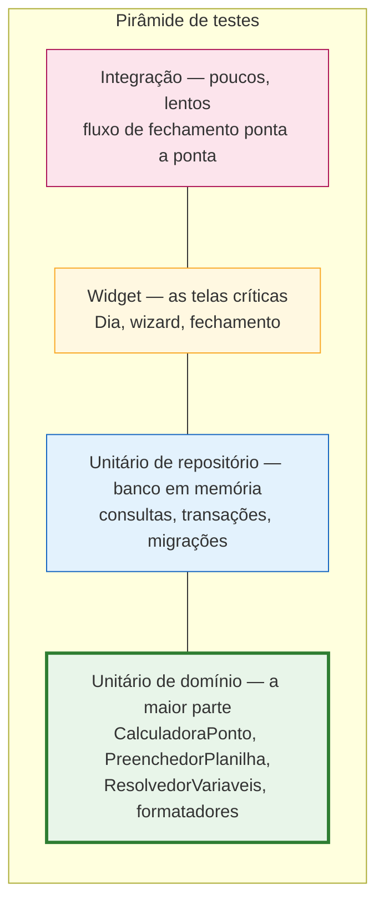

# 14 — Testes e Qualidade

## 14.1 Estratégia

O desenho de camadas de [09](09-arquitetura-tecnica.md) foi feito para que o que **mais importa**
seja o que **mais fácil se testa**. As duas coisas que, se estiverem erradas, arruínam o produto —
o cálculo de horas e o preenchimento da planilha — são Dart puro, sem I/O, sem Flutter e sem banco.
Elas concentram o esforço de teste.



| Nível | Ferramenta | Onde | Roda com |
|-------|-----------|------|----------|
| Domínio | `flutter_test` | `test/domain/` | `flutter test` |
| Repositório | `drift` + `NativeDatabase.memory()` | `test/data/` | `flutter test` |
| Widget | `flutter_test` + providers sobrescritos | `test/presentation/` | `flutter test` |
| Integração | `integration_test` | `integration_test/` | emulador ou aparelho |

Nenhum teste unitário ou de widget precisa de emulador. `flutter test` roda tudo em segundos, o que
é o que faz a suíte ser efetivamente executada durante o desenvolvimento.

**SQLite no Windows.** Fora do app, o `flutter test` não tem a biblioteca do SQLite que o plugin
empacota. `test/helpers/banco_teste.dart` aponta a `sqlite3.dll` do PATH ou, na falta dela, a
`winsqlite3.dll` que vem com o Windows 10. Os widget tests também usam esse banco em memória, com
os repositórios reais: só o relógio, o pulso do relógio vivo e os serviços de arquivo são falsos.

**Inventário da primeira entrega** (212 testes): formatadores e datas do Excel; calculadora com
todas as tabelas de 12.4 a 12.11; `mes_exemplo` de maio/2026 com os totais fixados; competência
(inclusive o período de 26 a 25) e referência A1; validadores; resolvedor de variáveis;
preenchedor nas duas estratégias e em todos os formatos; inferência do wizard; escritor e leitor
`.xlsx`; repositórios; e widget tests de TL-06, TL-18 e TL-21. Ainda faltam o teste de migração
(só existe a versão 1 do esquema), o de desempenho (T-309) e o de integração.

## 14.2 Testes obrigatórios

Cada item abaixo é condição de conclusão da sua fase em [13](13-plano-de-implementacao.md). "Origem"
indica de onde os casos são copiados — não é preciso inventar cenário.

### Cálculo — `test/domain/calculadora_ponto_test.dart`

| Grupo | Origem | Casos |
|-------|--------|-------|
| Minutos trabalhados e saldo | [12, 12.4](12-regras-de-calculo.md) | C01 a C11 |
| Virada de dia | [12, 12.5](12-regras-de-calculo.md) | V01 a V05 |
| Status e abono | [12, 12.6](12-regras-de-calculo.md) | S01 a S10 |
| Tolerância | [12, 12.7](12-regras-de-calculo.md) | T01 a T06 |
| Previsão de saída | [12, 12.8](12-regras-de-calculo.md) | P01 a P07 |
| Banco de horas | [12, 12.9](12-regras-de-calculo.md) | A tabela completa, com e sem data de início |
| Casos de borda | [12, 12.11](12-regras-de-calculo.md) | Meia-noite, ano bissexto, mudança de fuso |
| Ordenação | RN-01 | Marcações informadas fora de ordem produzem o mesmo resultado |
| Pureza | Invariante 3 | Duas chamadas com a mesma entrada produzem saídas idênticas |

`agora` é sempre injetado. Nenhum teste depende do relógio da máquina — um teste que passa de manhã
e falha à meia-noite não é um teste, é uma armadilha.

### Preenchimento — `test/domain/preenchedor_planilha_test.dart`

| Caso | O que verifica | Origem |
|------|----------------|--------|
| Estratégia sequencial | Dia 1 na `primeira_linha_dados`, dia 31 na linha correta | [10, 10.2](10-especificacao-planilha.md) |
| Estratégia por data | Índice montado corretamente; data no meio da planilha é encontrada | RN-20 |
| Data ausente no modo por data | Entra em `diasNaoResolvidos`, os demais dias seguem | RN-20 |
| Capacidade de linhas | 31 dias em 28 linhas falha **antes** de qualquer escrita | RN-21 |
| Campo não mapeado | Ausência de `SALDO_DIA` não gera célula nem exceção | [10, 10.2](10-especificacao-planilha.md) |
| Coluna compartilhada | `STATUS` tem prioridade; observação é concatenada | [10, 10.2](10-especificacao-planilha.md) |
| Mais marcações que colunas | Trunca e produz aviso | [10, 10.2](10-especificacao-planilha.md) |
| Dia não trabalhado | Escreve o texto do status e limpa as colunas de horário | [10, 10.4](10-especificacao-planilha.md) |
| Célula fixa com origem vazia | É pulada; nenhuma célula é gerada | [10, 10.2](10-especificacao-planilha.md) |
| Cada formato de data e hora | Um teste por valor de `FormatoData` e `FormatoHora` | [10, 10.2](10-especificacao-planilha.md) |

### Escrita do arquivo — `test/data/escritor_xlsx_test.dart`

Os testes mais importantes do projeto, porque protegem contra a falha silenciosa que o usuário só
descobriria depois de enviar ao RH.

| Caso | Critério de aprovação |
|------|----------------------|
| **Preservação de estilos** | Após a escrita, `xl/styles.xml` é **byte a byte idêntico** ao original |
| **Preservação de textos** | `xl/sharedStrings.xml` é byte a byte idêntico ao original |
| **Preservação de abas** | Toda entrada do zip que não seja a aba alvo é idêntica ao original |
| Escrita de texto | A célula fica com `t="inlineStr"` e o atributo `s` original preservado |
| Escrita de valor nativo | A célula fica sem `t`, com `<v>` numérico e `s` preservado |
| Célula inexistente | É inserida na posição correta, em ordem crescente de coluna |
| Linha inexistente | É inserida em `<sheetData>` em ordem crescente de linha |
| Sobrescrita de fórmula | O elemento `<f>` é removido e um aviso é produzido |
| Recálculo | `calcChain.xml` é removido e `fullCalcOnLoad="1"` está em `workbook.xml` |
| Escape de XML | Uma observação contendo `P&D <urgente>` produz XML válido |
| Arquivo resultante válido | O `.xlsx` gerado é relido com sucesso pelo `LeitorPlanilha` |

### Repositórios — `test/data/`

- Adicionar marcação recalcula e persiste `minutos_trabalhados`, `saldo_minutos` e `inconsistente`.
- Excluir marcação reordena as restantes e recalcula tipos (RN-05).
- Marcação duplicada é rejeitada pela chave única (RN-04).
- Salvar modelo desativa o anterior **na mesma transação** (RN-17); falha no meio não deixa dois
  modelos ativos nem nenhum.
- Excluir um dia remove suas marcações em cascata.
- `buscarPorData` de uma data sem registro devolve um dia vazio com a carga prevista aplicada.
- Migração da versão 1 para a versão seguinte preserva os dados existentes (RNF-09).

### Telas — `test/presentation/`

- **TL-06 Dia**: estado vazio, linha do tempo com dois turnos, dia inconsistente sinalizado, bater
  ponto chama o repositório uma única vez.
- **TL-18 Wizard passo 3**: `Continuar` desabilitado sem a coluna de data; habilitado ao mapeá-la.
- **TL-21 Fechamento**: pendências listadas; geração com pendências pede confirmação.

### Integração — `integration_test/`

Um único teste, cobrindo o caminho que justifica o produto:

```gherkin
Cenário: Do registro ao arquivo pronto
  Dado um perfil e uma jornada configurados
  E um modelo de planilha mapeado a partir de um .xlsx de exemplo
  E um mês inteiro de marcações registradas
  Quando abro o fechamento do mês e gero a planilha
  Então o arquivo é criado no dispositivo
  E o registro de envio fica com status GERADO
  E o arquivo relido contém os horários nas células esperadas
```

## 14.3 Massa de dados

Dois artefatos versionados em `test/fixtures/`, usados por toda a suíte.

### `mes_exemplo.dart` — maio de 2026

Um mês fictício completo, escolhido por conter todos os casos interessantes em um único conjunto:

| Situação | Dias |
|----------|------|
| Dias normais completos (08:00–12:00, 13:00–17:00) | 15 dias úteis |
| Dia com hora extra (saída 18:00) | 08/05 |
| Dia com saída antecipada (16:00) | 06/05 |
| Dia inconsistente (falta a saída) | 05/05 |
| Dia útil sem nenhum registro | 12/05 |
| Feriado sem trabalho | 01/05 |
| Feriado com trabalho | 07/05 |
| Falta | 11/05 |
| Atestado | 20/05 |
| Sábado trabalhado | 09/05 |
| Três turnos no mesmo dia | 14/05 |
| Turno que cruza a meia-noite | 22/05 |
| Fins de semana sem registro | os demais |

Os totais esperados desse mês são calculados manualmente e fixados como constante no arquivo. Se um
refatoramento mudar o total, o teste falha — que é exatamente o objetivo.

### `modelo_exemplo.dart` — planilha de teste

> Na implementação, a planilha de teste é montada em código, parte por parte, a partir do XML
> (`test/fixtures/modelo_exemplo.dart`), em vez de um `.xlsx` binário. Cada detalhe fica à vista
> e versionável em texto, e um teste pode trocar uma parte (tirar o `calcPr`, esvaziar uma aba)
> sem precisar de outro arquivo. A planilha real da empresa **não** foi versionada: o spike S-01 a
> usa direto do disco, com `tool/spike_xlsx.dart`.

Um `.xlsx` construído à mão, com a estrutura da seção 10.1 de
[10](10-especificacao-planilha.md), contendo **de propósito** tudo que pode dar errado:

- Título nas linhas 1 e 2 com células mescladas.
- Campos de nome e matrícula em `B3` e `F3`.
- Cabeçalho na linha 5, dados nas linhas 6 a 36.
- Bordas, cores de fundo alternadas e formatação de hora nas colunas de horário.
- Uma fórmula `=SOMA(H6:H36)` em `H38`.
- Uma segunda aba com conteúdo, que precisa sair intacta.
- Uma coluna com texto no cabeçalho contendo acento (`SAÍDA 1`), para exercitar codificação.

Este arquivo é o padrão-ouro dos testes de preservação. Ele existe justamente para que a regressão
apareça no `flutter test`, e não na caixa de entrada do RH.

## 14.4 Checklist de revisão

Aplicado antes de encerrar cada tarefa de [13](13-plano-de-implementacao.md).

**Correção**
- [ ] A regra implementada confere, palavra por palavra, com o documento que a especifica.
- [ ] Os casos de borda do documento têm teste.
- [ ] Nenhum cálculo de horas foi escrito fora de `CalculadoraPonto`.
- [ ] Nenhuma data foi construída com `DateTime` contendo hora quando deveria ser data civil.

**Arquitetura**
- [ ] `domain/` não importa `package:flutter`, `package:drift` nem `data/`.
- [ ] `presentation/` acessa `data/` somente através de providers.
- [ ] Operações que dependem do mundo externo retornam `Resultado`, não lançam exceção.
- [ ] Nenhuma lógica de negócio dentro de um `build()`.

**Interface**
- [ ] Textos conferem com o microcopy de [04, 4.6](04-ux-navegacao-telas.md).
- [ ] Alvos de toque com 48 dp; ícones acionáveis com `Semantics`.
- [ ] Testado nos temas claro e escuro.
- [ ] Estados de carregando, vazio e erro existem e foram vistos.

**Dados**
- [ ] Nenhuma coluna criada sem estar em [06](06-modelo-de-dados.md).
- [ ] Escritas múltiplas relacionadas estão dentro de uma transação.
- [ ] Exclusões em cascata conferem com o diagrama ER.

**Higiene**
- [ ] `flutter analyze` limpo, `flutter test` verde.
- [ ] Nenhum `print`, `TODO` ou bloco comentado.
- [ ] Nenhuma dependência nova sem registro em [09, 9.3](09-arquitetura-tecnica.md).
- [ ] `AndroidManifest.xml` continua sem `android.permission.INTERNET`.

## 14.5 Verificação manual antes de cada entrega

Roteiro curto, executado em aparelho real:

1. Instalar sobre a versão anterior e conferir que os dados sobrevivem à migração.
2. Registrar um ponto, matar o app pelo gerenciador de tarefas e reabrir — o registro está lá.
3. Colocar o aparelho em modo avião e usar o app inteiro, exceto o envio ([RNF-01](02-requisitos.md)).
4. Ampliar a fonte do sistema para 200% e percorrer todas as telas ([RNF-03](02-requisitos.md)).
5. Alternar tema claro e escuro nas telas alteradas.
6. Gerar a planilha real da empresa e abri-la no Excel de verdade, não só no visualizador do
   celular.

O item 6 é inegociável em qualquer entrega que toque em F-4 ou F-5. O visualizador do Android é
tolerante com arquivos que o Excel rejeita.
